<p align="center">
  <a href="https://sur950.github.io/gpu-deck/">
    <picture>
      <source media="(prefers-color-scheme: dark)" srcset="assets/brand/readme-header-dark.svg">
      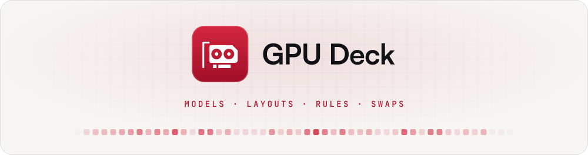
    </picture>
  </a>
</p>

<h3 align="center">The control plane for your own GPUs.</h3>

<p align="center">Run vLLM, SGLang, llama.cpp and MLX across every GPU you own from one place. GPU Deck places models on the right GPUs, swaps them by schedule and rule, serves them through OpenAI, Anthropic and Ollama compatible APIs, and shows what every GPU is doing. Open source, self-hosted, no account.</p>

<p align="center">
  <a href="https://github.com/sur950/gpu-deck/actions/workflows/ci.yml"></a>
  <a href="CHANGELOG.md"></a>
  <a href="LICENSE"></a>
</p>

<p align="center">
  <a href="https://sur950.github.io/gpu-deck/"><strong>Website</strong></a>
  &middot; <a href="#get-started-in-minutes">Get started</a>
  &middot; <a href="#supported-ecosystem">Supported ecosystem</a>
  &middot; <a href="#documentation">Docs</a>
  &middot; <a href="CHANGELOG.md">Changelog</a>
</p>

<p align="center">
  <picture>
    <source media="(prefers-color-scheme: light)" srcset="docs/screenshots/light-overview.svg">
    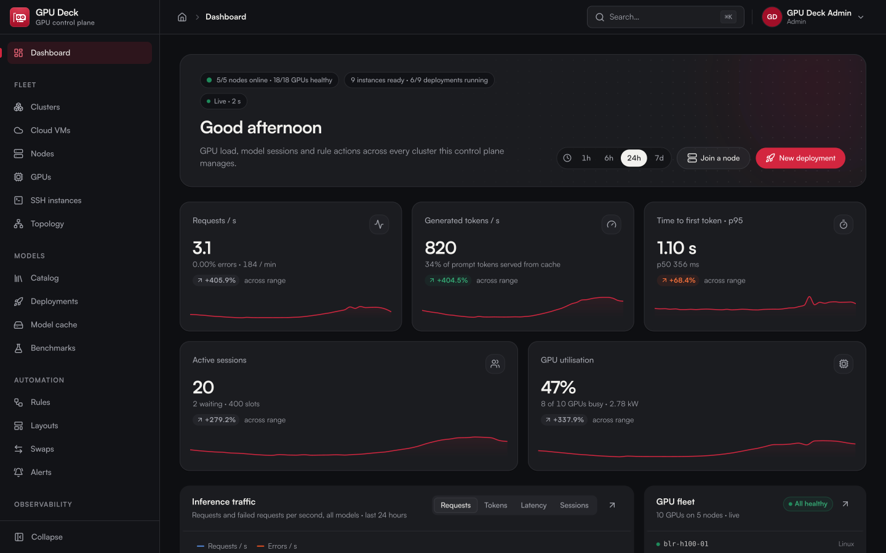
  </picture>
</p>

## Why GPU Deck

GPUs are the expensive part of running your own models, and most fleets waste them. Inference servers get started by hand, one box at a time. The daytime chat model holds the VRAM all night while a batch job waits. Nobody can see at a glance which model is using which GPU.

GPU Deck turns those machines into one fleet. You run a small control plane on one CPU server and a lightweight agent on every GPU machine. Pick a model from Hugging Face or ModelScope and GPU Deck chooses the engine, places it on the right GPUs, starts it and serves it. Then it keeps the fleet busy and shows you what every GPU is doing.

What makes it different:

- **Rules, layouts and swaps on your own GPUs.** Six rule types unload idle models, grow under load, shrink when traffic drops, make room by priority and heal failures. Layouts swap whole sets of models on a schedule, such as Day and Night, and every swap drains, loads and rolls back step by step.
- **Three API formats on one port.** OpenAI, Anthropic and Ollama compatible endpoints with streaming, tools, embeddings, rerank, speech and images, so existing SDKs, tools and AI gateways work unchanged.
- **A zero-trust node agent.** GPU machines dial out over mutual TLS to the one control plane whose keys they pinned at join, and by default open no inbound port: inference requests come back over the agent's own tunnel. Engines bind to localhost and the installer locks the rest down with a host firewall.
- **One CPU server runs the control plane.** No GPU, CUDA or drivers on the control plane: Docker Compose on one small server, or the Helm chart on Kubernetes.

GPU Deck is not an AI gateway. Put any AI gateway in front of it (LiteLLM, Kong, Portkey, your own) for users, quotas, rate limits and guardrails; GPU Deck authenticates with API keys, routes, and stores nothing about end users.

## Supported ecosystem

Everything GPU Deck supports today, with GPU Deck in the middle. A green dot marks what has run on real hardware, a half amber dot what ran with known gaps; the rest is implemented and tested against recorded fixtures (see [Hardware and engine support](#hardware-and-engine-support)).

<!-- ecosystem:begin (generated by assets/brand/readme_art.py; edit ROWS there) -->
<p>
  <picture>
    <source media="(prefers-color-scheme: dark)" srcset="assets/brand/ecosystem-dark.svg">
    
  </picture>
</p>

<details>
<summary>The same as a table</summary>

| | Supported |
| --- | --- |
| Drive it with | Web UI, Desktop app, CLI, Terraform, REST API, Any AI gateway in front |
| Compatible APIs | OpenAI, Anthropic, Ollama |
| Model types | Chat and thinking, Vision, Embeddings, Rerank, Speech-to-text, Text-to-speech, Image, Video |
| Inference engines | vLLM (verified), SGLang (partial), llama.cpp (verified), TensorRT-LLM (partial), MLX (verified), mlx-audio, vLLM-Omni, SGLang Diffusion, whisper.cpp, stable-diffusion.cpp, Custom container |
| Accelerators | NVIDIA (verified), AMD, Apple Silicon (verified), Hygon, MetaX, Moore Threads, T-Head, CPU only |
| Where it runs | On-prem bare metal, VMs, Kubernetes (Helm), AWS, Azure, Google Cloud, DigitalOcean, Air-gapped |
| GPU Deck itself | Fleet, Placement, Rules, Layouts, Swaps, Routing, Metrics, Alerts |

(verified) means verified on real hardware; (partial) means it ran on real hardware with known gaps. Everything else is implemented and tested against recorded fixtures, awaiting hardware reports.

</details>
<!-- ecosystem:end -->

Which engine runs on which accelerator, driver minimums and GPU slicing are in the [support matrix](docs/hardware/README.md).

## Where it runs

| Part | Where |
| --- | --- |
| Control plane: web UI, admin and serving APIs, agent hub, jobs, PostgreSQL and Redis | One CPU-only server with Docker Compose, or Kubernetes with the Helm chart |
| GPU machines | Linux (systemd) or macOS (launchd), on bare metal or VMs; a DaemonSet on Kubernetes GPU nodes; GPU VMs on AWS, Azure, Google Cloud or DigitalOcean that GPU Deck launches and joins to a cluster |
| Sites without internet access | An air-gapped bundle with the images, the Helm chart, agent builds, the CLI and a Terraform provider mirror |
| Your desk | The browser, or the desktop app for macOS, Windows and Linux |

### How the pieces connect

Two halves, and only one of them needs a GPU. Read [docs/DEPLOYMENT.md](docs/DEPLOYMENT.md) for the full picture.

- **Control plane: one CPU-only server (or Kubernetes), in Docker.** Web UI, admin API, serving API (the API layer), agent hub, Celery worker and beat, scheduler, PostgreSQL and Redis, plus optional Prometheus and Grafana. Images are published to GHCR (`ghcr.io/sur950/gpu-deck-api`, `-web`) with each release. It never touches a GPU.
- **GPU machines: only the node agent.** One native binary per machine, installed as a systemd (Linux) or launchd (macOS) service with a single command. The agent dials out to the control plane over mutual TLS, starts the inference engines (llama.cpp, vLLM, SGLang, TensorRT-LLM, MLX, whisper.cpp, stable-diffusion.cpp, your own) bound to `127.0.0.1`, caches model files locally and carries inference requests to the engines over its outbound mutual-TLS tunnel to the API layer. You install the GPU driver and, for container engines, a container runtime; the agent does the rest.
- **Nothing listens on a GPU machine.** By default a GPU machine needs no inbound port: the agent dials the agent hub (8443) and the API layer's tunnel (8444). Direct mode, an opt-in for low-latency private networks, opens the agent proxy on 9443 to the API layer's addresses and pinned key only.

<p>
  <picture>
    <source media="(prefers-color-scheme: dark)" srcset="docs/diagrams/system-overview-dark.svg">
    
  </picture>
</p>

## Highlights

Captured from a populated development stack: three clusters, five nodes (L40S, H100, MI300X, an AWS burst node, a Mac Studio), nine deployments across llama.cpp, vLLM, SGLang and MLX, and seven weeks of traffic. Most of that fleet is simulated; see [Hardware and engine support](#hardware-and-engine-support) for what has run on real hardware.

| | |
| --- | --- |
| 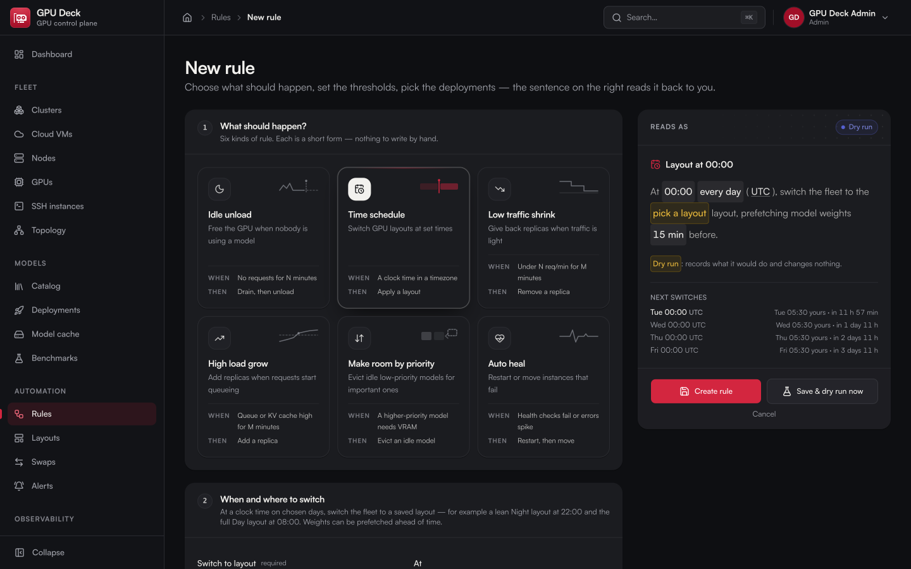 **Rules that read as sentences.** Unload after 30 idle minutes, add a replica when requests queue, evict by priority. Dry-run first, then let it act. | 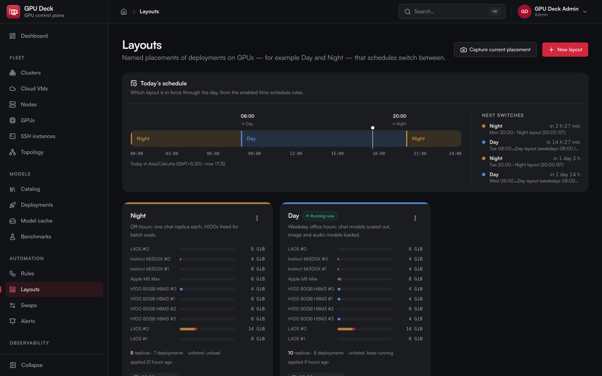 **Day and Night layouts.** Named sets of models and replicas, switched on a timezone-aware schedule, with models prefetched before the switch. |
|  **See where a model lands before it loads.** The engine is picked for the format, GPU vendor and driver, and a dry run shows the placement. | 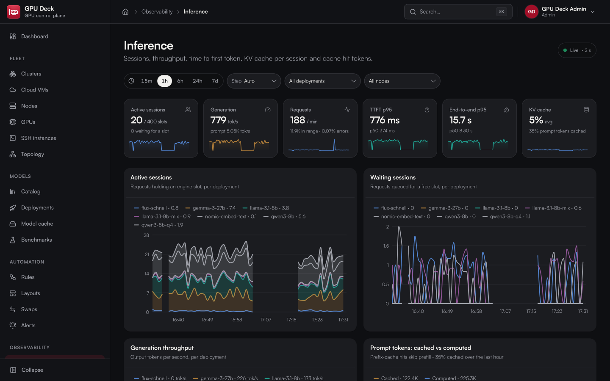 **Inside every inference.** Sessions, throughput, time to first token, end-to-end latency and KV cache per deployment. |
| 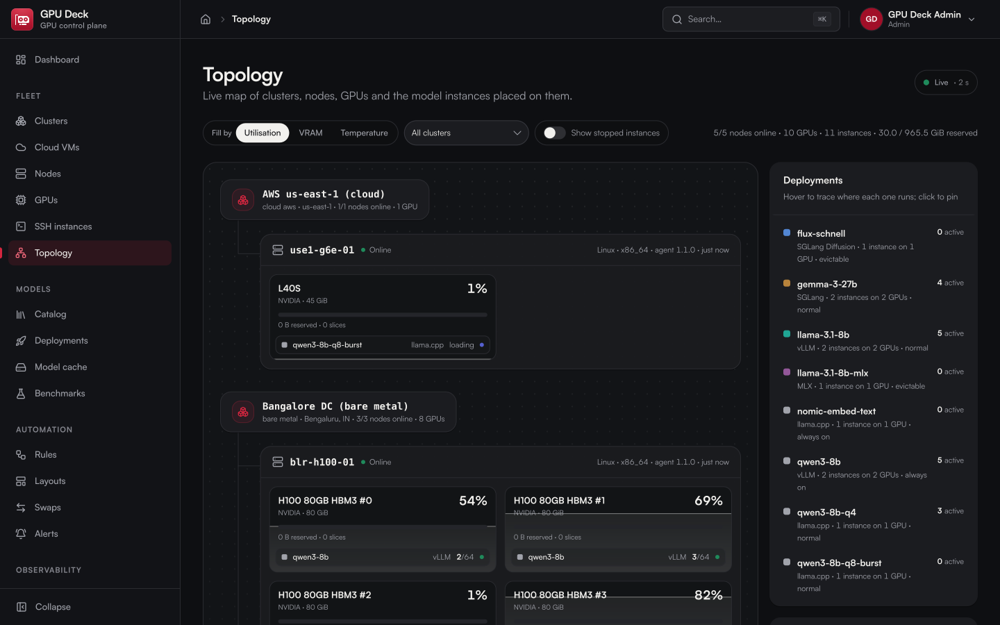 **See what runs where.** Clusters, nodes, GPUs and the model instances placed on them, live. |  **Every GPU in one inventory.** Accelerators from every vendor with VRAM slices, live load, power, temperature, driver and health. |

<details>
<summary>All 24 screens</summary>

| | |
| --- | --- |
|  **Dashboard**: fleet health, live requests, tokens, TTFT, sessions and GPU load. |  **GPUs / infra**: utilisation, VRAM, power and temperature per GPU. |
|  **Topology**: clusters, nodes, GPUs and the instances placed on them. | 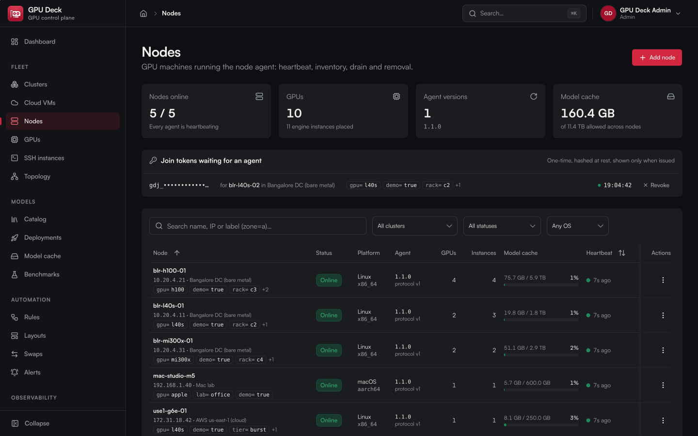 **Nodes**: heartbeat, agent, GPUs, model cache, pending join tokens. |
| 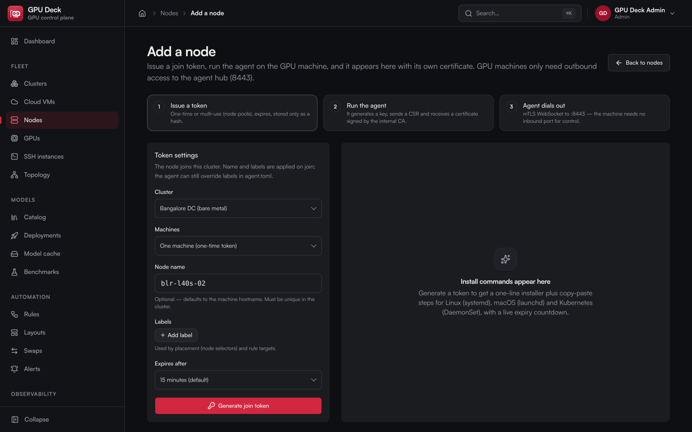 **Add a node**: one-time join token, then the agent dials in over mTLS. | 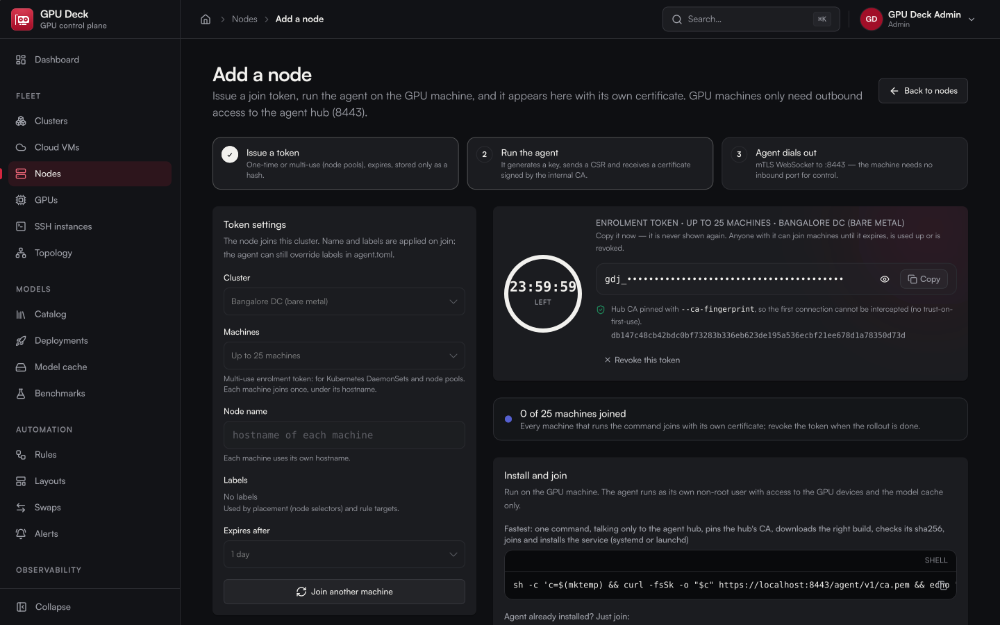 **Node pools**: a multi-use enrolment token with install commands for systemd, launchd and Kubernetes. |
|  **Catalog**: Hugging Face models with versions, formats, priority and security defaults. | 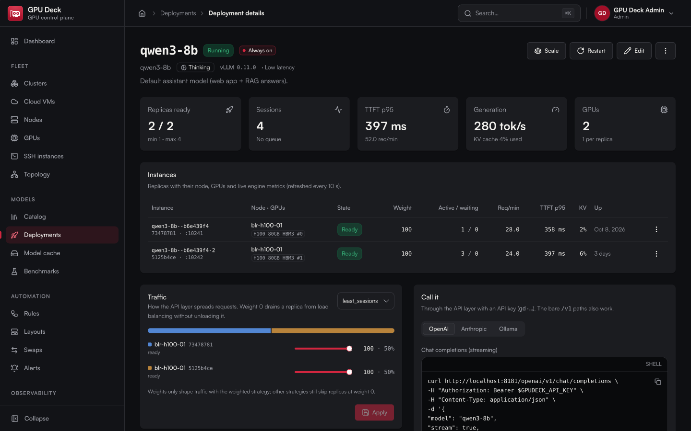 **Deployment**: replicas, live sessions, TTFT, traffic weights and a ready-to-run curl. |
| 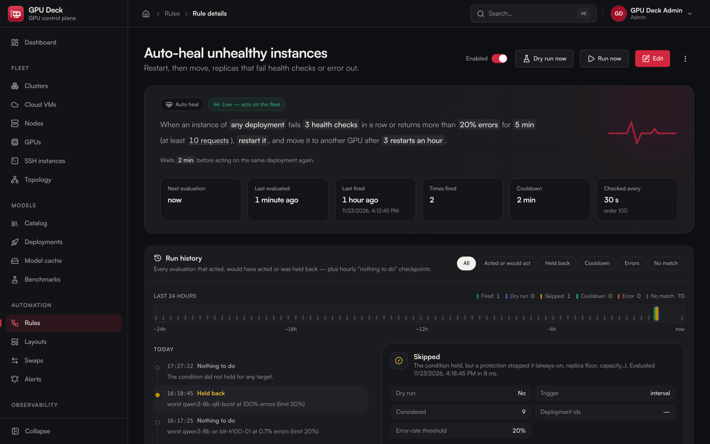 **Rule history**: every evaluation, including what was held back and why. | 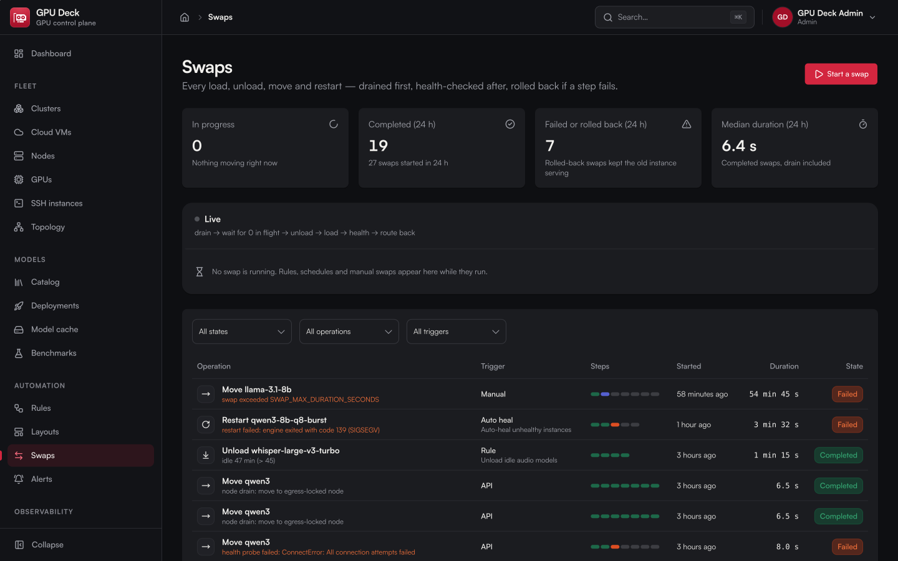 **Swaps**: loads, unloads, moves and restarts step by step, with rollback. |
|  **Credentials**: typed vault entries for clouds, model hubs, alert channels and SSH. |  **SSH GPU instances**: containers with sshd and a GPU or a slice, stopped by TTL. |
|  **Cloud VMs**: GPU VMs launched on AWS, Azure, GCP or DigitalOcean that join their cluster. | 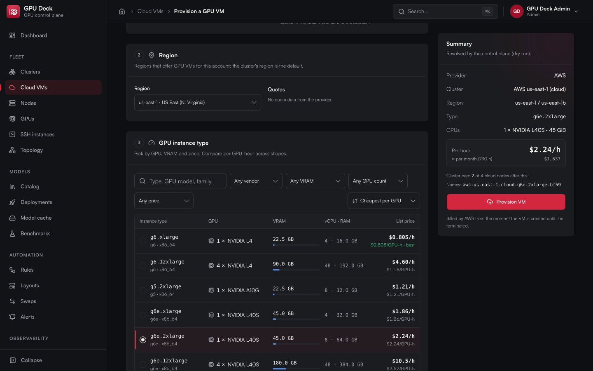 **Provision a cloud VM**: region, GPU instance type at list price, then the VM joins its cluster. |
| 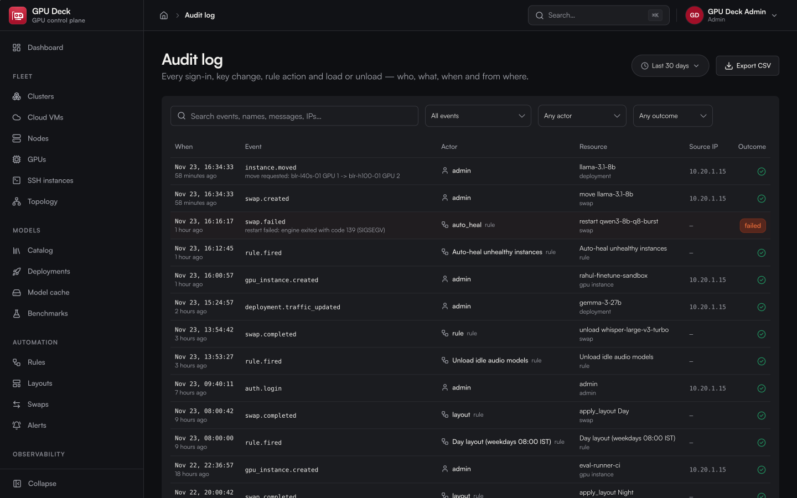 **Audit log**: sign-ins, changes, rule actions and swaps: who, what, when, from where. |  **Light mode**: dashboard. |
| 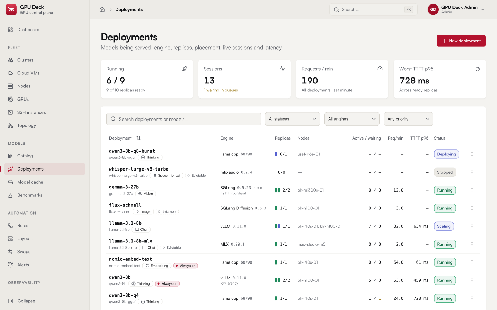 **Light mode**: deployments. |  **Desktop app**: saved control planes with a live health check before connecting. |
| 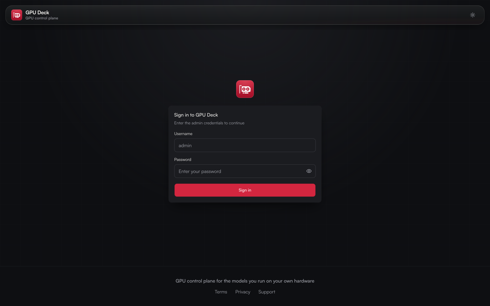 **Sign in**: the single admin from `.env`. | |

Every screen is an editable vector SVG captured by `node docs/screenshots/capture.mjs`; see [Screenshots](docs/DEVELOPMENT.md#screenshots) in the development guide.

</details>

## Features

- **Fleet.** Clusters, nodes and GPUs with a topology view. Machines join with a one-time token (or one multi-use enrolment token for a node pool) and a certificate from GPU Deck's own CA, needing only outbound access to the control plane; certificates rotate automatically and revoking one drops the node at once.
- **Models and engines.** A catalog with Hugging Face and ModelScope search, local model scanning and a per-node model cache. Engine auto-pick by format, GPU vendor and driver, with a scheduler dry run that shows the placement before you deploy. GPU slicing, tensor and pipeline parallelism.
- **Serving.** OpenAI, Anthropic and Ollama formats on one port, streaming, tools, embeddings, rerank, speech and images. API keys (`gd-...`) are stored as hashes and shown once. The API layer routes from an in-memory table with no database read on the hot path and keeps serving while the control plane restarts.
- **Rules, layouts and swaps.** Six rule types (time schedule, idle unload, high load grow, low traffic shrink, make room by priority, auto heal), each with a history that includes what was held back and why. Layouts switch on a timezone-aware schedule. Swaps load, unload, move and restart step by step, persist their progress and roll back.
- **Deep inference metrics.** Sessions, throughput, time to first token, end-to-end latency and KV cache per deployment, plus GPU load, VRAM, power and temperature. Prometheus metrics and Grafana dashboards.
- **SSH GPU instances and cloud GPU VMs.** Hand a user an SSH container with a slice of a GPU; provision GPU VMs on AWS, Azure, GCP or DigitalOcean that join their cluster.
- **Security.** No inbound port on GPU machines by default, control-plane keys pinned by every agent, a host firewall applied by the installer, Argon2id passwords, HttpOnly sessions with CSRF protection, IP rules, an audit log with CSV export, an encrypted credentials vault, an optional egress lock on nodes, and non-root read-only containers. See [docs/security-model.md](docs/security-model.md).
- **Everything else you need.** Alerts to Slack, email and signed webhooks; a desktop app (Tauri) that wraps any control plane; the `gpudeck` CLI; a Terraform provider; a Helm chart; an offline (air-gapped) bundle.

Planned for v2: usage metering per API key, model and node, billing and cost reports from price plans, and request traces in the UI.

## Get started in minutes

### Production: Docker Compose on one CPU server

Docker with the compose plugin and the images from GHCR. The full walkthrough, with the files the agents and the API layer need, HTTPS, sizing and the Kubernetes path, is [docs/DEPLOYMENT.md](docs/DEPLOYMENT.md).

```bash
git clone --branch v1.0.0 --depth 1 https://github.com/sur950/gpu-deck.git && cd gpu-deck
cp apps/fastapi/.env.example apps/fastapi/.env     # replace every CHANGE-ME (SECRET_KEY, VAULT_KEYS, ADMIN_PASSWORD, ...)
echo "POSTGRES_PASSWORD=$(openssl rand -hex 24)" >> infra/docker/.env
echo "REDIS_PASSWORD=$(openssl rand -hex 24)"    >> infra/docker/.env
export GPUDECK_VERSION=1.0.0
COMPOSE="docker compose -f infra/docker/docker-compose.yml -f infra/docker/docker-compose.full.yml"
$COMPOSE pull
$COMPOSE --profile tools run --rm migrate
$COMPOSE up -d
```

Open `http://127.0.0.1:3180`, sign in with `ADMIN_USERNAME` / `ADMIN_PASSWORD`, create a cluster, then **Nodes, Add node** and run the shown command on each GPU machine:

```bash
curl -fsSL -H 'X-GPUDeck-Join-Token: gdj_...' 'https://<your-control-plane>/api/v1/agent/install.sh' | sh
```

Then deploy a model from **Catalog**, create an API key under **API keys** and call it.

### Development: this repository on your machine

You need Docker (for Postgres and Redis), Python 3.12 with `uv`, Node 22+ with `pnpm`, and Rust for the agent. Nothing else is installed on the host.

```bash
./infra/scripts/bootstrap.dev.sh                 # Postgres + Redis containers, .env, venv, migrations, seed, start all
./infra/scripts/bootstrap.dev.sh verify          # smoke-test the endpoints
./infra/scripts/bootstrap.dev.sh stop            # stop the app processes (add --deps for the containers)
```

| Service | URL |
| --- | --- |
| Web UI | http://localhost:3180 |
| Serving API (OpenAI, Anthropic, Ollama) | http://localhost:8181 |
| Admin API (`/api/v1`, `/docs` with `DEBUG=true`) | http://localhost:8180 |
| Agent hub (mTLS, agents dial in) | https://localhost:8443 |

To look around without a backend, run the web UI on its built-in fixtures: `NEXT_PUBLIC_API_MOCKS=1 pnpm --filter web dev` (sign in as `admin` / `admin-admin-admin`). To use a real Mac or Linux box as a node, add it from **Nodes, Add node**. More in [docs/DEVELOPMENT.md](docs/DEVELOPMENT.md) and [CONTRIBUTING.md](CONTRIBUTING.md).

## API compatibility

One serving port speaks three formats. Use the explicit prefixes in gateway configuration (`/openai/v1`, `/anthropic/v1`, `/ollama/api`); the bare `/v1` and `/api` paths are kept for drop-in clients.

```bash
# OpenAI
curl http://localhost:8181/v1/chat/completions \
  -H "Authorization: Bearer gd-..." -H 'content-type: application/json' \
  -d '{"model":"qwen3-0.6b","messages":[{"role":"user","content":"hi"}]}'

# Anthropic
curl http://localhost:8181/anthropic/v1/messages \
  -H "x-api-key: gd-..." -H 'anthropic-version: 2023-06-01' -H 'content-type: application/json' \
  -d '{"model":"qwen3-0.6b","max_tokens":128,"messages":[{"role":"user","content":"hi"}]}'

# Ollama
curl http://localhost:8181/ollama/api/chat \
  -H "Authorization: Bearer gd-..." \
  -d '{"model":"qwen3-0.6b","messages":[{"role":"user","content":"hi"}],"stream":false}'
```

Endpoints, auth, error shapes and routing are specified in [libs/contracts/openapi/serving.md](libs/contracts/openapi/serving.md).

## Hardware and engine support

<p>
  <picture>
    <source media="(prefers-color-scheme: dark)" srcset="docs/diagrams/support-matrix-dark.svg">
    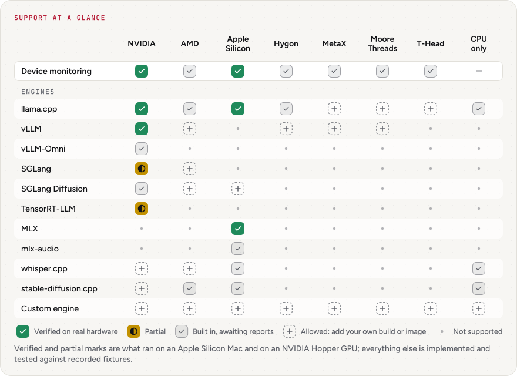
  </picture>
</p>

**Verified on real hardware so far:** an Apple silicon Mac (llama.cpp, MLX); an NVIDIA Hopper GPU (H100 / H200 class) with NVML device monitoring (its metrics matched `nvidia-smi`), vLLM including embeddings, the llama.cpp CUDA build, all three API formats through the API layer, slices, weighted routing, failover, auto-heal, idle unload, layout swaps and SSH GPU instances with the GPU passed through; and Linux nodes in containers with simulated GPUs for multi-node scheduling, routing and failover.

**Partial:** SGLang on NVIDIA (needs the CUDA toolkit on the host) and TensorRT-LLM (official image; tool-call and reasoning parsing missing, no slices).

Everything else, including AMD and the other vendors, is **implemented and tested against recorded fixtures** (vendor tool output, engine responses, cloud API replies) but **awaiting reports from real hardware or accounts**. Fixes made after the NVIDIA run (engine re-adoption on agent restart, pooled HTTP/2 connections to the nodes, the outbound-only mode) are covered by automated tests and await re-verification on GPUs. Reports from your setup are the most useful contribution you can make: file a [hardware report](https://github.com/sur950/gpu-deck/issues/new?template=hardware_report.yml). The detail of what ran where is in [docs/TESTING.md](docs/TESTING.md), and every accelerator and engine combination is in the [support matrix](docs/hardware/README.md).

| GPU vendor | Detected through | Status |
| --- | --- | --- |
| Apple silicon (Metal, unified memory) | IOKit, Metal | Verified on a Mac |
| NVIDIA | NVML, falling back to `nvidia-smi` | Verified on a Hopper GPU (NVML); the `nvidia-smi` fallback, MIG and Xid tracking awaiting reports |
| AMD | `amd-smi` or `rocm-smi` | Implemented, awaiting hardware reports |
| Hygon, MetaX, Moore Threads, T-Head | `hy-smi`, `mx-smi`, `mthreads-gmi`, `ppu-smi` | Implemented from vendor docs, awaiting hardware reports |

| Engine | Runs as | Status |
| --- | --- | --- |
| llama.cpp (GGUF, router mode) | native | Verified on a Mac (Metal), an NVIDIA GPU (CUDA build) and Linux CPU; ROCm and Vulkan builds awaiting reports |
| MLX (`mlx_lm.server`) | native, macOS | Verified on a Mac |
| vLLM | container / native | Verified on NVIDIA, embeddings included (run natively); the pinned image awaiting reports |
| SGLang | container / native | Partial on NVIDIA: native needs the CUDA toolkit on the host |
| TensorRT-LLM | container | Partial on NVIDIA: no tool-call or reasoning parsing, no slices |
| vLLM-Omni | container | Implemented, awaiting hardware reports |
| SGLang Diffusion | native | Implemented, awaiting hardware reports |
| mlx-audio, whisper.cpp, stable-diffusion.cpp | native | Implemented, awaiting hardware reports |
| Custom engine | container | Implemented, awaiting hardware reports |

Other things not yet run for real: MIG, tensor and pipeline parallelism, multi-node models, the Kubernetes chart on a live cluster, the egress lock on a real host, and the AWS, Azure, GCP and DigitalOcean providers. See the [changelog](CHANGELOG.md#known-limitations).

## FAQ

<details>
<summary><b>Does the control plane need a GPU?</b></summary>

No. It is a set of CPU-only containers plus PostgreSQL and Redis. A small server (4 vCPU and 8 GB of RAM is a reasonable start for up to five GPU machines) or a Kubernetes cluster is enough. GPUs live only on the machines that run the agent.

</details>

<details>
<summary><b>What do I install on a GPU machine?</b></summary>

The vendor driver, and the node agent through the one-line command from the web UI. The agent fetches pinned builds of llama.cpp and the other native engines itself (MLX and mlx-audio need Python on the machine, whisper.cpp on a Mac needs CMake); for vLLM, SGLang or TensorRT-LLM you add a container runtime. Models are downloaded and cached by the agent.

</details>

<details>
<summary><b>Does it work with my OpenAI or Anthropic SDK?</b></summary>

Yes. Point the SDK's base URL at the serving API (`/openai/v1`, `/anthropic`, or `/ollama` for Ollama clients) and use a `gd-` API key. Streaming, tools, embeddings and the other endpoints in [API compatibility](#api-compatibility) work through the same port.

</details>

<details>
<summary><b>Does GPU Deck see my users' prompts?</b></summary>

Requests pass through the API layer to your engines, but GPU Deck stores nothing about end users. Usage rows hold counts and timings (tokens, GPU seconds, latency) per API key, model and node, not prompts or completions.

</details>

<details>
<summary><b>Which hardware has actually been tested?</b></summary>

Apple silicon end to end, with llama.cpp and MLX; an NVIDIA Hopper GPU with NVML monitoring, vLLM, the llama.cpp CUDA build, slices, routing and automation (SGLang and TensorRT-LLM ran with known gaps); and Linux nodes in containers for multi-node behaviour. AMD and the other vendor plugins, MIG, multi-node models and the cloud providers are tested against recorded fixtures. If you run any of them, please [file a hardware report](https://github.com/sur950/gpu-deck/issues/new?template=hardware_report.yml).

</details>

<details>
<summary><b>Can it run without internet access?</b></summary>

Yes. The offline bundle carries the images, the Helm chart, the agent builds, the CLI and a Terraform provider mirror. Point the agents at a Hugging Face or ModelScope mirror, or use local model files.

</details>

<details>
<summary><b>Is there a paid or enterprise edition?</b></summary>

No. There is one edition with every feature, under the Apache License 2.0.

</details>

## Documentation

- [Deployment](docs/DEPLOYMENT.md): what runs where, ports, sizing, the Docker, Kubernetes and offline installs, upgrades.
- [Architecture](docs/architecture.md): components and the three flows that matter (join, serving, swap).
- [Hardware support matrix](docs/hardware/README.md): every accelerator and engine combination, and how to prepare each machine.
- [Operations](docs/operations.md): install details, upgrade, backup, rotation, HA, troubleshooting.
- [Security model](docs/security-model.md): network rules and controls. The reporting policy is [docs/SECURITY.md](docs/SECURITY.md).
- [Development](docs/DEVELOPMENT.md): conventions, extension points, migrations, tests.
- [Testing and verification](docs/TESTING.md): what is verified on real hardware and what is fixture-tested.
- [Releasing](docs/RELEASING.md) and [Brand](docs/BRAND.md).
- [Documentation index](docs/README.md), including per-component notes and the contracts in [`libs/contracts`](docs/components/contracts.md).

Website: <https://sur950.github.io/gpu-deck/>

## Contributing

Issues and pull requests are welcome. Start with [CONTRIBUTING.md](CONTRIBUTING.md), and please follow the [Code of Conduct](CODE_OF_CONDUCT.md). Questions and ideas go to [Discussions](https://github.com/sur950/gpu-deck/discussions) ([how to get help](docs/SUPPORT.md)). Report security issues privately as described in [docs/SECURITY.md](docs/SECURITY.md).

## License

[Apache License 2.0](LICENSE). Copyright 2026 Suresh Konakanchi. Attributions are in [NOTICE](NOTICE).

## Acknowledgements

GPU Deck runs on the shoulders of [llama.cpp](https://github.com/ggml-org/llama.cpp), [vLLM](https://github.com/vllm-project/vllm), [SGLang](https://github.com/sgl-project/sglang), [MLX](https://github.com/ml-explore/mlx), [whisper.cpp](https://github.com/ggml-org/whisper.cpp) and [stable-diffusion.cpp](https://github.com/leejet/stable-diffusion.cpp).

<p align="center">
  <br>
  
  <br>
  <sub>Made by <a href="https://suresh-konakanchi.in">Suresh Konakanchi</a>. GPU Deck is an independent project, not made by, affiliated with, or endorsed by NVIDIA, AMD, Apple or any engine project. Product names are trademarks of their owners.</sub>
</p>
