<p align="center">
  <a href="https://sur950.github.io/gpu-deck/">
    <picture>
      <source media="(prefers-color-scheme: dark)" srcset="assets/brand/lockup-dark.svg">
      
    </picture>
  </a>
</p>

<h3 align="center">The control plane for your own GPUs.</h3>

<p align="center">Deploy models across your GPU fleet, switch layouts by time of day, load and unload by rule, and meter every request. OpenAI, Anthropic and Ollama APIs in front, any GPU machine behind. Open source, self-hosted, no account.</p>

<p align="center">
  <a href="https://github.com/sur950/gpu-deck/actions/workflows/ci.yml"></a>
  <a href="https://github.com/sur950/gpu-deck/releases/latest"></a>
  <a href="LICENSE"></a>
  <a href="https://github.com/sur950?tab=packages&repo_name=gpu-deck"></a>
</p>

<p align="center">
  <a href="https://sur950.github.io/gpu-deck/"><strong>Website</strong></a>
  &middot; <a href="https://github.com/sur950/gpu-deck/releases/latest">Releases</a>
  &middot; <a href="docs/DEPLOYMENT.md">Deploy</a>
  &middot; <a href="#documentation">Docs</a>
  &middot; <a href="CHANGELOG.md">Changelog</a>
</p>

<p align="center">
  <picture>
    <source media="(prefers-color-scheme: light)" srcset="docs/screenshots/light-overview.svg">
    
  </picture>
</p>

## What it is

GPU Deck is a control plane for the GPUs you own or rent. You run one small server (CPU only) that holds the web UI, the APIs and the scheduler, and you put a lightweight agent on every GPU machine. From the UI you add machines, pick a model from Hugging Face or ModelScope, and GPU Deck chooses an engine, places it on the right GPUs, starts it and serves it through OpenAI, Anthropic and Ollama compatible endpoints. Rules then keep the fleet efficient (unload idle models, grow under load, make room by priority, heal failures) and layouts swap whole sets of models on a schedule, for example Day and Night. Every request is metered per API key, model and node, and billing shows what the servers cost.

It is not an AI gateway. Put any AI gateway in front of it (LiteLLM, Kong, Portkey, your own) for users, quotas, rate limits and guardrails; GPU Deck authenticates with API keys, routes, and stores nothing about end users.

## How it runs

Two halves, and only one of them needs a GPU. Read [docs/DEPLOYMENT.md](docs/DEPLOYMENT.md) for the full picture.

- **Control plane: one CPU-only server (or Kubernetes), in Docker.** Web UI, admin API, serving API (the API layer), agent hub, Celery worker and beat, scheduler, PostgreSQL and Redis, plus optional Prometheus and Grafana. Images are on GHCR (`ghcr.io/sur950/gpu-deck-api`, `-web`). It never touches a GPU.
- **GPU machines: only the node agent.** One native binary per machine, installed as a systemd (Linux) or launchd (macOS) service with a single command. The agent dials out to the control plane over mutual TLS, starts the inference engines (llama.cpp, vLLM, SGLang, TensorRT-LLM, MLX, whisper.cpp, stable-diffusion.cpp, your own) bound to `127.0.0.1`, caches model files locally and serves traffic through an mTLS proxy that only the API layer can call. You install the GPU driver and, for container engines, a container runtime; the agent does the rest.
- **Nothing is public on a GPU machine.** The only inbound port is the agent proxy (9443), and it accepts only the API layer's certificate. The agent hub (8443) is the only thing machines connect to.

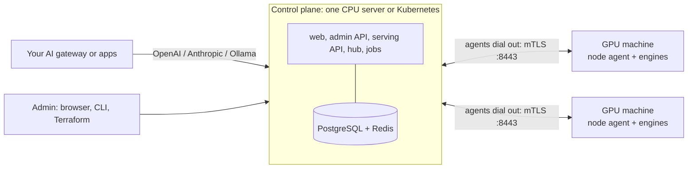

## Features

- **Fleet.** Clusters, nodes and GPUs with a topology view. Machines join with a one-time token (or one multi-use enrolment token for a node pool) and a certificate from GPU Deck's own CA, needing only outbound access to the agent hub; certificates rotate automatically and revoking one drops the node at once.
- **Models and engines.** A catalog with Hugging Face and ModelScope search, local model scanning and a per-node model cache. Engine auto-pick by format, GPU vendor and driver, with a scheduler dry run that shows the placement before you deploy. GPU slicing, tensor and pipeline parallelism.
- **Serving.** OpenAI, Anthropic and Ollama formats on one port, streaming, tools, embeddings, rerank, speech and images. API keys (`gd-...`) are stored as hashes and shown once. The API layer routes from an in-memory table with no database read on the hot path and keeps serving while the control plane restarts.
- **Rules, layouts and swaps.** Six rule types (time schedule, idle unload, high load grow, low traffic shrink, make room by priority, auto heal), each with a history that includes what was held back and why. Layouts switch on a timezone-aware schedule. Swaps load, unload, move and restart step by step, persist their progress and roll back.
- **Deep inference metrics.** Sessions, throughput, time to first token, end-to-end latency and KV cache per deployment, plus GPU load, VRAM, power and temperature. Prometheus, Grafana dashboards and OpenTelemetry traces.
- **Metering and billing.** Requests, tokens and GPU minutes per API key, model and node. Cost per key and cluster from price plans, including idle loaded time. Server costs only: no budgets and no thresholds.
- **SSH GPU instances and cloud GPU VMs.** Hand a user an SSH container with a slice of a GPU; provision GPU VMs on AWS, Azure, GCP or DigitalOcean that join their cluster.
- **Security.** Argon2id passwords, HttpOnly sessions with CSRF protection, IP rules, an audit log with CSV export, an encrypted credentials vault, an optional egress lock on nodes, and non-root read-only containers. See [docs/security-model.md](docs/security-model.md).
- **Everything else you need.** Alerts to Slack, email and signed webhooks; a desktop app (Tauri) that wraps any control plane; the `gpudeck` CLI; a Terraform provider; a Helm chart; an offline (air-gapped) bundle.

## Quick start

### Production: Docker Compose on one CPU server

Docker with the compose plugin and the images from GHCR. The full walkthrough, with the files the agents and the API layer need, HTTPS, sizing and the Kubernetes path, is [docs/DEPLOYMENT.md](docs/DEPLOYMENT.md).

```bash
git clone --branch v1.0.0 --depth 1 https://github.com/sur950/gpu-deck.git && cd gpu-deck
cp apps/fastapi/.env.example apps/fastapi/.env     # replace every CHANGE-ME (SECRET_KEY, VAULT_KEYS, ADMIN_PASSWORD, ...)
echo "POSTGRES_PASSWORD=$(openssl rand -hex 24)" >> infra/docker/.env
echo "REDIS_PASSWORD=$(openssl rand -hex 24)"    >> infra/docker/.env
export GPUDECK_VERSION=1.0.0
COMPOSE="docker compose -f infra/docker/docker-compose.yml -f infra/docker/docker-compose.full.yml"
$COMPOSE pull
$COMPOSE --profile tools run --rm migrate
$COMPOSE up -d
```

Open `http://127.0.0.1:3180`, sign in with `ADMIN_USERNAME` / `ADMIN_PASSWORD`, create a cluster, then **Nodes, Add node** and run the shown command on each GPU machine:

```bash
curl -fsSL -H 'X-GPUDeck-Join-Token: gdj_...' 'https://<your-control-plane>/api/v1/agent/install.sh' | sh
```

Then deploy a model from **Catalog**, create an API key under **API keys** and call it.

### Development: this repository on your machine

You need Docker (for Postgres and Redis), Python 3.12 with `uv`, Node 20+ with `pnpm`, and Rust for the agent. Nothing else is installed on the host.

```bash
./infra/scripts/bootstrap.dev.sh                 # Postgres + Redis containers, .env, venv, migrations, seed, start all
./infra/scripts/bootstrap.dev.sh verify          # smoke-test the endpoints
./infra/scripts/bootstrap.dev.sh stop            # stop the app processes (add --deps for the containers)
```

| Service | URL |
| --- | --- |
| Web UI | http://localhost:3180 |
| Serving API (OpenAI, Anthropic, Ollama) | http://localhost:8181 |
| Admin API (`/api/v1`, `/docs` with `DEBUG=true`) | http://localhost:8180 |
| Agent hub (mTLS, agents dial in) | https://localhost:8443 |

To look around without a backend, run the web UI on its built-in fixtures: `NEXT_PUBLIC_API_MOCKS=1 pnpm --filter web dev` (sign in as `admin` / `admin-admin-admin`). To use a real Mac or Linux box as a node, add it from **Nodes, Add node**. More in [docs/DEVELOPMENT.md](docs/DEVELOPMENT.md) and [CONTRIBUTING.md](CONTRIBUTING.md).

## API compatibility

One serving port speaks three formats. Use the explicit prefixes in gateway configuration (`/openai/v1`, `/anthropic/v1`, `/ollama/api`); the bare `/v1` and `/api` paths are kept for drop-in clients.

```bash
# OpenAI
curl http://localhost:8181/v1/chat/completions \
  -H "Authorization: Bearer gd-..." -H 'content-type: application/json' \
  -d '{"model":"qwen3-0.6b","messages":[{"role":"user","content":"hi"}]}'

# Anthropic
curl http://localhost:8181/anthropic/v1/messages \
  -H "x-api-key: gd-..." -H 'anthropic-version: 2023-06-01' -H 'content-type: application/json' \
  -d '{"model":"qwen3-0.6b","max_tokens":128,"messages":[{"role":"user","content":"hi"}]}'

# Ollama
curl http://localhost:8181/ollama/api/chat \
  -H "Authorization: Bearer gd-..." \
  -d '{"model":"qwen3-0.6b","messages":[{"role":"user","content":"hi"}],"stream":false}'
```

Endpoints, auth, error shapes and routing are specified in [libs/contracts/openapi/serving.md](libs/contracts/openapi/serving.md).

## Screenshots

All images are captured from a populated development stack: three clusters, five nodes (L40S, H100, MI300X, an AWS burst node, a Mac Studio), nine deployments across llama.cpp, vLLM, SGLang and MLX, and seven weeks of usage. Every screen is captured as an editable vector SVG (text, colours and shapes stay editable) by `node docs/screenshots/capture.mjs`; see [Screenshots](docs/DEVELOPMENT.md#screenshots) in the development guide. Most of that fleet is simulated; see [Hardware and engine support](#hardware-and-engine-support) for what has run on real hardware.

| | |
| --- | --- |
| 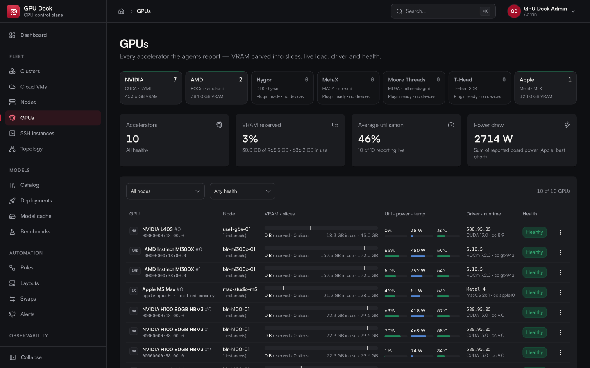 **GPUs**: every accelerator by vendor, VRAM slices, live load, driver and health. | 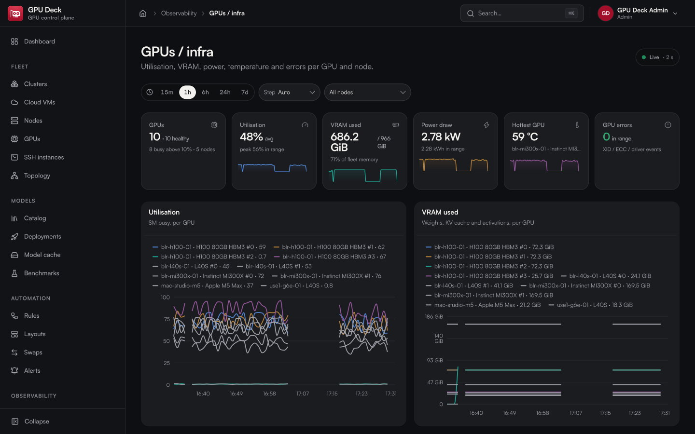 **GPUs / infra**: utilisation, VRAM, power and temperature per GPU. |
|  **Inference**: sessions, throughput, TTFT, end-to-end latency and KV cache per deployment. |  **Topology**: clusters, nodes, GPUs and the instances placed on them. |
|  **Nodes**: heartbeat, agent, GPUs, model cache, pending join tokens. |  **Add a node**: one-time join token, then the agent dials in over mTLS. |
| 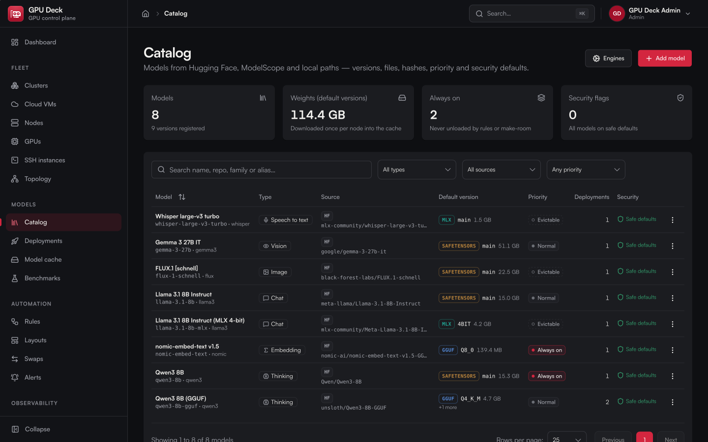 **Catalog**: Hugging Face models with versions, formats, priority and security defaults. | 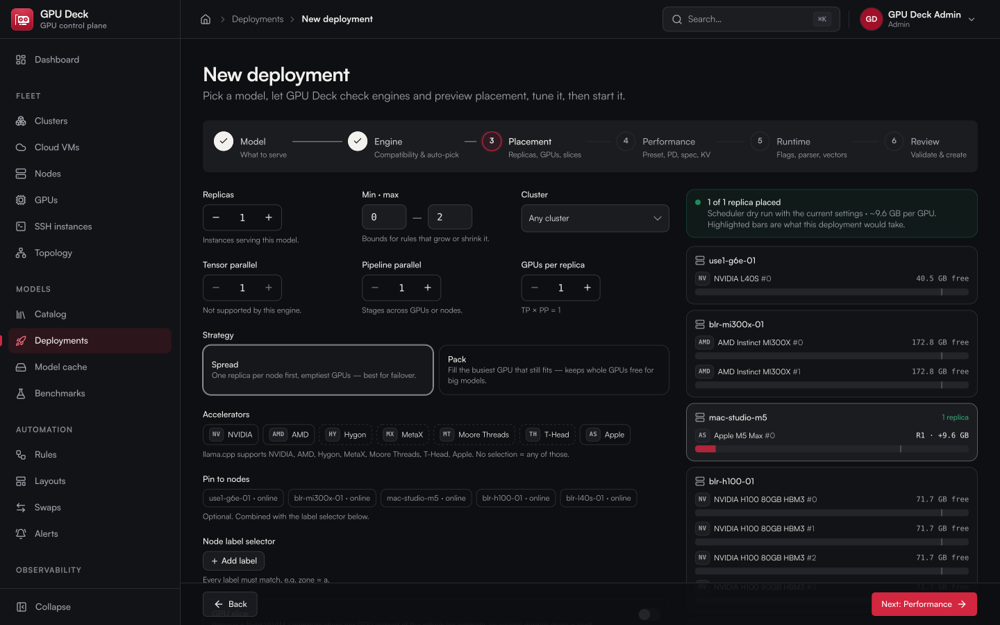 **Deploy wizard**: engine auto-pick, then a scheduler dry run of the placement. |
|  **Deployment**: replicas, live sessions, TTFT, traffic weights and a ready-to-run curl. |  **Rule builder**: six rule types, each a short form that reads back as a sentence. |
|  **Rule history**: every evaluation, including what was held back and why. |  **Layouts**: Day and Night GPU layouts switched by time-schedule rules. |
|  **Swaps**: loads, unloads, moves and restarts step by step, with rollback. | 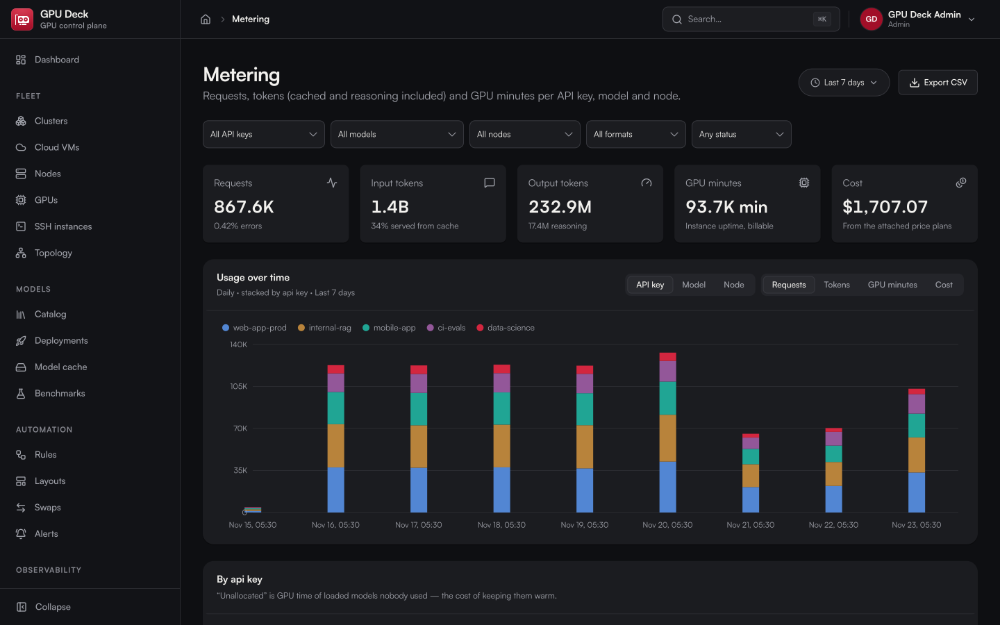 **Metering**: requests, tokens and GPU minutes per API key, model and node. |
| 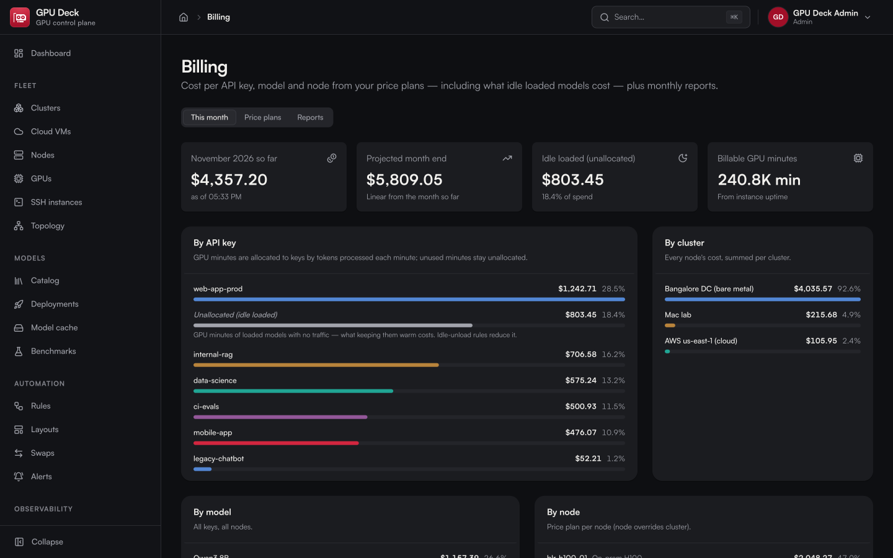 **Billing**: cost per key and cluster from price plans, including idle loaded time. | 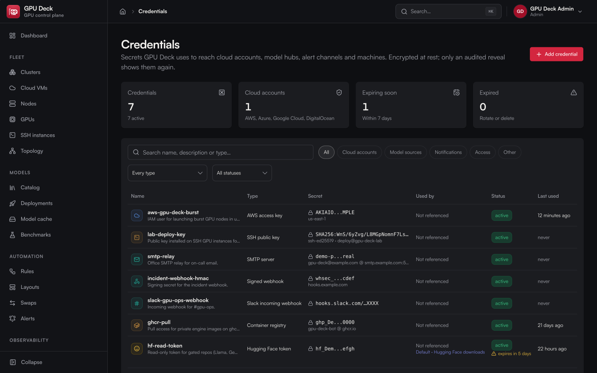 **Credentials**: typed vault entries for clouds, model hubs, alert channels and SSH. |
| 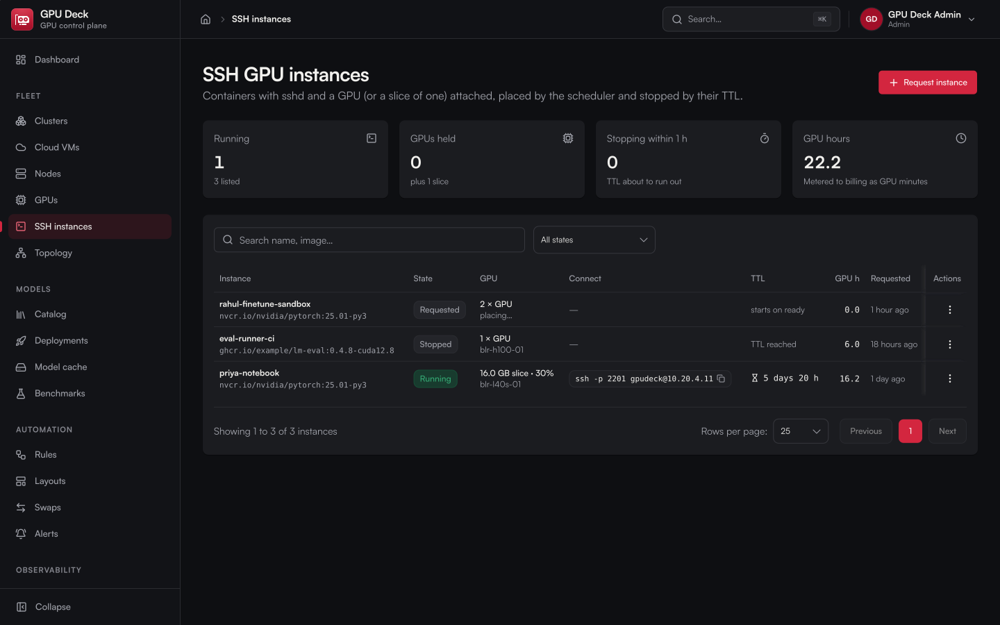 **SSH GPU instances**: containers with sshd and a GPU or a slice, stopped by TTL. | 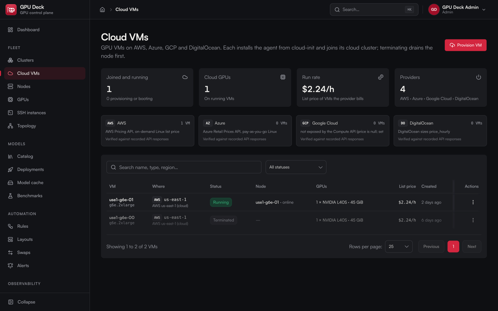 **Cloud VMs**: GPU VMs launched on AWS, Azure, GCP or DigitalOcean that join their cluster. |
|  **Provision a cloud VM**: region, GPU instance type at list price, then the VM joins its cluster. |  **Node pools**: a multi-use enrolment token with install commands for systemd, launchd and Kubernetes. |
|  **Audit log**: sign-ins, changes, rule actions and swaps: who, what, when, from where. |  **Sign in**: the single admin from `.env`. |
| 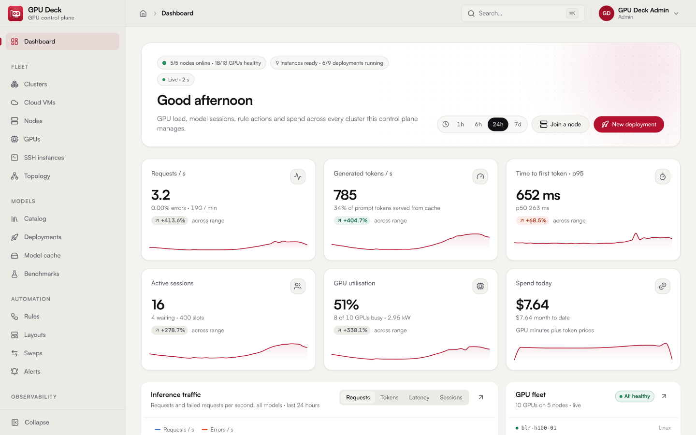 **Light mode**: dashboard. |  **Light mode**: deployments. |
| 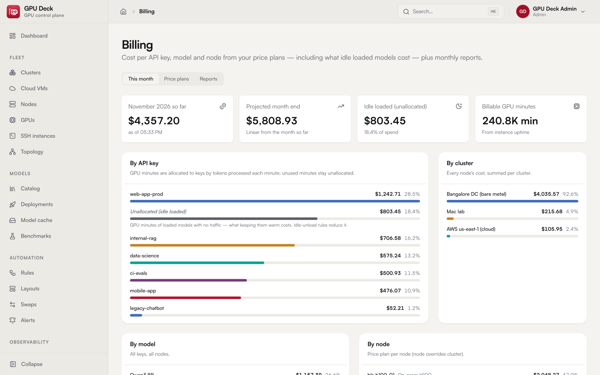 **Light mode**: billing. | 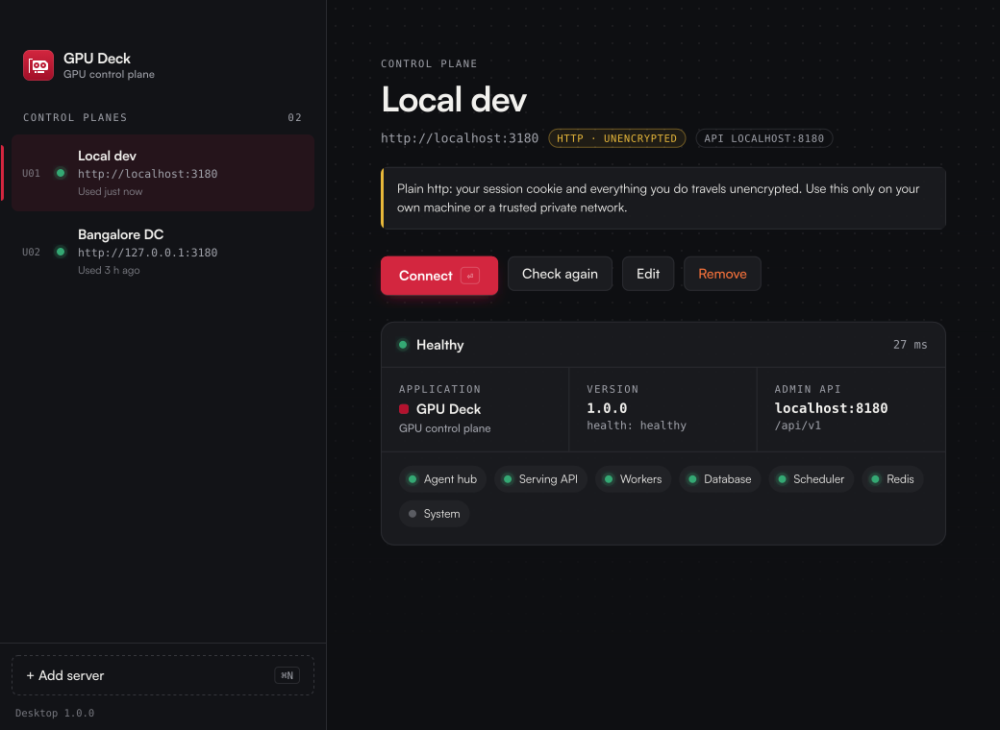 **Desktop app**: saved control planes with a live health check before connecting. |

## Hardware and engine support

**Verified on real hardware so far:** an Apple silicon Mac (llama.cpp, MLX), plus Linux nodes in containers with simulated GPUs for multi-node scheduling, routing and failover.

Everything else, including NVIDIA, is **implemented and tested against recorded fixtures** (vendor tool output, engine responses, cloud API replies) but **not yet verified on real hardware or accounts**. Reports from your setup are the most useful contribution you can make: file a [hardware report](https://github.com/sur950/gpu-deck/issues/new?template=hardware_report.yml). The detail of what ran where is in [docs/TESTING.md](docs/TESTING.md).

| GPU vendor | Detected through | Status |
| --- | --- | --- |
| Apple silicon (Metal, unified memory) | IOKit, Metal | Verified on a Mac |
| NVIDIA | NVML, falling back to `nvidia-smi` | Implemented (NVML, `nvidia-smi` fallback), awaiting hardware reports |
| AMD | `amd-smi` or `rocm-smi` | Implemented, not yet verified on hardware |
| Hygon, MetaX, Moore Threads, T-Head | `hy-smi`, `mx-smi`, `mthreads-gmi`, `ppu-smi` | Implemented from vendor docs, not yet verified on hardware |

| Engine | Runs as | Status |
| --- | --- | --- |
| llama.cpp (GGUF, router mode) | native | Verified on a Mac (Metal); CUDA, ROCm, Vulkan and CPU builds implemented, awaiting hardware reports |
| MLX (`mlx_lm.server`) | native, macOS | Verified on a Mac |
| vLLM | container / native | Implemented, awaiting hardware reports |
| vLLM-Omni | container | Implemented, not yet verified on hardware |
| SGLang | container / native | Implemented, awaiting hardware reports |
| SGLang Diffusion | native | Implemented, not yet verified on hardware |
| TensorRT-LLM | container | Implemented, awaiting hardware reports |
| mlx-audio, whisper.cpp, stable-diffusion.cpp | native | Implemented, not yet verified on hardware |
| Custom engine | container | Implemented, not yet verified on hardware |

Other things not yet run for real: tensor and pipeline parallelism, MIG, the Kubernetes chart on a live cluster, the egress lock on a real host, and the AWS, Azure, GCP and DigitalOcean providers. See the [changelog](CHANGELOG.md#known-limitations).

## Documentation

- [Deployment](docs/DEPLOYMENT.md): what runs where, ports, sizing, the Docker, Kubernetes and offline installs, upgrades.
- [Architecture](docs/architecture.md): components and the four flows that matter (join, serving, swap, billing).
- [Operations](docs/operations.md): install details, upgrade, backup, rotation, HA, troubleshooting.
- [Security model](docs/security-model.md): network rules and controls. The reporting policy is [docs/SECURITY.md](docs/SECURITY.md).
- [Development](docs/DEVELOPMENT.md): conventions, extension points, migrations, tests.
- [Testing and verification](docs/TESTING.md): what is verified on real hardware and what is fixture-tested.
- [Releasing](docs/RELEASING.md) and [Brand](docs/BRAND.md).
- [Documentation index](docs/README.md), including per-component notes and the contracts in [`libs/contracts`](docs/components/contracts.md).

Website: <https://sur950.github.io/gpu-deck/>

## Contributing

Issues and pull requests are welcome. Start with [CONTRIBUTING.md](CONTRIBUTING.md), and please follow the [Code of Conduct](CODE_OF_CONDUCT.md). Questions and ideas go to [Discussions](https://github.com/sur950/gpu-deck/discussions) ([how to get help](docs/SUPPORT.md)). Report security issues privately as described in [docs/SECURITY.md](docs/SECURITY.md).

## License

[Apache License 2.0](LICENSE). Copyright 2026 Suresh Konakanchi.

## Acknowledgements

GPU Deck includes ideas and code adapted from [GPUStack](https://github.com/gpustack/gpustack) (Apache-2.0), such as accelerator detection and placement heuristics; the files that started from GPUStack code name their source, and [NOTICE](NOTICE) carries the credit. It runs on the shoulders of [llama.cpp](https://github.com/ggml-org/llama.cpp), [vLLM](https://github.com/vllm-project/vllm), [SGLang](https://github.com/sgl-project/sglang), [MLX](https://github.com/ml-explore/mlx), [whisper.cpp](https://github.com/ggml-org/whisper.cpp) and [stable-diffusion.cpp](https://github.com/leejet/stable-diffusion.cpp).

<p align="center">
  <br>
  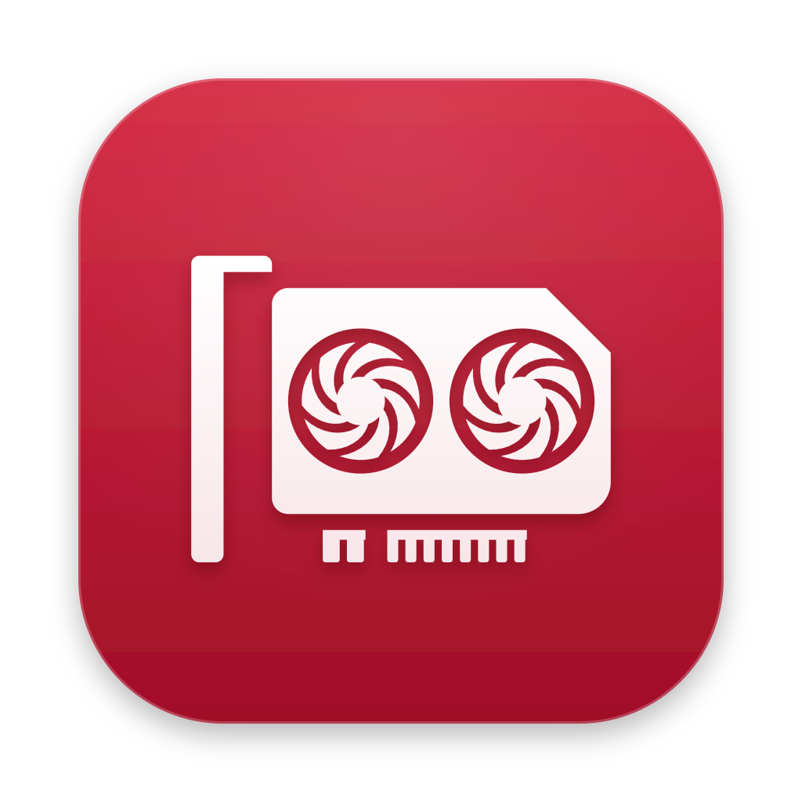
  <br>
  <sub>Made by <a href="https://suresh-konakanchi.in">Suresh Konakanchi</a>. GPU Deck is an independent project, not made by, affiliated with, or endorsed by GPUStack, NVIDIA, AMD, Apple or any engine project.</sub>
</p>
