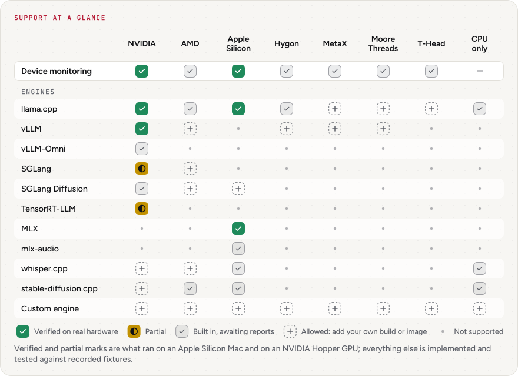

# Testing and hardware coverage

This page says what GPU Deck has been run against for real, what is covered only by automated
tests with recorded fixtures, and where reports from people with other hardware or cloud
accounts would help most. If you run GPU Deck on something listed under "awaiting reports",
please open an issue with the agent version, the device/driver versions and what worked.

<!-- cards -->
- **Verified on real hardware**: an Apple Silicon Mac (llama.cpp, MLX), an NVIDIA Hopper GPU (NVML monitoring, vLLM, the llama.cpp CUDA build, slices, routing, automation, SSH instances) and Linux nodes in containers.
- **Partial**: SGLang (needs the CUDA toolkit on the host) and TensorRT-LLM (no tool-call or reasoning parsing, no slices), both on the NVIDIA GPU.
- **Awaiting reports**: AMD and the other vendors, MIG, tensor and pipeline parallel, multi-node models, the image and audio engines, cloud providers and Kubernetes.

  <picture>
    <source media="(prefers-color-scheme: dark)" srcset="diagrams/support-matrix-dark.svg">
    
  </picture>

## How the release was tested

- **Control plane** on macOS (Apple Silicon) with PostgreSQL 17 and Redis 7.4 in Docker: admin
  API, serving API, agent hub, workers, scheduler and the web UI.
- **A real NVIDIA GPU**: a Linux machine with one Hopper-class (H100 / H200) GPU, installed with
  the one-line installer under systemd and joined to that control plane over the network. It ran
  the device monitoring, vLLM, the llama.cpp CUDA build, SGLang and TensorRT-LLM, slices,
  routing, automation rules and an SSH GPU instance (details in [NVIDIA](#nvidia-hopper-gpu)).
- **An Apple Silicon Mac** (Metal) running the agent with llama.cpp and MLX.
- **Linux nodes in containers**: the agent and llama.cpp built for aarch64 Linux, two to four
  containers (Debian 12 and Ubuntu 24.04, some booting systemd) joined to the same control plane.
  Each container reports one *simulated* NVIDIA GPU through a stand-in `nvidia-smi`; llama.cpp
  really runs on the CPU. This exercises everything that needs more than one node (scheduling,
  routing, failover, draining, automation rules) without GPU hardware. The setup is in
  `apps/node-agent/testing/multinode/`.
- **No large model downloads on the Mac**: tests there use small GGUF models already on the
  machine (qwen3 0.6B, TinyLlama 1.1B).

Automated suites: the backend suite (unit + integration against real PostgreSQL/Redis, ~740
tests), the agent's Rust tests on macOS and Linux (including an end-to-end run against a fake
hub over mTLS with every frame validated against the protocol schemas), web unit tests and
Playwright flows, CLI tests and the Terraform provider's acceptance test.

## Verified on real systems

| Area | What was run |
| --- | --- |
| Install and join | One-line installer served by the hub (pinned CA, sha256-checked agent download) on macOS (per-user LaunchAgent) and on Linux as root under systemd (service user `gpudeck`); multi-use join tokens (a 2-use token enrolled two nodes, the third use was refused). |
| Engines | llama.cpp router mode on macOS (Metal) and Linux (CPU), including downloading the pinned upstream build, sha256 check and unpacking by the agent; MLX on macOS. `/slots` and `/metrics` parsing, live per-slot sessions. |
| Serving | OpenAI, Anthropic and Ollama formats through the official SDKs: chat, streaming, tools, completions, responses, embeddings, messages, batches. Size limits, timeouts and context overflow errors in each format. |
| Routing | Requests spread across nodes through each node's mTLS proxy; least-sessions, round-robin and weighted strategies; failover to another replica when a node drops off the network; a node whose certificate is revoked is cut off. |
| Scheduling | Spread placement, rolling updates that keep replicas spread, VRAM-aware placement on tight devices, node selectors. |
| Draining | Node drain with "move instances": copies load on other nodes first, traffic keeps flowing (600 of 600 requests succeeded during a drain), then the originals unload. |
| Automation | `idle_unload`, time-scheduled layouts, layouts that move models between nodes (unload before load on a full device), `make_room_by_priority` (evicts the lowest-priority idle model, never `always_on`), `auto_heal` (restart, then move to another node when restarts do not help; a hung engine process is detected). |
| Benchmarks | Load tests at several concurrency levels and auto-tuning of launch flags, on Metal and on Linux CPU nodes; load tests on the NVIDIA GPU. |
| Security | Login lockout, CSRF, session revocation, IP allow/block rules for the admin and serving APIs, vault key rotation, mTLS proxy path policy, certificate revocation, pickle-only weights blocked by default. |
| Locked-down nodes (Linux) | Two container nodes installed with the one-line installer (one in the default outbound-tunnel mode, one in direct mode) next to an attacker container: full port scans, TLS with self-signed, foreign-CA and valid-but-unpinned GPU Deck certificates, a non-allow-listed source, a handshake flood, a replayed join token, the SSH-instance and engine ports, and a spoofed hub and API layer all failed closed while the real API layer served both nodes; the host firewall kept the operator's SSH port open. Results: [security-model.md](security-model.md#5-verification-2026-11-24); harness: `apps/node-agent/testing/security/run.sh`. |
| Egress lock (Linux) | nftables rules applied for real by the agent (as a non-root service with `CAP_NET_ADMIN`): the hub and the model hubs on 443 reachable, everything else rejected, inbound limited to the proxy and SSH ports. |
| Usage counters | Usage events with token counts and hourly rollups (metering and billing pages are planned for v2). |
| Tooling | CLI against a live control plane; Terraform provider acceptance test plus apply/plan/destroy of the complete example; Docker Compose stack with non-root, read-only containers; macOS desktop app. |

## NVIDIA (Hopper GPU)

One Linux machine with a Hopper-class (H100 / H200) GPU and a current NVIDIA driver, joined to the
control plane like any other node. Status only; no performance figures are published from it.

| Area | Status | What ran |
| --- | --- | --- |
| Device monitoring | Verified | The NVML plugin: inventory, VRAM, utilisation, power, temperatures, clocks, throttle reasons, ECC and process count, compared with `nvidia-smi` at the same moments; the stored samples, per-minute rollups, Prometheus series and the live event stream; reconnect and replay after an agent restart and a network outage |
| vLLM | Verified | Chat with reasoning, tools, completions, responses and embeddings (a separate embedding model) through all three API formats. It ran from an existing vLLM installation via `engine_paths`; the pinned vLLM image has not run on a GPU yet |
| llama.cpp CUDA | Verified | The agent downloaded the pinned CUDA build and its runtime (sha256-checked) on a recent glibc and driver; every layer on the GPU; router mode with several models |
| API formats | Verified | OpenAI, Anthropic and Ollama through the API layer with the official SDKs, streaming and tools included, for vLLM and llama.cpp |
| Slices and routing | Verified | Sliced replicas (memory and compute share), round-robin and weighted routing, direct slices refused when the real free VRAM (including memory used outside GPU Deck) is too small |
| Failover and automation | Verified | A replica's engine process killed under load: traffic moved to the healthy replica once the agent marked it unhealthy, and `auto_heal` restarted it; `idle_unload`; Day / Night layout swaps |
| SSH GPU instances | Verified | An instance on a slice with the GPU passed through and the slice limits set, reached over SSH with the host key pinned |
| SGLang | Partial | Served chat with tool calls natively once the CUDA toolkit was on the host (the pip wheel alone is not enough); the container image has not run on a GPU yet |
| TensorRT-LLM | Partial | The official image served chat; tool calls and reasoning are not parsed yet, and it does not run on slices |
| Not run on NVIDIA yet | Awaiting reports | MIG, Xid error tracking, the `nvidia-smi` fallback backend, tensor and pipeline parallel, multi-node models, vLLM-Omni, SGLang Diffusion, whisper.cpp and stable-diffusion.cpp, the `high_load_grow`, `low_traffic_shrink`, `make_room_by_priority` and `time_schedule` rules on a GPU, CUDA tools inside an SSH instance, other NVIDIA generations |

> [!NOTE]
> Fixes made after that run (engines re-adopted after an agent restart, pooled HTTP/2
> connections from the API layer to the nodes, the outbound-only tunnel mode, immediate failover
> when a llama.cpp router child dies, the glibc-based SSH-instance image, GPU-minutes split on a
> shared GPU) are covered by automated tests and await re-verification on a GPU.

## Covered by automated tests only

These code paths are exercised with recorded or documented tool output, mocks or fakes, but not
yet on the real thing:

- **NVIDIA**: the `nvidia-smi` fallback (ran against a simulated tool), MIG, Xid error tracking
  and CUDA work inside an SSH instance (the NVML plugin, slices and SSH instances ran on a real
  GPU, see above).
- **AMD** (`amd-smi` / `rocm-smi`), **Hygon** (`hy-smi`), **MetaX** (`mx-smi`), **Moore Threads**
  (`mthreads-gmi`), **T-Head** (`ppu-smi`): parsers tested against output taken from vendor
  documentation.
- **Engines**: vLLM-Omni, SGLang Diffusion, whisper.cpp, stable-diffusion.cpp, mlx-audio and
  custom engines; the vLLM and SGLang container images; llama.cpp's ROCm and Vulkan builds.
- **Multi-GPU and multi-node models**: tensor and pipeline parallel (including cross-node),
  prefill/decode split, shared KV cache, speculative decoding.
- **Cloud GPU VMs** on AWS, Azure, GCP and DigitalOcean (recorded API responses), cloud-init
  bootstrap on a real GPU image, idle auto-terminate.
- **Kubernetes** DaemonSet on GPU nodes.
- **Egress lock on macOS** (pf anchor rules are rendered and unit-tested; applying them needs root).
- Vision, speech, rerank, image and video model types.
- **Network latency across regions**: RTT probing, latency-aware routing (near node under equal
  load, spill-over under load), `Server-Timing` and the hub's ping round trips are tested over
  simulated links (a relay that delays every packet) with fake node proxies, and placement near
  the traffic and low link cost with synthetic RTT and traffic; not yet on API layers and GPU
  machines in different regions.
- **Agent self-update**: staging, the atomic swap, re-adoption, health check and rollback ran on
  macOS with the real agent binary as a supervised service against a fake hub, and with fake
  binaries for the applier; the control plane side ran against a real hub process with simulated
  agents, including an agent that predates updates. The root update helper (systemd path unit,
  launchd daemon) and a swap under a real systemd unit on a GPU machine have not run yet.

## Awaiting reports from the community

Most useful, in order:

1. Linux + AMD Instinct or Radeon (ROCm): inventory and a vLLM/llama.cpp deployment.
2. NVIDIA beyond what ran above: MIG, multi-GPU tensor/pipeline parallel, the vLLM and SGLang
   container images, consumer and other data-center generations (Ampere, Ada, Blackwell).
3. A cloud account (any of the four providers): one provision → join → terminate cycle.
4. Multi-node tensor/pipeline parallel with real interconnects.
5. API layers in two or more regions: the round trips on Node › Network, how requests spread
   under load, and `Server-Timing` as seen behind your gateway.
6. Agent self-update on a Linux GPU machine installed with the one-line installer: an update
   and a forced rollback while a model serves (requests should keep flowing), and a rolling
   update of a cluster.
7. Other accelerators listed above.

## Known requirements and limits

- The upstream llama.cpp Linux builds that GPU Deck pins need **glibc 2.38 or newer** (Ubuntu
  24.04, Debian 13 or later), except the x86_64 CPU and Vulkan builds (glibc 2.34+), and
  `libgomp1` (plus `libvulkan1` for the Vulkan build). On older distributions the agent uses an
  older pinned build (ROCm), the official llama.cpp image when Docker or Podman is installed, or
  an engine you installed (`engine_paths`); see
  [DEPLOYMENT.md](DEPLOYMENT.md#linux-requirements-per-platform). The container fallback has
  not run on a GPU machine yet.
- Engines keep running while the agent restarts or is upgraded and are re-adopted on their
  ports; only the node proxy is down for the restart itself (about a second or two). In the
  Kubernetes DaemonSet the engines live in the agent's container and restart with it.
- When several CPU-backed engines share a machine, set `threads` in the deployment's launch flags;
  llama.cpp otherwise starts one thread per core per process and the processes slow each other
  down sharply.
- Blocked outbound connections under the egress lock are logged and counted by the kernel
  (`gpudeck-egress-blocked`); the agent raises an alert only when the lock cannot be applied.

> [!IMPORTANT]
> Native SGLang needs the CUDA toolkit on the machine (its kernels are compiled at run time); the
> agent checks for it before loading and names what is missing, and the container image includes
> it. TensorRT-LLM deployments do not parse tool calls or reasoning yet.

## Running the multi-node setup yourself

1. Start the dev stack (`./infra/scripts/bootstrap.dev.sh bootstrap`) and make the hub reachable
   from containers: set `AGENT_HUB_PUBLIC_URL` to an address containers can resolve (for example
   `https://host.docker.internal:8443`) and add that name to `AGENT_HUB_TLS_SANS`.
2. Build the test node image: `docker build -t gpudeck-testnode apps/node-agent/testing/multinode`.
3. Start one or more nodes on a shared Docker network (see the comment at the top of the
   Dockerfile), mounting a directory with GGUF files read-only at the same path on every node.
4. Create a join token in the web UI (Fleet → Nodes → Join) and run its install command inside
   each container. Set `FAKE_GPU_MEM_MIB` in `/etc/fake-gpu.env` to make a node's simulated GPU
   smaller.
5. Register the GGUF files as local models and deploy them; they are scheduled onto the simulated
   GPUs and run on the CPU.
