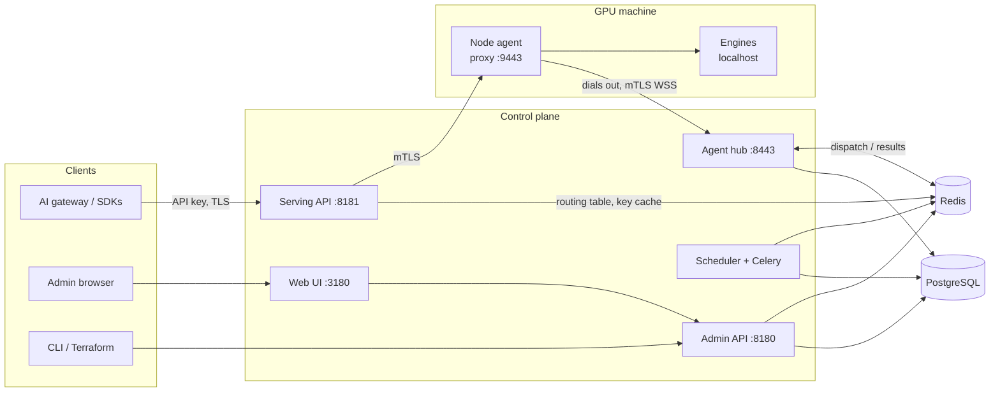
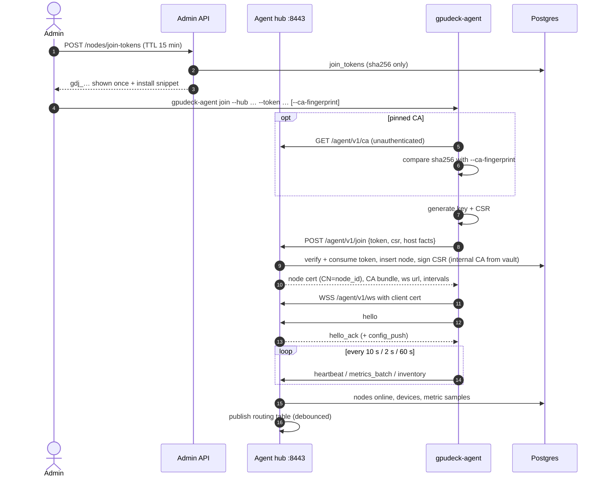
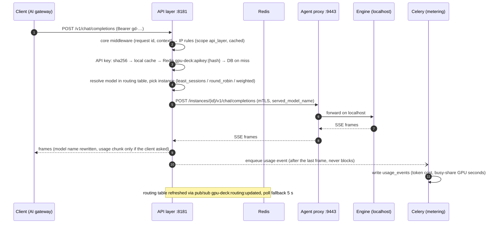
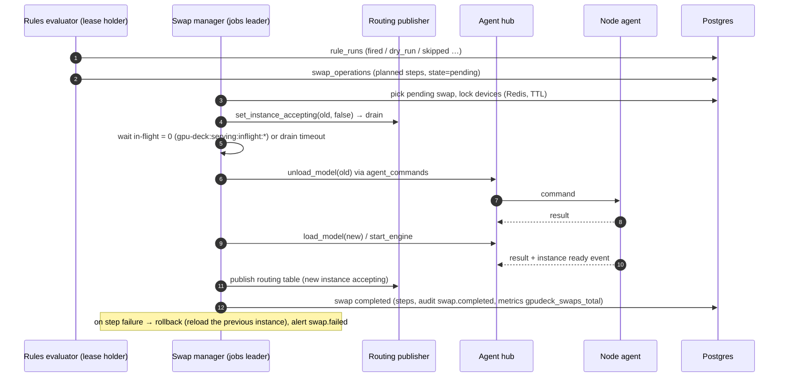
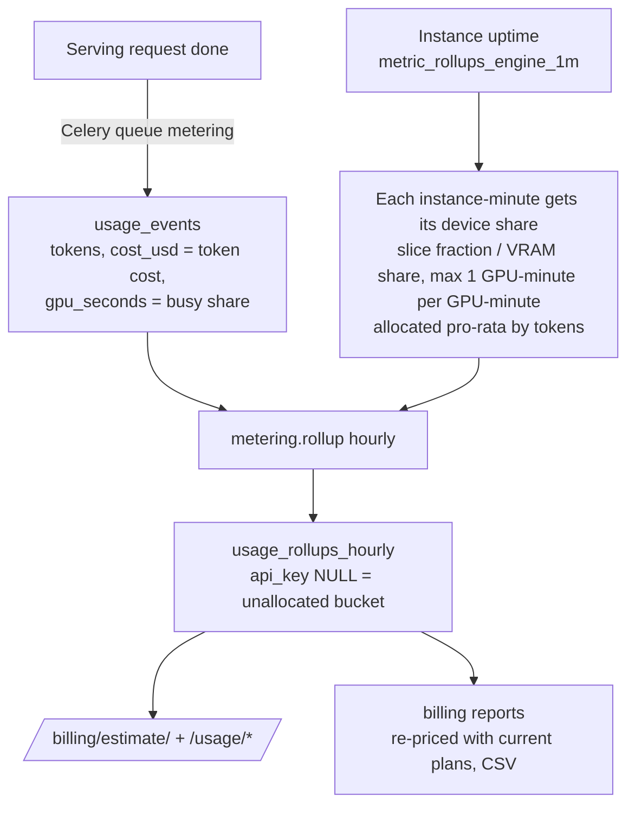
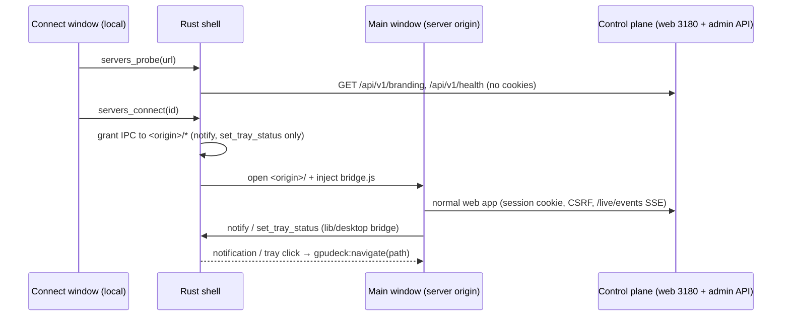

# GPU Deck architecture

How the pieces fit, what talks to what, and the four flows that matter most: a machine
joining, a serving request, a swap, and billing. Contracts live in `libs/contracts/`
(the source of truth for every name used here); contributor conventions in [DEVELOPMENT.md](DEVELOPMENT.md). Where each part runs, and the
step-by-step install, is in [DEPLOYMENT.md](DEPLOYMENT.md).

## 1. Components

| Component | Process / binary | Port | Owns |
| --- | --- | --- | --- |
| Web UI | Next.js (`apps/web`) | 3180 | Admin screens; talks only to the admin API |
| Admin API | `uvicorn app.main:app` | 8180 | `/api/v1/**` (admin.yaml): auth, fleet, models, deployments, rules, billing, audit |
| Serving API (API layer) | `uvicorn app.api_layer_main:app` | 8181 | OpenAI / Anthropic / Ollama formats (serving.md); API-key auth; pass-through to node proxies |
| Agent hub | `python -m app.agent_hub_main` | 8443 (mTLS) | Join (`/agent/v1/join`), agent WebSocket (`/agent/v1/ws`), CA download, agent binaries |
| Jobs scheduler | `python -m app.workers.scheduler` | — | APScheduler ticks; Postgres-lease leader election (`jobs-leader`, `rules-evaluator`) |
| Celery worker + beat | `celery -A app.workers.celery_app` | — | Off-path work: metering writes, rollups, billing, alerts delivery, catalog hashing, benchmarks |
| Node agent | `gpudeck-agent` (Rust, `apps/node-agent`) | 9443 (mTLS proxy) | Device plugins, engine lifecycle, metrics/log shipping, engine proxy |
| Engines | llama.cpp, vLLM, SGLang, MLX, … | localhost only | Inference; reachable only through the agent proxy |
| PostgreSQL | shared / managed | 5432 | All state (SQL-first migrations, partitioned time series) |
| Redis | shared / managed | 6379 | Cache, routing table, pub/sub, Celery broker; every name `gpu-deck:<domain>:<event-or-key>` |
| CLI / Terraform | `gpudeck` (Python), `terraform-provider-gpudeck` (Go) | — | Clients of the admin API |
| Desktop app | `GPU Deck.app` / `.msi` / `.AppImage` (Tauri 2, `apps/desktop`) | — | Native shell around a control plane's own web UI: connect screen, notifications, tray, deep links (§8) |

Key properties:

- **No DB read on the serving hot path.** The API layer serves from an in-memory routing table
  (`gpu-deck:routing:v1`, refreshed by pub/sub `gpu-deck:routing:updated`), a process-local +
  Redis API-key cache, and in-memory IP rules. Usage is enqueued to Celery after the response.
- **Agents dial out.** GPU machines need no inbound control port; the control plane reaches an
  agent only through the hub's WebSocket (other processes publish on `gpu-deck:hub:dispatch` and
  read `gpu-deck:hub:results`). Commands are persisted in `agent_commands` and replayed on
  reconnect.
- **Single writer per concern.** Routing table: `services/deployments/routing_publisher.py`.
  Swaps: the swap manager on the jobs leader. Rules: the `rules-evaluator` lease holder.
- **Serving middleware is pure ASGI** (no `BaseHTTPMiddleware`); per-request logs are DEBUG on
  the serving process with a sampled INFO access line (`SERVING_ACCESS_LOG_SAMPLE_RATE`). Measured
  proxy overhead on streaming TTFB: ~1.2-1.4 ms p50 (`tests/integration/test_proxy_overhead.py`,
  target < 1.5 ms).

## 2. Data model in one paragraph

SQL-first migrations (`apps/fastapi/app/db/postgres/alembic/migrations/NNN_slug/`), one linear
alembic chain. ORM classes are generated by sqlacodegen into the committed
`app/db/postgres/models/generated_models.py` (`generate_models.sh` builds a scratch schema from
the migrations; CI runs `--check`). Time series (`metric_samples_*`, `metric_rollups_*_1m`,
`log_chunks`, `traces`, `usage_events`) are partitioned by UTC day; the jobs process pre-creates
partitions 7 days ahead. Secrets are Fernet-encrypted rows in `credentials` (the vault).

### Typed credentials (the vault)

Every credential has a **kind** (`credentials.provider`), defined once in
`apps/fastapi/app/services/vault/types.py`: its fields (which are secret), a JSON Schema
(2020-12) built from them, semantic checks (GCP key JSON, OpenSSH public key, kubeconfig) and
how the value is stored. Create / update validate against it (422 `CREDENTIAL_INVALID`);
`GET /vault/metadata` serves the catalog, and the web dialog is generated from it. Single-secret
kinds store the secret verbatim (so `VaultService.get_secret` returns e.g. the HF token or the
Slack URL); AWS and Azure store one JSON object (what the cloud providers parse). Public fields
and derived facts are mirrored in `extra_data.typed` and returned by the API; secret fields are
write-only (edit = "replace"). No migration: `type` keeps the category enum.

| Kind | Fields (secret in bold) | Consumers |
| --- | --- | --- |
| aws | **access_key_id**, **secret_access_key**, **session_token?**, role_arn?, external_id?, region? | `cloud_aws` clusters → cloud browse / provision / lifecycle (`services/cloud/credentials.py`) |
| azure | tenant_id, client_id, **client_secret**, subscription_id | `cloud_azure` clusters → cloud |
| gcp | **service_account_json** (project_id, client_email derived) | `cloud_gcp` clusters → cloud |
| digitalocean | **api_token** | `cloud_do` clusters → cloud |
| huggingface / modelscope | **token** | catalog search / file listing (`credential_id` query), `models.metadata.credential_id`, node downloads (`model_cache.model_source`); default = `HF_TOKEN_CREDENTIAL` / `MODELSCOPE_TOKEN_CREDENTIAL`, else the newest credential of the kind |
| slack | **webhook_url** | Slack alert channels |
| smtp | host, port, username?, **password**, from?, starttls | email alert channels (server settings come from the credential, recipients from the channel) |
| webhook | url, **hmac_secret** | signed-webhook alert channels (`X-GPUDeck-Signature`) |
| ssh_key | public_key (key type, fingerprint, comment derived) — public only | cluster install helper (`bare_metal` / `vm` / `config.ssh_key_credential_id`), cloud VM login (`ssh_public_key` for Azure / GCP), SSH GPU instance `authorized_keys` (picked in the form) |
| container_registry | registry, username, **password** | none yet (agents pull with their own credentials) |
| kubernetes | **kubeconfig** (context, server derived) | `kubernetes` clusters (stored; not read by the control plane) |
| generic | key?, **value** | named lookups, e.g. `BENCHMARK_API_KEY_CREDENTIAL` |

System credentials (`internal-ca`, hub / API-layer TLS keys, written by the PKI service) are not
kinds: hidden from `/vault` (unless `include_system=true`) and refused by update / delete /
reveal / test. Consumers check compatibility with `vault.service.require_compatible` (clusters by
type, alert channels by channel type, catalog by source; untyped legacy rows pass when their
category matches). `GET /vault/{id}/usage` and the `used_by` counts come from clusters
(`credential_id`, config SSH / kubeconfig refs), alert channels, models and non-terminated cloud
VMs; delete is refused while any reference exists (409 `CREDENTIAL_IN_USE`).

## 3. Machine join

Revocation: revoking a node certificate closes its socket (4003), pushes the CRL to every agent
and drops the node from the routing table. Rotation: `rotate_cert` 30 days before expiry →
`install_cert`; the old cert is revoked 10 minutes after the new one connects.

## 4. Serving request path

Failover: connect/TLS failures (and a llama.cpp router answering `model is not loaded` for a
child that died) eject the instance for `SERVING_EJECT_SECONDS` and retry another replica before
any byte is sent. No ready instance → wait up to `SERVING_NO_INSTANCE_WAIT_SECONDS` (and
optionally ask for an on-demand start on `gpu-deck:deployments:start-requested`).

Model names: `model` is the catalog model name (or an alias) and balances across every
deployment of that model. Each deployment is also addressable by its own name, so two
deployments of one model (say an SGLang and a TensorRT-LLM one) can be targeted one at a time;
`/v1/models` lists the deployment names whenever a model has more than one deployment
(`gpudeck.deployments` on the model entry, `gpudeck.model` on a deployment entry).

Connections to node proxies are pooled per node and kept open
(`SERVING_UPSTREAM_KEEPALIVE_SECONDS`); a node's pool is pre-warmed when it first serves an
instance and kept warm with a `/_health` ping (`SERVING_UPSTREAM_KEEPWARM_SECONDS`), so a
request over a long link pays one round trip, not a new TCP + TLS handshake. The pools speak
HTTP/2 to the proxy (ALPN `h2`, `SERVING_UPSTREAM_HTTP2`): concurrent requests to a node
share one multiplexed connection; a proxy that only offers HTTP/1.1 gets keep-alive HTTP/1.1.

## 5. Swap (rule or layout driven)

Every step is persisted, so a new jobs leader resumes a swap from its last step. Time schedules
apply layouts on the rules tick (timezone-aware cron, DST-safe); `Rule.next_evaluation_at`
exposes the next fire time.

## 6. Metering and billing

- Token cost: `(input − cached)/1000 × input rate + cached/1000 × cached rate + output/1000 ×
  output rate` from the node's price plan (else cluster, else default).
- Billable GPU time comes from uptime, not request wall time (see the metering section of `libs/contracts/openapi/serving.md`).
  On a shared GPU the instances split it: a slice bills its compute share, whole-GPU instances
  sharing a device split it by VRAM, so one GPU never bills more than one GPU-minute per minute.
- Costs are shown, not enforced: no budgets, thresholds or budget alerts (by design). Cost per server / cluster / model / API key and the unallocated idle bucket come
  from the rollups; monthly reports and CSV exports from `/billing/reports`.

## 7. High availability

Admin API, API layer and hub are stateless (scale horizontally behind the ingress / LB; the hub
behind a TCP LB with sticky-free reconnects since commands are persisted). The scheduler runs on
N replicas; Postgres leases (`HA_LEASE_TTL_SECONDS`, fenced writes) elect exactly one holder per
lease. Celery workers scale freely. Postgres and Redis HA are provided by the platform (managed
or operator-run). See [operations.md](operations.md) section 6.

## 8. Desktop app (remote shell)

`apps/desktop` is a Tauri 2 app that does **not** bundle the web UI. A bundled connect screen
(Vite + TypeScript) keeps the saved servers and checks each one through the public
`GET /api/v1/branding` and `GET /api/v1/health`; connecting opens a `main` window on the
server's own web UI. Because the page is served by the server, cookies, CSRF and every screen
work exactly as in a browser and the UI is always the server's version.

The web side (`apps/web/lib/desktop/`, mounted in the dashboard layout) is a no-op in browsers.
In the shell it subscribes to the `alert`, `rule_run` and `swap` live topics, polls the
`/metrics/overview` snapshot every 30 s (the dashboard's own query), turns new alerts,
finished swaps and fired rules into notifications (the first snapshot is a silent baseline;
each item is announced once) and pushes the fleet summary to the tray. Closing the main window
hides it so notifications keep flowing; Quit is explicit. Deep links
(`gpudeck://open?server=&path=`) and a second launch are routed to the running instance.
Security boundaries: [security-model.md](security-model.md) section 3. Build, signing, updater: [components/desktop.md](components/desktop.md).

