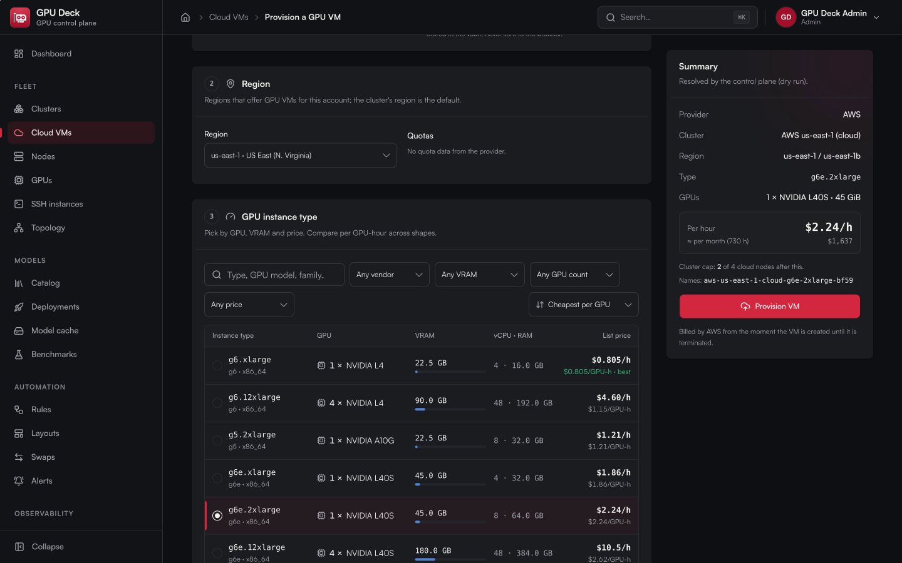

# Cloud GPU VMs

GPU Deck creates GPU VMs on **AWS, Azure, GCP and DigitalOcean**; each VM installs the node
agent from cloud-init and joins its cluster as an ordinary node. API: the `Cloud` tag in
`libs/contracts/openapi/admin.yaml` (`/cloud/providers/**`, `/cloud/nodes/**`).

> [!WARNING]
> **Not run against a real account yet.** Every provider is tested against mocked / recorded
> provider APIs only (`tests/unit/test_cloud_providers.py`:
> moto for AWS, recorded ARM / Compute REST payloads replayed through the real Azure and Google
> SDK clients, recorded DigitalOcean API v2 payloads). `GET /cloud/providers` reports
> `verified_live: false`. Run one real provision per provider before relying on it.



*Provisioning a GPU VM: region and instance type at list price; the VM joins its cluster on boot.*

## Layout

| File | Role |
| --- | --- |
| `base.py` | `CloudProvider` interface, data shapes, `CloudError` family (stable error codes) |
| `providers/{aws,azure,gcp,digitalocean}.py` | boto3 / azure-mgmt-compute+network / google-cloud-compute / httpx REST |
| `credentials.py` | vault credential → provider client (`VaultService.get_secret`, never logged) |
| `catalog.py` | provider descriptions, Redis-cached regions / GPU instance types / quotas |
| `user_data.py` | the bash bootstrap (cloud-init user-data, Azure custom data, GCP startup-script) |
| `lifecycle.py` | state machine, drain → stop/terminate, idle auto-terminate |
| `service.py` | API-facing validation, provisioning, actions |
| `app/workers/tasks/cloud_tasks.py` | `cloud.reconcile` job + `cloud_tasks.advance` Celery task (queue `cloud`) |
| migration `650_cloud_instances` | `cloud_instances` table (+ `cloud_provider`, `cloud_instance_status` enums) |

## Setup

1. Store the account secret in the vault (`POST /vault`) with `provider` = `aws` | `azure` |
   `gcp` | `digitalocean`:

   | Provider | type | value |
   | --- | --- | --- |
   | aws | `cloud_account` | `{"access_key_id","secret_access_key","session_token"?,"role_arn"?,"external_id"?}` |
   | azure | `service_account` | `{"tenant_id","client_id","client_secret","subscription_id"}` |
   | gcp | `service_account` | the service account JSON key |
   | digitalocean | `token` | the API token (or `{"token": ...}`) |

   `POST /cloud/providers/{provider}/check-credential` verifies it.
2. Create a cluster of type `cloud_aws` / `cloud_azure` / `cloud_gcp` / `cloud_do` with
   `credential_id`, `region` and launch defaults in `config.cloud`:

   ```json
   {"cloud": {"max_nodes": 8, "auto_terminate_idle_minutes": 60, "disk_gb": 300,
              "subnet_id": "subnet-0abc", "security_group_ids": ["sg-0abc"]}}
   ```

   Our keys: `max_nodes`, `auto_terminate_idle_minutes`, `region`, `zone`, `image`, `disk_gb`,
   `default_instance_type`. Everything else is a provider launch option (see below) and can be
   overridden per request in `CloudNodeCreate.options`.
3. Browse `GET /cloud/providers/{p}/instance-types?region=...&cluster_id=...`, then
   `POST /cloud/nodes` (`dry_run: true` first for price / monthly estimate).

### Launch options

| Provider | Options | Default image |
| --- | --- | --- |
| AWS | `subnet_id`, `security_group_ids`, `key_name`, `iam_instance_profile`, `associate_public_ip` | Deep Learning Base OSS NVIDIA driver AMI (Ubuntu 22.04) via public SSM parameter |
| Azure | `resource_group` + `subnet_id` (required), `public_ip`, `network_security_group_id`, `admin_username`, `ssh_public_key`, `os_disk_type`, `marketplace_plan` | `microsoft-dsvm:ubuntu-hpc:2204:latest` |
| GCP | `project`, `network`, `subnetwork`, `public_ip`, `disk_type`, `service_account_email` | Deep Learning VM `common-cu124-ubuntu-2204-py310` family + `install-nvidia-driver=True` |
| DigitalOcean | `vpc_uuid`, `ssh_keys`, `monitoring` | `gpu-h100x1-base` / `gpu-h100x8-base` / `gpu-amd-base` |

### Network rules

The VM only needs **outbound** connections: HTTPS to the agent hub (`AGENT_HUB_PUBLIC_URL`, 8443:
downloads, join, WebSocket), the API layer's tunnel ports (8444 upward, the agent's serving
tunnel; agent protocol §13) and model sources. **No inbound port** is needed: the bootstrap joins
in the default tunnel serving mode and applies the agent's host firewall. Keep the security group
(AWS), NSG (Azure), firewall rule for the network tag `gpu-deck-node` (GCP) or VPC cloud firewall
(DigitalOcean) closed inbound; no SSH is required (Azure gets a throwaway public key whose private
half is discarded, GCP blocks project SSH keys).

## Bootstrap (cloud-init)

`user_data.render_bootstrap` writes a bash script that

1. embeds the internal CA certificate and uses it to trust the hub (falls back to the system
   trust store if the hub has a public certificate),
2. downloads `$DOWNLOAD_BASE/agent/v1/downloads/$CLOUD_AGENT_VERSION/<target>` from the hub
   (authorised with the VM's still-unused join token in `X-GPUDeck-Join-Token`)
   and checks the SHA-256 from `X-Checksum-Sha256` (or `.../sha256`); tarball or bare binary,
3. installs `/usr/local/bin/gpudeck-agent`, the `gpudeck` user (video/render groups) and the
   hardened `gpudeck-agent.service` unit,
4. runs `gpudeck-agent join --url <hub> --token <one-time token> --ca-fingerprint <sha256>
   --name <vm name> --label gpu-deck/cloud-*=...` and starts the service.

It is idempotent (`/var/lib/gpudeck/.gpudeck-joined`), logs to `/var/log/gpudeck-bootstrap.log`
and never prints the token. The one-time token (TTL `CLOUD_JOIN_TOKEN_TTL_MINUTES`) is the only
secret in the user-data; it is revoked when the create fails or the VM is terminated unused.

## Lifecycle

```
pending ─create─▶ provisioning ─VM up─▶ booting ─agent joined─▶ running
running ─stop/terminate─▶ draining ─node drained│offline│timeout─▶ stopping ─▶ stopped ─start─▶ starting ─▶ running
                                                                 └▶ terminating ─▶ terminated (node removed, certs revoked)
any failure ─▶ error (last_error {code, message, provider_code, stage}, alert cloud.instance_failed)
```

- Creates run in the `cloud` Celery queue right after `POST /cloud/nodes` and in the
  `cloud.reconcile` job (`CLOUD_RECONCILE_SECONDS`) — whichever is first. A per-row Redis lock
  plus a conditional status claim make it single-shot; provider creates are idempotent anyway
  (AWS `ClientToken`, GCP `requestId`, Azure resource name, DigitalOcean tag lookup).
- Join detection: the VM's join token row gets `used_by_node_id` → the row links `node_id`, the
  node gets `cloud_instance_id` / `cloud_instance_type` and `metadata.cloud`.
- Terminate/stop drain the node first through `NodeService.drain(move_instances=true)` (the
  swap manager moves instances); `force=true` skips it. Then the VM is terminated and the node is
  removed with `NodeService.remove(force=True)`.
- Running/stopped VMs are re-read every `CLOUD_STATUS_POLL_SECONDS`: stops / starts / deletions
  done in the provider console are reflected (`VM was deleted outside GPU Deck`).
- No join within `CLOUD_BOOT_TIMEOUT_MINUTES` → `error` / `CLOUD_AGENT_JOIN_TIMEOUT` (the VM keeps
  running until someone terminates it).
- **Idle auto-terminate (rule hook):** `auto_terminate_idle_minutes` per VM (default from
  `config.cloud.auto_terminate_idle_minutes`). The job marks `idle_since` when the node runs no
  live instance and terminates (after drain) once idle long enough; alert
  `cloud.instance_idle_terminated`. `CloudLifecycle.idle_sweep()` is the hook a future rule type
  can call.
- **Per-cluster cap:** `config.cloud.max_nodes` (default `CLOUD_MAX_NODES_PER_CLUSTER`) counts
  live cloud VMs plus other nodes → `409 CLOUD_MAX_NODES`.

## List prices

Instance types carry the provider's on-demand list price per hour when the API exposes one
(AWS Pricing API Linux on-demand, Azure Retail Prices pay-as-you-go Linux, DigitalOcean
`price_hourly`; GCP: `null`). It is stored on the row (`price_per_hour_usd`, `price_source`) and
shown when you pick a type and on the VM page. Turning the list price into a price plan for the
node (`apply_price_plan`, `nodes.metadata.price_plan_suggestion`) belongs to billing, which is
planned for v2: v1 does not mount `POST /cloud/nodes/{id}/apply-price-plan`.

## Errors

| error_code | HTTP | Meaning |
| --- | --- | --- |
| `CLOUD_QUOTA_EXCEEDED` | 409 | vCPU / GPU / droplet quota (AWS `VcpuLimitExceeded`, Azure `QuotaExceeded`, GCP `QUOTA_EXCEEDED`, DO droplet limit) |
| `CLOUD_CAPACITY_UNAVAILABLE` | 409 | no capacity in the zone (AWS `InsufficientInstanceCapacity`, Azure `SkuNotAvailable`/`AllocationFailed`, GCP `ZONE_RESOURCE_POOL_EXHAUSTED`) |
| `CLOUD_AUTH_FAILED` | 424 | the provider rejected the credential / permission missing |
| `CLOUD_CREDENTIAL_INVALID` | 422 | vault secret missing or not in the provider's format |
| `CLOUD_INVALID_REQUEST` | 422 | bad image / subnet / unknown instance type |
| `CLOUD_NOT_FOUND` | 404 | provider resource not found |
| `CLOUD_RATE_LIMITED` | 429 | provider rate limit |
| `CLOUD_MAX_NODES` | 409 | cluster node cap reached |
| `CLOUD_AGENT_JOIN_TIMEOUT` | — | (row `last_error`) VM never joined |
| `CLOUD_PROVIDER_ERROR` | 502 | anything else |

## Tags

Everything GPU Deck creates carries `gpu-deck:managed=true`, `gpu-deck:cluster-id`,
`gpu-deck:cloud-instance-id`, `gpu-deck:name` (AWS tags incl. volumes, Azure tags on VM / NIC /
disk / IP, DigitalOcean tags `gpu-deck:managed:true` …). GCP labels cannot contain `:`, so they
are `gpu-deck-managed`, `gpu-deck-cluster-id`, … plus the network tag `gpu-deck-node`.

## EKS / Kubernetes GPU nodes (no provisioning by GPU Deck)

Kubernetes nodes — including **EKS** GPU node groups — join through the node-agent DaemonSet,
not through this module: `apps/node-agent/packaging/kubernetes/daemonset.yaml`.

1. Create a cluster of type `kubernetes` and a join token per node
   (`POST /nodes/join-tokens`; tokens are one-time, so one token per GPU node).
2. On EKS use a GPU node group with the EKS-optimised accelerated AMI (NVIDIA driver +
   container toolkit) and install the NVIDIA device plugin (or GPU Operator).
3. Label the GPU nodes `gpudeck.sur950.github.io/gpu=true`, put the token and the CA fingerprint in
   the `gpudeck-agent-join` Secret and the hub URL in the `gpudeck-agent` ConfigMap, set
   `runtimeClassName: nvidia` where the NVIDIA runtime is not the default, and apply the
   manifest. The agent joins on first start (`GPUDECK_AGENT_JOIN_TOKEN`), keeps its identity on
   the host path and exposes the :9443 mTLS proxy on the node IP (`hostNetwork`).
4. Network: in-cluster agents run in direct mode, so the node security group must allow tcp/9443
   from the API layer only (the agent also accepts only the API layer's pinned key from private
   source ranges); pods need outbound 8443 to the hub. Node scaling (Cluster Autoscaler / Karpenter) stays with EKS; scaled-in
   nodes go offline in GPU Deck and are removed with `DELETE /nodes/{id}?force=true`.
