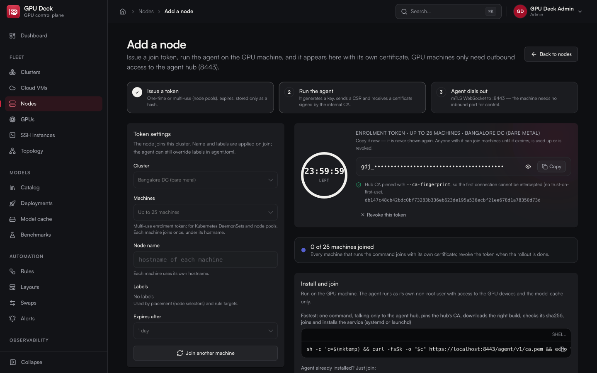

# GPU Deck node agent

Rust workspace for the agent that runs on every GPU machine. Paths below are relative to `apps/node-agent`. For where the agent sits in a deployment, and what it installs versus what the operator installs, see [DEPLOYMENT.md](../DEPLOYMENT.md).

| Crate | What |
| --- | --- |
| `gpudeck-protocol` | serde types for every schema in `libs/contracts/agent-protocol` (tested against the schemas) |
| `gpudeck-agent` | the `gpudeck-agent` binary: join, hub connection, command runner, supervisor, metrics, outbound serving tunnel and mTLS proxy, signed security policy, host firewall, security audit, model cache |
| `gpudeck-devices`, `gpudeck-engines` | vendor device plugins and engine adapters (bridged in `src/backend/plugins.rs`, cargo feature `plugins`, default on) |

How a machine joins, from the token to the first heartbeat (the web UI's **Nodes, Add node** runs
steps 1 to 3 for you; `gpudeck-agent join` below is step 4 onwards):

<p>
  <picture>
    <source media="(prefers-color-scheme: dark)" srcset="../diagrams/node-join-dark.svg">
    
  </picture>
</p>



*A multi-use enrolment token for a node pool, with the install command per platform.*

## Use

```bash
export PATH="$HOME/.cargo/bin:$PATH"
cargo build --release -p gpudeck-agent
gpudeck-agent join --url https://hub:8443 --token gdj_... --ca-fingerprint <sha256 of hub CA> [--name mac-1] [--label zone=office]
                   [--serving-mode tunnel|direct] [--no-firewall]   # --insecure-skip-ca-pin: only on a trusted network
gpudeck-agent run [--apply-egress-lock]
gpudeck-agent status | version
gpudeck-agent stop-engines [--grace-seconds 20]   # engines outlive the agent; stop them on purpose
gpudeck-agent firewall status | apply [--dry-run] [--egress-lock] [--preserve-port P] | remove
gpudeck-agent security audit          # listening sockets; flags anything of GPU Deck's reachable from the network
gpudeck-agent security reset-policy   # forget the signed policy (pins) after a missed key rotation
gpudeck-agent update status           # update mode, staged and previous version, an update in progress
gpudeck-agent update install-helper [--restart systemd:<unit>|launchd:<domain>/<label>] [--dry-run]   # root, run by the installers
gpudeck-agent update apply [--restart ...]   # the applier (run by the update helper or the agent itself)
```

Config: `agent.toml` (keys in `libs/contracts/env.md` §13; `/etc/gpudeck/agent.toml`, macOS
`/usr/local/etc/gpudeck/agent.toml`, `--config` / `GPUDECK_AGENT_CONFIG` to override), every key
overridable by `GPUDECK_AGENT_<KEY>`, engine binaries by `GPUDECK_AGENT_ENGINE_PATHS_<ENGINE>`.
Extra keys: `serving_mode` (`tunnel` default / `direct`, see *Serving* below), `firewall` (`auto` / `off`), `firewall_preserve_ports` (operator SSH ports the firewall always accepts; `firewall apply` records the detected ones), `firewall_egress_lock`, `proxy_bind` (default `auto`, see *Proxy :9443* below), `proxy_advertise_port` (port sent to the control plane as `hello.proxy.port` when the node proxy is reached through a port forward / NAT, e.g. `ssh -L 19443:127.0.0.1:9443`; pair with `proxy_address`), `name`, `container_runtime` (force `docker` /
`podman` / `nerdctl`), `ssh_bind` (SSH-instance forwarder address), `ssh_port_range` (default
`[2200, 2299]`, env `GPUDECK_AGENT_SSH_PORT_RANGE=2200-2299`), `ssh_bind_roots` (extra host dirs SSH
instances may bind-mount; env comma-separated). Non-interactive join (DaemonSet):
`GPUDECK_AGENT_JOIN_TOKEN` + `hub_url`, then `run` joins on first start. Engine lifecycle keys
(all in env.md §13): `keep_engines_on_exit` (default `true`), `engine_scope` (`auto`),
`engine_warmup` (`auto`), `verify_local_files` (`background`), `router_overflow` (`true`).

State (`<state_dir>`, 0700): `agent.key/agent.crt/ca.pem` (0600), `config.json` (last applied
config_push), `commands.json` (seen ids + results), `instances/`, `engine_processes/` (specs +
port, pid and pid start time: re-adoption and restart after an agent restart), `devices.json`
(learned hub device ids), `logs/<id>.log` / `logs/<id>.err.log` (engine stdout / stderr written
by the engine, copied to `.log.1` and truncated at 16 MiB), `tmp/` (engines' `TMPDIR`),
`hub_features.json` (last `hello_ack.features`), `engines/<name>/<version>/` (native
artifacts), `firewall.{pf,nft}` (rendered host firewall), `security_policy.json` (the CA-signed node security policy, re-verified on every start), `update/` (self-update: `staged/<version>/`, `staged.json`, `request.json`, `status.json`, `result.json`, `health.json`, `running.json`, `previous.json`, `history/`). `<cache_dir>/.gpudeck-hashes.json`: sha256 of
node files by path + size + mtime.

## Behaviour notes

- **Engines outlive the agent (restarts, crashes, upgrades)**: every engine is spawned detached —
  its own session / process group (`setsid`), stdout / stderr to `logs/<id>.log` / `.err.log`
  (no pipe that would break when the agent exits), `TMPDIR=<state_dir>/tmp`, and on Linux under
  systemd its own transient scope (`systemd-run --scope`, `engine_scope = auto`) when the agent
  may create one (root or a polkit rule); otherwise the unit's `KillMode=process` makes systemd
  stop only the agent. launchd: `AbandonProcessGroup`. On start the agent **re-adopts** what the
  previous process left before it connects to the hub: a persisted pid that is still the same
  process (start time, so a reused pid is never taken) and answers its health check is taken
  over with the same port and no reload (router instances: their router was adopted and still
  has the model `loaded`); an engine still starting is waited for. Only what is gone or
  unhealthy is relaunched, **on its previous port** when free. Adopted engines are watched by
  polling (exit status unknown) and crash-restarted like any other; their log files are
  followed from the end. `keep_engines_on_exit = false` stops engines on a clean shutdown.
  **Upgrade**: from the control plane (see *Updates* below), or replace the binary and
  `systemctl restart gpudeck-agent` (or let the installer do it) — serving continues; the proxy is down for the agent's restart (~1-2 s), the engines
  are not. `gpudeck-agent stop-engines` stops them on purpose (maintenance, uninstall); their
  specs stay, so the next `run` starts them again (unload from the control plane to remove
  them). In the Kubernetes DaemonSet the engines live in the agent's container and stop with it.
- **Model files on load** (`load_model` → engine start, `info` log "model files ready in …"):
  downloaded files are trusted by their `.sha256ok` marker; in-place `local_path` files whose
  sha256 the agent already knows (`hash_files` at registration, an earlier load: path + size +
  mtime) are not read again; others are verified in the background while the engine loads
  (`verify_local_files = background`; a mismatch is logged and set on the cache item) — before,
  the first load of a 30 GB checkpoint spent ~26 s hashing before the engine started.
- **Warm-up** (`engine_warmup`, default `auto` = llama.cpp on NVIDIA): before an instance is
  reported `ready`, 2-3 requests of different prompt lengths (short, ~1 and ~3 ubatches, capped
  by the context) go to the engine on loopback, so the first user requests do not pay the PTX
  JIT of a llama.cpp CUDA build on a newer GPU (8-25 s per new prompt shape on an H200 with the
  CUDA 12.8 build; the CUDA compute cache keeps them afterwards). Embedding models get
  `/v1/embeddings`; failures only log. `on` warms every chat / embedding engine.
- **Native engine environment**: the engine executable's directory first on `PATH` (a venv's
  `bin/`: `ninja`, `nvcc` wrappers), `VIRTUAL_ENV` for a venv, `TMPDIR`. **SGLang native on
  NVIDIA** needs a CUDA toolkit and `ninja` for its JIT kernels (deep_gemm, flashinfer): the agent
  looks for `CUDA_HOME` / `CUDA_PATH` (deployment env or the agent's), `/usr/local/cuda`, `nvcc`
  on `PATH`, exports `CUDA_HOME` and its `bin/`, and otherwise refuses the load up front with
  `unsupported_engine` naming what is missing (install the toolkit matching the driver's CUDA and
  `pip install ninja` in the venv, or deploy SGLang as a container: the image ships the
  toolkit). An explicitly set `CUDA_HOME` is trusted (e.g. pip `nvidia/cu13` with
  `--attention-backend triton --sampling-backend pytorch`).
- **Container engines**: the cache (`HF_HOME`) and the weights are mounted read-only;
  `HF_MODULES_CACHE` / `HF_ASSETS_CACHE` point at `/tmp/gpudeck/…` in the container's writable
  layer (transformers' remote-code modules: TRT-LLM failed with "Read-only file system").

- **Join**: `--ca-fingerprint` is required (`--insecure-skip-ca-pin` overrides, trusted networks
  only; the automatic join of `run` needs `GPUDECK_AGENT_CA_FINGERPRINT`). The agent fetches
  `GET /agent/v1/ca`, checks the pin, then verifies the hub certificate against it; no redirects
  are followed. The join response's signed security policy is verified against that CA and stored
  before anything else. The CSR carries DNS/IP SANs (hostname, IPs, `proxy_address`).
- **Serving** (`src/tunnel.rs`, protocol.md §13): `serving_mode = "tunnel"` (default) opens no
  listener; the agent keeps `policy.tunnel.connections` TLS 1.3 connections to every endpoint of
  the signed policy (node certificate, ALPN `h2`, the API layer's key pinned) and serves the
  proxy's request handler as an HTTP/2 server on them; a quiet tunnel (no request or keep-alive
  probe for `idle_timeout_seconds`) is redialled, refused identities are logged at warn.
  `serving_mode = "direct"` runs the :9443 proxy below. Only the node's own config can choose
  direct (the control plane cannot open a listener).
- **Security policy** (`src/security.rs`): CA-signed, bound to the node, monotonic serial; pins
  the hub (`hub_client_config_pinned`) and API-layer keys, names the tunnel endpoints, direct-mode
  source CIDRs / handshake limits and SSH default CIDRs. A `config_push` whose policy fails is
  rejected whole (`config_rejected`).
- **Host firewall** (`src/firewall.rs`, `src/egress.rs`): nftables table `inet gpudeck` / pf anchor
  `com.apple/gpudeck`. The operator's SSH ports first (sshd config, sshd sockets, the
  installing session), then the proxy port (direct: allow-listed sources; tunnel: nobody), the
  SSH-instance range (instances' CIDRs only), metrics and the engine port range (never from the
  network). Applied by the installer as root, kept current by the agent when it may (root or
  `CAP_NET_ADMIN`, granted by the systemd unit) and re-asserted every 15 minutes; `firewall =
  "off"` renders only. The egress lock (opt-in) adds outbound restrictions and inbound default
  deny.
- **Rejected inbound attempts** (`src/ingress.rs`): every refusal (source, rate limit, TLS
  identity, SSH CIDRs) is counted per reason and source and reported as one
  `event(ingress_rejected)` per interval (critical at the burst threshold); Prometheus
  `gpudeck_agent_ingress_rejected_total`, `gpudeck_agent_tunnel_connections`.
- **Self-check / audit** (`src/audit.rs`): at start the listening sockets are checked (metrics
  and engines loopback-only, nothing on the proxy port in tunnel mode, direct proxy on a private
  address); an engine left running that answers on a network interface is relaunched on loopback
  instead of being re-adopted. `gpudeck-agent security audit` prints the same with exit code 1 on
  an exposure.
- **Launch templates**: `engine.launch_template.command` is rendered by the agent (placeholders of
  `common.json`, `{{flags}}` from `launch.flags` plus derived flags: llama.cpp `--ctx-size`,
  `--parallel`, `--alias`, `--model-draft`, control vectors; vLLM/SGLang `--max-num-seqs` /
  `--max-running-requests` / tool parser). A template of exactly `["{{adapter}}"]` delegates the
  command line to the engine adapter. Host/bind flags are forced to `127.0.0.1` and the agent refuses an
  engine reachable on a non-loopback address. Containers: `docker run --rm` (Linux
  `--network host`, macOS `-p 127.0.0.1:port:port`).
- **llama.cpp router mode** (`router_mode=true`, `start_engine` + `load_model` with
  `engine_process_id`): the agent manages `<state_dir>/engines/llama_cpp/routers/<id>/preset.ini`
  and passes `--models-preset … --no-models-autoload`. The router reads its model list only at
  start (verified on b8798, see `libs/contracts/metrics.md`), so loading a model it does not know
  restarts the router after draining co-hosted instances (bounded by
  `drain_default_timeout_seconds`) and reloads them — b12500 still has no runtime model add
  (`tests/fixtures/llama_cpp_b12500/llama-server-help.txt`). To avoid that reload (~30 s per
  co-hosted model), a model the router does not know while it hosts others is started as its own
  single-model `llama-server` from the router's build (`router_overflow`, default on): reported
  under the router (`engine_process_id`), not in its preset, stopped with it, crash-restarted on
  its own; it costs the same per-model process as a router child. The router is only restarted
  when it hosts nothing else. A router with no instance (loading or
  hosted) for `router_idle_stop_seconds` (default 120, `0` = never) is stopped and reported with
  `engine_stopped`; the control plane also asks for the stop when it unloads the last instance
  (`stop_engine_if_empty`).
- **Engine builds per host** (`src/engine_compat.rs`): `Artifact.min_glibc` is compared with the
  host glibc (`getconf GNU_LIBC_VERSION`, reported as `hello.capabilities.glibc_version`); the
  agent installs the first build the host runs (the pinned one, then `Artifact.fallbacks`, each in
  its own folder), else runs `Artifact.container` (the official image, entrypoint from the
  artifact) when a container runtime is available, else fails with `unsupported_engine` and a
  message naming the glibc it has / needs and the options. After install, `ldd` on the
  entrypoint reports missing libraries (`libgomp.so.1`, `GLIBC_2.38`, ...) by name, with the
  package to install, or switches to the image. `engine_paths` always wins.
- **PID 1** (`src/init.rs`): started as PID 1 (a container without `tini` / `--init`), the agent
  re-executes itself as a child and stays a minimal init: forwards SIGTERM/SIGINT/SIGHUP/SIGQUIT/
  SIGUSR1/SIGUSR2, reaps every exited child (orphaned router children included) and exits with
  the agent's status. `GPUDECK_AGENT_INIT=1|0` forces / disables it (forced on a non-PID-1 Linux
  process it registers as child subreaper). The agent image runs `tini` as PID 1.
- **Device ids** (protocol.md §10): `uuid5(namespace = node_id, name = "<vendor>:<index>")`, sent
  as `Device.device_id` in every inventory and used in `GpuSample.device_id`, instance/SSH
  `device_ids` and events. A different id seen in a command `DeviceAssignment` is learned and
  reused (`devices.json`) for older hubs; `GpuSample.extra` always carries `vendor`, `index`, `uuid`.
- **scan_path / hash_files** (`src/scan.rs`, protocol.md §11): read-only scan of a node path
  (Ollama stores, LM Studio, HF caches, MLX dirs, diffusers pipelines, plain GGUF/safetensors/
  pickle; GGUF headers read for architecture / context / quantization), same candidates and
  suggestions as the control plane's `local_scanner.py`: a directory with `model_index.json` is
  one pipeline candidate (all components, `type` image / video), safetensors get family / type
  (config `architectures`, name), quantization (name, then `quantization_config`: FP8, AWQ,
  GPTQ, compressed-tensors, ...) and context (`max_position_embeddings`, also `text_config`).
  `hash_files` streams `running` progress and records the hashes for later loads. Both
  cancellable.
- **SSH GPU instances** (`src/ssh.rs`, protocol.md §8): `docker run -d` of the requested sshd
  image with GPUs (`--gpus device=…` / `/dev/kfd` + `/dev/dri/renderD*`), limits (`--cpus`,
  `--memory`, `--shm-size`, `--pids-limit`, MPS env for VRAM/compute), `--cap-drop ALL` + minimal
  caps, `no-new-privileges`; keys via read-only `/etc/gpudeck/authorized_keys` + `PUBLIC_KEY*`
  env. sshd is published on `127.0.0.1` only; the agent's TCP forwarder on
  `ssh_bind:ssh_port_range` is the only listener (private interface by default; source CIDRs of the
  instance, else the policy default, else nobody; connection accounting). Host keys
  via `ssh-keyscan` (fallback `docker exec cat`), OpenSSH `SHA256:` fingerprints. Default image
  (control-plane setting `GPU_INSTANCE_DEFAULT_IMAGE`): `ghcr.io/sur950/gpu-deck-ssh:1`
  (published with the first release; until then build it locally from `packaging/ssh-image/`)
  (`packaging/ssh-image/`: Ubuntu 24.04 + OpenSSH on 2222, glibc so the host `nvidia-smi` /
  libcuda the NVIDIA runtime mounts work; keys copied root-owned for StrictModes; the GPU env —
  `CUDA_VISIBLE_DEVICES`, MPS limits, `GPUDECK_*` — exported to login shells). Alpine images
  (`linuxserver/openssh-server`) cannot run the mounted NVIDIA binaries. Health + TTL
  every 15 s; containers are re-adopted after an agent restart; stop removes container, non-kept
  volumes and the keys file. Apple GPUs cannot be passed into containers (CPU-only + warning).
- **Cross-node pipeline parallel** (`src/distributed.rs`, protocol.md §9): `launch.distributed`
  adds vLLM `--nnodes/--node-rank/--master-addr/--master-port[/--headless]`, SGLang
  `--nnodes/--node-rank/--dist-init-addr`, llama.cpp head `--rpc <peers>` (a single-model
  `llama-server`: a router-mode template's `--models-dir` becomes `--model <file>`) / workers
  `ggml-rpc-server --host <bind> --port <rpc_port>` (`rpc-server` in older builds; flags checked
  against b12500's `--help` in `tests/fixtures/llama_cpp_b12500/`), and `MASTER_*`/`RANK`/`WORLD_SIZE` env; workers
  get no proxy route, are not health-probed over HTTP and report `distributed_rank` in inventory.
  With the egress lock, group peers are allowed in/out.
- **Disconnected**: events buffered (`event_buffer_max`, log events dropped first), the last 60
  `metrics_batch`es kept and replayed (each sample has its own `ts`), heartbeats/inventory dropped,
  terminal command results re-sent from `commands.json` after `hello_ack`.
- **Proxy :9443** (direct mode): listens on `proxy_bind` — `auto` (default) = `proxy_address`
  when it is an IP of this host or loopback (`proxy_address = "127.0.0.1"` behind an SSH tunnel
  binds loopback only), else the first private address, else loopback; every interface only when
  set explicitly (the agent warns). Before TLS: the source must be in the policy's
  `direct.allowed_source_cidrs` (default private ranges), per-source handshake rate limit, cap on
  pending handshakes — refused connections are reset. TLS 1.3 with HTTP/2 (ALPN `h2`,
  multiplexed requests: one handshake per node over a high-latency link) or HTTP/1.1 keep-alive;
  client cert chained to the CA, subject rules, CRL and the pinned API-layer key checked in the
  handshake (a TLS alert, never an HTTP response); `/_health`, `/_metrics`, `/instances/{id}/_health`; `/slots`, `/models*`, `/metrics`,
  `/props`, `/lora-adapters` always blocked. The proxy certificate is the node certificate
  (`CN=<node_id>`): clients should verify chain + CN (`tls::node_proxy_client_config`).
- **Cache**: `local_path` sources (Ollama blobs, LM Studio dirs) are used in place, never copied or
  deleted; pickle formats blocked unless `allow_pickle`; downloads resume from `.partial`.
- **Egress lock** (part of the host firewall, opt-in): destinations = hub, tunnel endpoints,
  HF/ModelScope (or mirrors), allow-list, DNS resolvers; inbound default deny besides the guard
  rules above. Programmed only with `--apply-egress-lock` / `firewall_egress_lock`; host names
  are resolved only then (every config change and every 15 min; an unresolvable name is
  warned about once an hour). Without the flag the rules are rendered with literal IPs / CIDRs
  only — no DNS lookups, no warnings. HF hosts: `huggingface.co`, `hf.co`, `cdn-lfs.hf.co`,
  `cdn-lfs-{us,eu}-1.hf.co`, `cas-bridge` / `cas-server` / `transfer.xethub.hf.co` (the legacy
  `cdn-lfs.huggingface.co` names no longer resolve); ModelScope `modelscope.cn`,
  `www.modelscope.cn`.

## Observed engines

`[[observe]]` entries (`src/observe/`, protocol.md §12) watch model servers GPU Deck did not start, read-only. They are reported only to a hub that lists `observed_engines` in `hello_ack.features`.

| Key | Default | Meaning |
| --- | --- | --- |
| `name` | required | Unique on the node, `[A-Za-z0-9][A-Za-z0-9._-]*`, max 64. Ids: `uuid5(node_id, "observe:<name>")` (instance), `uuid5(node_id, "observe-deployment:<name>")` |
| `engine` | required | `vllm`, `sglang`, `llamacpp`, `tgi` (Prometheus parsers), `openai` (health + `/v1/models`), `generic` (health only) |
| `url` | none | `http(s)://host:port[/prefix]`, no credentials. Only `GET <url><metrics_path>`, `GET <url>/health`, `GET <url>/v1/models` (every 60 s); 2 s timeout, no redirects or proxy, bodies capped (8 MiB metrics, 1 MiB otherwise); backoff 2, 4, 8 ... 60 s while it does not answer |
| `metrics_path` | `/metrics` | Absolute path only |
| `log_file` | none | Followed from the end, read-only; rotation (new inode) and truncation handled; 1 MiB read per cycle, older backlog over 8 MiB skipped, lines over 64 KiB dropped. Parsed: vLLM 0.5+ stats lines (V0 `metrics.py`, V1 `loggers.py`, `Engine NNN:` per data-parallel engine), SGLang `Decode batch` / `Prefill batch`, startup lines (model, version, startup complete, shutdown, engine death) and access lines (uvicorn, gunicorn, nginx combined; probe paths and tqdm bars ignored). New lines are shipped as `event(log)` for the external instance, redacted, at most 200 lines / 128 KiB per entry per metrics interval. With no `url`, no network request is made |
| `model` | none | Display name / served model (first in the model list) |
| `listen_port` | port of a local `url` | Listener → pid through `/proc/net/tcp{,6}` + `/proc/<pid>/fd` (needs the server's user or root); with its descendants, used to attribute NVML per-process GPU memory |
| `pid_cmd_contains` | none | Alternative match on `/proc/<pid>/cmdline` (matched on the node, never reported) |
| `interval_seconds` | `10` | Poll / sample interval (2-300); fewer probe lines in the server's own access log |

Not available from a log: TTFT / end-to-end / TPOT histograms, exact token counters (estimated from logged throughput), KV cache size in tokens for vLLM. Observed local ports are kept out of the agent's port allocation, so it never binds or bind-tests them.

**GPU processes** (NVIDIA): every `GpuSample` carries `processes[]` from NVML `running_compute_processes` (pid, memory, `/proc/<pid>/comm` or the basename of `argv[0]`, never the arguments), each tagged with the managed instance (its engine's process tree) or observed engine holding it, so the control plane can tell memory used outside GPU Deck. Sent only when the hub lists `gpu_processes`.

## Updates

Agents update themselves when the control plane says so (agent protocol §14); nobody has to check
for new versions, and models keep serving.

1. **Pre-staged and verified.** When the control plane has a newer signed release, every node that
   can update downloads it in the background (`stage_update`) from the hub it joined, through
   the pinned hub connection: the release manifest must be signed (ed25519) by a release key the
   node pinned (the CA-signed security policy's `release.public_keys`, plus `agent.toml`
   `release_public_keys`), the binary must match the manifest's sha256 and size and must run
   (`version`). It is kept in `<state_dir>/update/staged/<version>/` after a free-space check
   (two copies plus 64 MiB). The running binary is not touched.
2. **Update button / rolling update / maintenance window.** `apply_update` downloads nothing:
   the agent re-verifies the staged binary and asks the applier, which verifies again, copies it
   next to the installed binary, keeps the installed one as `<binary>.prev` (a hard link) and
   renames the new one over it (atomic), restarts the service, and waits up to the health
   timeout (default 120 s) for the new agent to re-adopt its engines and reconnect to the hub. If
   it does not, the applier puts `.prev` back (the failed one stays as `<binary>.failed`),
   restarts again and reports `rolled_back`.
3. **Who swaps the binary.** The installers install a root-owned *update helper*
   (`gpudeck-agent update install-helper`): on Linux `gpudeck-agent-update.path` (watches
   `<state_dir>/update/request.json`) and `gpudeck-agent-update.service` (oneshot, root, runs
   `gpudeck-agent update apply --restart systemd:gpudeck-agent.service`); on macOS the launchd
   daemon `io.github.sur950.gpudeck-agent-update` (`WatchPaths`). So the binary stays
   root-owned and the agent unprivileged. As root, the applier trusts only release keys anchored
   outside the agent's writable state (`agent.toml` keys, and policy keys only from a policy
   that verifies against the CA certificate `agent.toml` pins) and opens state files without
   following symlinks. When the agent user owns its binary (per-user macOS install) and launchd,
   systemd or another supervisor (`GPUDECK_AGENT_SUPERVISED=1`) restarts it, the agent starts
   the applier itself (`self` mode). In Kubernetes the agent never updates itself (the
   DaemonSet image is updated with Helm; the UI shows "Managed by Helm").
   `update_helper = "off"` turns updates off for a node.
4. **Older agents** (before self-update) keep working; the UI shows "update manually" with the
   install command. After one manual update (re-running the installer, which also adds the
   helper) they update from the control plane.

Progress goes to the hub as `event(agent_update)` phases (staged, swapping, restarting,
re-adopting engines with their count, health check, then succeeded or rolled back) and the
`apply_update` result, sent by whichever agent runs after the restart.

## Packaging

`packaging/systemd/gpudeck-agent.service` (user `gpudeck`, `ProtectSystem=strict`, device
allow-list, `KillMode=process` so engines outlive agent restarts, `StateDirectory=gpudeck
gpudeck/tmp` + `BindPaths=/var/lib/gpudeck/tmp:/tmp`: a writable `/tmp` for engines that is not
wiped on restart, unlike `PrivateTmp`; the hub installer, the web install command and the offline
installer write the same unit), `packaging/launchd/io.github.sur950.gpudeck-agent.plist` (LaunchDaemon, user
`_gpudeck`) and `…agent.dev.plist` (per-user LaunchAgent for development),
`packaging/systemd/gpudeck-agent-update.{path,service}` and
`packaging/launchd/io.github.sur950.gpudeck-agent-update.plist` (the root update helper, default
paths; the installers write it with `gpudeck-agent update install-helper`),
`packaging/kubernetes/daemonset.yaml` (non-root, read-only root FS, hostNetwork, join token Secret),
`packaging/ssh-image/` (default SSH GPU-instance image, built and pushed by the release workflow
as `ghcr.io/<owner>/gpu-deck-ssh`).
The agent never needs root; the systemd unit grants `CAP_NET_ADMIN` (and nothing else) so the agent
keeps the host firewall current — remove `AmbientCapabilities` together with `firewall = "off"`
to opt out. The installers run `gpudeck-agent firewall apply` and `firewall status` as root.

Release: `packaging/build-release.sh [--version X] [target ...]` builds `gpudeck-agent` (default:
host triple) and writes `dist/agent/<version>/<target>/{gpudeck-agent, gpudeck-agent.sha256,
gpudeck-agent-<version>-<target>.tar.gz(.sha256), manifest.json}` plus `dist/agent/<version>/SHA256SUMS`
and `dist/agent/latest` — the layout the control plane serves at
`/agent/v1/downloads/{version}/{target}`. Targets whose std is not installed are skipped (no
toolchains are installed). Linux targets (`x86_64|aarch64-unknown-linux-gnu` glibc ≥ 2.28,
`*-linux-musl` static): build natively on Linux, or from a Mac with
`infra/scripts/cross-compile-agent.sh` (cargo-zigbuild + zig, `rustup target add <t>`);
`x86_64-apple-darwin`: `rustup target add x86_64-apple-darwin` on macOS.

## Tests

```bash
cargo clippy --all-targets -- -D warnings && cargo test          # unit + fake-hub e2e over mTLS
cargo test -p gpudeck-agent --test live_mac -- --ignored --nocapture   # real llama-server + qwen3 on a Mac
cargo test -p gpudeck-agent --test live_docker -- --ignored --nocapture # sshd container + ssh login, container engine
cargo test -p gpudeck-agent --lib live_scan_home -- --ignored --nocapture # scan ~/.ollama, ~/.lmstudio
```

`tests/restart_adopt_e2e.rs`: engines (dedicated, router + model, router overflow model) keep
running across agent stops; the next agent re-adopts them (same pids / ports, no
`engine_started`), restarts a crashed adopted engine on its port, relaunches one that died while
no agent ran on its previous port; warm-up requests counted by the fake engine (`/fake/stats`);
loading a second model into a busy router does not restart it.
`tests/fake_hub_e2e.rs` runs the agent against `fakehub.rs` (join, hello, commands incl. replay,
router restart, crash restart, drain, proxy policy/CRL, cert rotation) with the
`gpudeck-fake-engine` binary and validates every frame against the JSON Schemas.
`gpudeck-fake-hub` is a stand-alone hub for manual runs.
`tests/self_update.rs`: the applier on a real file system with fake agent binaries under a
supervisor: atomic swap keeping `.prev`, health check, rollback when the new agent hangs or
crash-loops, refusals (tampered staged binary, foreign signing key, no pinned key) that leave
the binary untouched. `tests/self_update_e2e.rs`: the real agent binary as a supervised service
against the fake hub: the release key from the signed policy, staging (wrong token and foreign
key refused), a version that never reconnects rolled back, a working version applied with the
running engine re-adopted (same pid, no `engine_started`), and N-1: a hub without
`agent_updates` gets none of the new fields.
`tests/secure_transport_e2e.rs`: tunnel mode (no listener, pinned API-layer key, an impostor
endpoint refused, unbuffered streaming, in-flight accounting, drain over the tunnel; forged,
rolled-back and foreign policies rejected), direct mode (source allow-list before TLS, every
identity but the pinned API layer refused in the handshake, rate limit, `ingress_rejected`), and
tunnel vs direct latency over a relay with a simulated 20 ms RTT.
`testing/security/run.sh`: the attacker verification in Linux containers against a local control
plane (docs/security-model.md §5).
