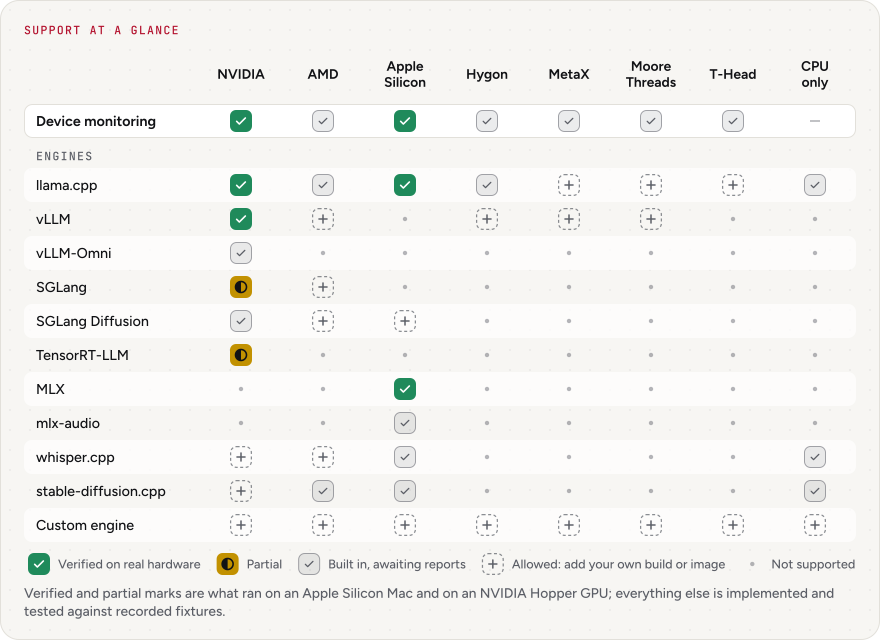
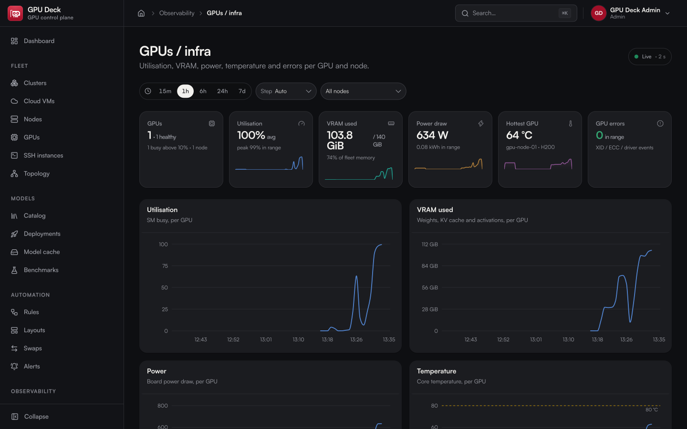

# Hardware and engine support

GPU Deck's node agent detects the accelerator on a machine and starts whichever inference
engines it is compatible with. This page is the support matrix: which engine runs on which
accelerator, which model types each engine serves, and how solid the verification behind each
combination is. The per-family pages under this folder ([nvidia.md](nvidia.md),
[amd.md](amd.md), [apple-silicon.md](apple-silicon.md), [hygon.md](hygon.md),
[metax.md](metax.md), [moore-threads.md](moore-threads.md), [t-head.md](t-head.md),
[cpu.md](cpu.md)) go through OS support, driver/runtime minimums, what the agent installs versus
what the operator installs, slicing and multi-GPU support, and a prepare-this-machine checklist.
[engines.md](engines.md) covers the same ground organised by engine instead of by accelerator.

  <picture>
    <source media="(prefers-color-scheme: dark)" srcset="../diagrams/support-matrix-dark.svg">
    
  </picture>

Everything on this page is taken from the compatibility rules
([`apps/fastapi/app/services/engines/compat.py`](../../apps/fastapi/app/services/engines/compat.py)),
the built-in engine catalog
([`apps/fastapi/app/services/engines/seed.py`](../../apps/fastapi/app/services/engines/seed.py),
the row each engine was seeded with in
[`001_init/up.sql`](../../apps/fastapi/app/db/postgres/alembic/migrations/001_init/up.sql)) and
the artifact-selection rules
([`apps/fastapi/app/services/engines/artifacts.py`](../../apps/fastapi/app/services/engines/artifacts.py)).
Where the code does not say something, this page says "not specified" rather than guess.

## How to read the matrix

- **✓** — the accelerator is in the engine's `supported_vendors` and GPU Deck ships a pinned,
  accelerator-specific build or container image for it out of the box.
- **~** — the engine is allowed on that accelerator (listed in `supported_vendors`), but nothing
  accelerator-specific is pinned for it: GPU Deck falls back to a CPU or Vulkan build, or an
  operator has to add an engine version (for example a ROCm container image) before it is usable.
  See the accelerator's page for what to add.
- **✗** — the engine's `supported_vendors` does not include that accelerator, so the scheduler
  never offers it there.
- **V** after a mark — verified on real hardware. **P** — partial: it ran on real hardware with a
  known gap (see the notes below). Without either, the combination is implemented and covered by
  automated tests (unit tests, or fixtures built from recorded tool output / vendor
  documentation), but has not yet been run on that accelerator. See
  [TESTING.md](../TESTING.md) for the full breakdown and how to send a hardware report.

| Accelerator | llama.cpp | vLLM | vLLM-Omni | SGLang | SGLang Diffusion | TensorRT-LLM | MLX | mlx-audio | whisper.cpp | stable-diffusion.cpp | Custom |
| --- | --- | --- | --- | --- | --- | --- | --- | --- | --- | --- | --- |
| NVIDIA (Ampere / Ada / Hopper / Blackwell) | ✓V | ✓V | ✓ | ✓P | ✓ | ✓P | ✗ | ✗ | ~ | ~ | ~ |
| AMD Instinct / Radeon (ROCm) | ✓ | ~ | ✗ | ~ | ~ | ✗ | ✗ | ✗ | ~ | ✓ | ~ |
| Apple Silicon (Metal) | ✓V | ✗ | ✗ | ✗ | ~ | ✗ | ✓V | ✓ | ✓ | ✓ | ~ |
| Hygon DCU | ✓ | ~ | ✗ | ✗ | ✗ | ✗ | ✗ | ✗ | ✗ | ✗ | ~ |
| MetaX | ~ | ~ | ✗ | ✗ | ✗ | ✗ | ✗ | ✗ | ✗ | ✗ | ~ |
| Moore Threads | ~ | ~ | ✗ | ✗ | ✗ | ✗ | ✗ | ✗ | ✗ | ✗ | ~ |
| T-Head PPU | ~ | ✗ | ✗ | ✗ | ✗ | ✗ | ✗ | ✗ | ✗ | ✗ | ~ |
| CPU-only (no accelerator) | ✓ | ✗ | ✗ | ✗ | ✗ | ✗ | ✗ | ✗ | ✓ | ✓ | ~ |

Notes on the **V** and **P** marks for NVIDIA: they come from one Hopper-class (H100 / H200) GPU.
llama.cpp ran the pinned CUDA build; vLLM ran from an existing installation (`engine_paths`), so
the pinned vLLM image itself awaits a report. SGLang ran natively once the CUDA toolkit was on the
host; TensorRT-LLM ran from the official image without tool-call or reasoning parsing and does
not run on slices. The other NVIDIA generations are expected to behave the same (the
compatibility code does not distinguish them) but have not been run.

Notes on the `~` cells (details and sources on each accelerator's page):

- **NVIDIA / whisper.cpp, stable-diffusion.cpp**: `supported_vendors` includes `nvidia`, but no
  CUDA-accelerated build is pinned — whisper.cpp's Linux release is CPU-only, and
  stable-diffusion.cpp has no `linux/x86_64/cuda` artifact, so an NVIDIA Linux node is offered the
  Vulkan build instead.
- **AMD / vLLM, SGLang Diffusion**: `supported_vendors` includes `amd`, but GPU Deck's seed only
  pins vLLM's NVIDIA CUDA image; [DEPLOYMENT.md](../DEPLOYMENT.md#engines-at-a-glance) says to
  add a ROCm image yourself. SGLang Diffusion's pinned wheel note says it "pulls PyTorch for the
  node's CUDA" — not specified whether an AMD node gets a ROCm-enabled PyTorch automatically.
- **AMD, Hygon, MetaX, Moore Threads / SGLang**: `supported_vendors` is `{nvidia, amd}` only for
  SGLang's base image; an AMD node needs the `-rocm720-mi30x` / `-mi35x` image added as its own
  version (see [amd.md](amd.md)); Hygon, MetaX and Moore Threads are not in SGLang's
  `supported_vendors` at all.
- **Hygon, MetaX, Moore Threads, T-Head / llama.cpp**: `llama_cpp` lists every vendor in
  `supported_vendors`, but `artifacts.py`'s per-vendor accelerator order
  (`ACCELERATOR_ORDER`) only maps `hygon → rocm, vulkan` and `moorethreads → vulkan`; MetaX and
  T-Head have no entry, so those two fall through to the plain CPU build. See the per-family
  pages for exactly which build each one gets.
- **Custom**: any vendor is allowed (`supported_vendors` lists all seven plus none), but the
  built-in `custom` engine version is a disabled template (`ghcr.io/example/custom-engine:latest`)
  — an operator always edits its image and launch/health/metrics config before use, so it is
  never a ✓ out of the box.

## Model types served, per engine

From `MODEL_TYPE_ENGINES` in `compat.py` and each engine's `supported_model_types` in
`001_init/up.sql`. "Custom" can serve any of these — its `supported_model_types` lists all
eight — once an operator configures it for the model it runs.

| Engine | Chat | Thinking | Vision | Embedding | Rerank | STT | TTS | Image | Video |
| --- | --- | --- | --- | --- | --- | --- | --- | --- | --- |
| llama.cpp | ✓ | ✓ | ✓ | ✓ | ✓ | | | | |
| vLLM | ✓ | ✓ | ✓ | ✓ | ✓ | | | | |
| vLLM-Omni | | | | | | | ✓ | ✓ | ✓ |
| SGLang | ✓ | ✓ | ✓ | ✓ | | | | | |
| SGLang Diffusion | | | | | | | | ✓ | ✓ |
| TensorRT-LLM | ✓ | ✓ | | | | | | | |
| MLX | ✓ | ✓ | ✓ | | | | | | |
| mlx-audio | | | | | | ✓ | ✓ | | |
| whisper.cpp | | | | | | ✓ | | | |
| stable-diffusion.cpp | | | | | | | | ✓ | |
| Custom | ✓ | ✓ | ✓ | ✓ | ✓ | ✓ | ✓ | ✓ | ✓ |

Every engine speaks an OpenAI-compatible HTTP API natively (`capabilities.native_formats` is
`["openai"]` for all eleven built-in rows in `001_init/up.sql`); GPU Deck's serving API
translates requests and responses to and from the Anthropic and Ollama shapes itself — no engine
is reached in those formats directly. See [engines.md](engines.md#api-formats) for the OpenAI
paths each engine serves.

## Verification status

The release notes in [TESTING.md](../TESTING.md) are the source for this; it is reproduced here
only to tie it to the matrix above.

<!-- cards -->
- **Verified on real hardware**: the control plane (macOS, Docker); an Apple Silicon Mac running llama.cpp and MLX; an NVIDIA Hopper GPU with NVML monitoring, vLLM (embeddings included), the llama.cpp CUDA build, all three API formats, slices, weighted routing, failover, auto-heal, idle unload, layout swaps and SSH GPU instances; Linux nodes in containers for fleet behaviour.
- **Partial**: SGLang on NVIDIA (needs the CUDA toolkit on the host) and TensorRT-LLM on NVIDIA (official image; tool-call and reasoning parsing missing, no slices).
- **Awaiting reports**: MIG, Xid tracking, tensor and pipeline parallel, multi-node models, vLLM-Omni, SGLang Diffusion, whisper.cpp, stable-diffusion.cpp and mlx-audio, llama.cpp's ROCm and Vulkan builds, the AMD / Hygon / MetaX / Moore Threads / T-Head device plugins (parsed against vendor documentation or recorded tool output), cloud providers and Kubernetes.

The ✗ cells above are not supported: the engine's `supported_vendors` does not include that
accelerator in the current catalog.

*GPUs / infra on a real H200 node, read through NVML.*

> [!NOTE]
> Fixes made after the NVIDIA run (engines re-adopted after an agent restart, pooled HTTP/2
> connections to the nodes, the outbound-only tunnel mode, among others) are covered by
> automated tests and await re-verification on a GPU.

If you run GPU Deck on hardware marked as awaiting reports, please open an issue with the agent
version, the device and driver versions, and what worked — see [SUPPORT.md](../SUPPORT.md).

## Prepare a GPU machine

Every per-accelerator page ends with a checklist for its vendor. In short:

  <picture>
    <source media="(prefers-color-scheme: dark)" srcset="../diagrams/prepare-gpu-machine-dark.svg">
    
  </picture>

