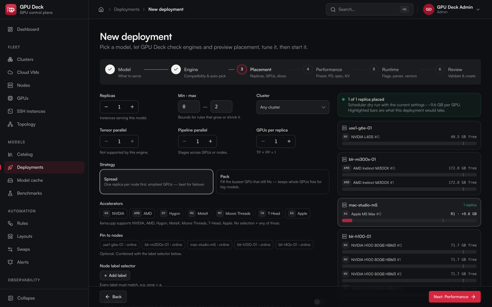

# Engines

The same ground as the per-accelerator pages, organised by engine instead of by hardware. Each
section covers what GPU Deck pins, which vendors it supports, how to bring your own build, and
what metrics it reports. See [README.md](README.md) for the accelerator × engine matrix and
[nvidia.md](nvidia.md) / [amd.md](amd.md) / [apple-silicon.md](apple-silicon.md) /
[hygon.md](hygon.md) / [metax.md](metax.md) / [moore-threads.md](moore-threads.md) /
[t-head.md](t-head.md) / [cpu.md](cpu.md) for the accelerator-first view.

## How GPU Deck runs an engine

Every engine version (`engine_versions` row) carries a `launch_template` the node agent renders
with `{{port}}`, `{{model_path}}`, `{{model_dir}}`, `{{context_size}}`, `{{served_model_name}}`,
`{{tp_size}}`, `{{pp_size}}`, `{{device_indices}}`, `{{cache_dir}}`, `{{host}}` and `{{flags}}`
placeholders (`apps/node-agent/crates/gpudeck-engines/src/launch.rs::expand`). Three ways an
engine actually runs:

1. **Native pinned build** — the agent downloads a pinned, sha256-checked artifact for the
   node's OS/arch/accelerator (`apps/fastapi/app/services/engines/artifacts.py` picks it; the
   agent verifies it with `ldd` after unpacking). llama.cpp, whisper.cpp and stable-diffusion.cpp
   work this way.
2. **Managed Python venv** — the agent creates a venv under
   `<state_dir>/engines/<engine>/<version>/venv` and installs the pinned wheel (plus any
   `pip_extras`). MLX, mlx-audio and SGLang Diffusion work this way.
3. **Official container image** — pinned by tag and index digest
   (`image:tag@sha256:...`), pulled by the node's container runtime. vLLM, vLLM-Omni, SGLang and
   TensorRT-LLM work this way; native llama.cpp builds also fall back to an image on hosts whose
   glibc is too old.

An **operator-installed build always wins**: set `engine_paths` in `agent.toml` (or
`GPUDECK_AGENT_ENGINE_PATHS_<ENGINE>`), or just put the binary on `PATH` — the agent prefers it
over any download. This is also the only way to run an engine on hardware the built-in catalog
has no pinned build for (see the per-accelerator pages for which combinations that applies to).

The deployment wizard picks the engine for you from the model's format, the GPU vendor and the
driver, and shows where the scheduler would place it before anything loads:

*The deploy wizard: engine auto-pick and a placement dry run before the model loads.*

## Status on real hardware

<!-- cards -->
- **Verified**: llama.cpp (Metal on a Mac, the CUDA build on an NVIDIA Hopper GPU, CPU in Linux containers), MLX on a Mac, vLLM on the NVIDIA GPU (embeddings included).
- **Partial**: SGLang on NVIDIA (needs the CUDA toolkit on the host) and TensorRT-LLM on NVIDIA (no tool-call or reasoning parsing, no slices).
- **Awaiting reports**: vLLM-Omni, SGLang Diffusion, mlx-audio, whisper.cpp, stable-diffusion.cpp, custom engines, the vLLM and SGLang images, llama.cpp's ROCm and Vulkan builds.

Details per engine and accelerator: [TESTING.md](../TESTING.md) and the
[support matrix](README.md).

## Presets

`low_latency` and `high_throughput` launch-flag presets exist for every engine (some empty) in
`apps/fastapi/app/services/engines/presets.py`; a deployment's `preset` field fills in flags like
`parallel`, `max-num-seqs`, `gpu-memory-utilization` before your own `launch_flags` are layered
on top (engine defaults < model defaults < preset < deployment flags,
`merge_launch_flags`). Concurrency for the VRAM estimate comes from whichever of
`parallel`/`max-num-seqs`/`max-running-requests`/`max_batch_size`/`np` is set, falling back to
the preset's default (2 for `low_latency`, 16 for `high_throughput`) or 1.

## llama.cpp

**Pinned**: release `b12500` (ggml-org/llama.cpp). **Runs as**: native, router mode — one
`llama-server --models-dir --no-models-autoload --models-preset <ini>` process per node serves
every model loaded on it, with the agent managing the preset INI and the router's
`POST /models/load` / `/models/unload` admin API (`components/node-agent.md` has the full
behaviour, including `router_overflow` for a model the router doesn't know yet). **Vendors**:
every one GPU Deck supports (`supported_vendors`: nvidia, amd, hygon, metax, moorethreads, thead,
apple) — but only NVIDIA (CUDA), AMD (ROCm), Apple (Metal), Moore Threads (Vulkan) and Hygon
(ROCm, reusing AMD's build) have an accelerator-specific artifact; MetaX and T-Head fall back to
the CPU build (see their pages). **Required flags**: none beyond the template; `jinja`,
`cont-batching` and `flash-attn: auto` are the engine defaults. **Slicing**: MIG/MPS on NVIDIA,
CU masking on AMD/Hygon, memory caps elsewhere — honoured through `-ngl`/`-c`/`--cache-type-k`/
`v` and the agent's own VRAM budget check (see the vendor pages). **Multi-GPU/multi-node**:
pipeline parallel since `003_llamacpp_pipeline_parallel` (head rank runs a single-model
`llama-server --rpc <peers>`, worker ranks run `ggml-rpc-server`); no tensor parallel
(`capabilities.tensor_parallel = false`). **Known limitations**: router restarts (bounded by
`drain_default_timeout_seconds`) when a model it doesn't know is loaded while it hosts others
unless `router_overflow` starts it standalone instead; `b12500` has no runtime model add to an
already-running router. **Your own build**: set `engine_paths` (or `GPUDECK_AGENT_ENGINE_PATHS_LLAMA_CPP`) to any `llama-server` build — router mode and all flags still apply.

## vLLM

**Pinned**: `vllm/vllm-openai:v0.34.0@sha256:20fd...`. **Runs as**: container.
**Vendors**: `supported_vendors` includes nvidia, amd, hygon, metax, moorethreads, but only the
NVIDIA image above is pinned; add a ROCm image (for example `rocm/vllm`) as a separate engine
version for AMD — nothing is pinned for Hygon, MetaX or Moore Threads. **Required**: NVIDIA
driver ≥ 580 (CUDA 13.0 image), container runtime, NVIDIA Container Toolkit. **Slicing**:
`--gpu-memory-utilization` (memory share) plus MIG/MPS env on NVIDIA, CU masking on AMD.
**Multi-GPU/multi-node**: tensor and pipeline parallel (`--tensor-parallel-size`,
`--pipeline-parallel-size`); cross-node via `--nnodes/--node-rank/--master-addr/--master-port
[/--headless]`. PD split (`--kv-transfer-config` with `NixlConnector`/`MooncakeConnector`),
speculative decoding (`--speculative-config`) and shared KV cache
(`LMCacheConnectorV1`/`MooncakeStoreConnector`/`SharedStorageConnector`) are all supported
(`capabilities.pd_split`/`speculative_decoding`/`kv_sharing = true`). **Your own build**: add an
engine version with your image, or `engine_paths` for a native `vllm` binary.

## vLLM-Omni

**Pinned**: `vllm/vllm-omni:v0.32.0@sha256:f713...`. **Runs as**: container, NVIDIA only
(`supported_vendors = {nvidia}`). **Serves**: tts, image, video — not chat/thinking/vision/
embedding/rerank. **Required**: NVIDIA driver ≥ 580 (CUDA 13.0 image). **Multi-GPU**: tensor
parallel only, no pipeline parallel (`capabilities.pipeline_parallel = false`). **Async jobs**:
`capabilities.async_jobs = true` — image/video generation is job-based, not just request/response.
**Startup timeout**: 1200s (vs. 600s for most engines) — large multimodal checkpoints load
slowly.

## SGLang

**Pinned**: `lmsysorg/sglang:v0.5.23@sha256:f832...`. **Runs as**: container.
**Vendors**: `supported_vendors = {nvidia, amd}`; only the NVIDIA image is pinned — add
`lmsysorg/sglang:v0.5.23-rocm720-mi30x` (or `-mi35x`) as your own version for AMD. **Required**:
NVIDIA driver ≥ 580 (CUDA 13.0 image). **Slicing**: `--mem-fraction-static` plus the same
MIG/MPS/CU-masking env as vLLM. **Multi-GPU/multi-node**: `--tp-size`/`--pp-size`; cross-node via
`--nnodes/--node-rank/--dist-init-addr`. PD split (`--disaggregation-mode`,
`--disaggregation-transfer-backend`), speculative decoding (`--speculative-algorithm` —
eagle/eagle3/etc.) and shared KV cache (`--enable-hierarchical-cache`) are supported.

## SGLang Diffusion

**Pinned**: `sglang` 0.5.23 wheel with the `diffusion` extra. **Runs as**: native, managed Python
3.12 venv (Linux x86_64/arm64 only — no macOS wheel, despite `apple` being in
`supported_vendors`). **Serves**: image, video via the OpenAI `/v1/images/*` and `/v1/videos`
paths. **Required**: Python 3.12 on the node; `pip` pulls PyTorch for the node's CUDA at install
time (ROCm PyTorch is not specified). **No metrics endpoint** — proxy-derived. **Startup
timeout**: 1200s.

## TensorRT-LLM

**Pinned**: `nvcr.io/nvidia/tensorrt-llm/release:1.3.0@sha256:bb9a...` (`trtllm-serve`, PyTorch
backend). **Runs as**: container, NVIDIA only. **Required**: NVIDIA driver ≥ 580 (CUDA 13.4
image). **Slicing**: `kv_cache_free_gpu_memory_fraction` in the `--extra_llm_api_options` YAML
the agent writes next to the cache (also turns on `enable_iter_perf_stats` and KV block reuse).
**Multi-GPU**: `--tp_size`/`--pp_size`, both supported. **Speculative decoding**: Eagle,
Eagle3, MTP, NGram, DraftTarget (draft model) and Medusa, each mapped to the engine's
`decoding_type`. **Known limitations**: does not parse tool calls or reasoning output yet
(TESTING.md) and does not run on slices; `/metrics` returns the iteration stats queued since the previous call, so the
adapter accumulates token counters across scrapes itself. **Startup timeout**: 1800s — the
longest of any engine (TensorRT engine builds / loads take a while).

## MLX

**Pinned**: `mlx-lm` 0.32.2 wheel (verified with `mlx-lm` 0.29.1 / `mlx` 0.30.6 on the reference
Mac). **Runs as**: native managed venv, Apple Silicon only. **Required**: Python 3.11+ on the
Mac. **Serves**: chat, thinking, vision. **Quirk**: the model loaded via `--model` answers to the
request-body name `default_model`, not its served name — the proxy rewrites `model` for every
request. **No `/metrics`** — everything is derived from the proxy (tokens from SSE `usage`, TTFT
from the first content chunk, TPOT, KV estimate). **Slicing**: memory cap only — `mlx_lm` has no
cap flag, so the agent sizes `context_size` and accounts process RSS instead.

## mlx-audio

**Pinned**: `mlx-audio` 0.6.7 wheel (`server`, `stt`, `tts` extras). **Runs as**: native managed
venv, Apple Silicon only. **Serves**: stt, tts via OpenAI-style `/v1/audio/speech` and
`/v1/audio/transcriptions`. Models are named per request (HF repo id or local path) and loaded on
first use. **No `/metrics`** — proxy-derived `media_units` from audio duration / input
characters.

## whisper.cpp

**Pinned**: release `b5907` (ggml-org/whisper.cpp). **Runs as**: native — Linux gets the
prebuilt CPU release binary (x86_64/arm64, needs glibc ≥ 2.35 and `libgomp1`); macOS has no
prebuilt server, so the agent builds the pinned source archive with CMake (Metal on by default,
needs `cmake` + Xcode Command Line Tools). **No accelerated Linux build** — `supported_vendors`
lists nvidia/amd/apple, but only the CPU build is pinned on Linux regardless of GPU vendor.
**Serves**: stt only. `--inference-path /v1/audio/transcriptions` maps the OpenAI path directly
onto the server's own endpoint. **No `/metrics`** — proxy-derived.

## stable-diffusion.cpp

**Pinned**: release `master-1106-532d2c1` (leejet/stable-diffusion.cpp). **Runs as**: native.
**Artifacts**: `linux/x86_64` (CPU), `linux/x86_64/vulkan`, `linux/x86_64/rocm` (10.1), and
`macos/aarch64` (needs macOS 26+) — **no CUDA build**, so an NVIDIA Linux node gets the Vulkan
build via `artifacts.py`'s selection order (cuda key absent → vulkan). **Serves**: image only,
via OpenAI `/v1/images/generations` (and `/v1/images/edits` on newer builds) plus the A1111-style
`/sdapi/v1/*` paths. **No `/metrics`** — proxy-derived `media_units` (images generated).

## Custom

**Runs as**: whatever you configure — container image (most common) or a native binary via
`engine_paths`, described by `CustomEngineConfig`: `command` argv with the same
`{{placeholders}}`, `health`, `metrics` (Prometheus with a `metric_map` that can scale a value,
e.g. `"ttft_ms_avg*1000"`; JSON with pointer/dotted-path keys; or `none` = fully proxy-derived),
optional hot-swap (`supports_hot_swap` + `load_path`/`unload_path`,
`POST {"model": name, "path": p}`). **Vendors/OS**: every vendor, linux and macos (Apple GPUs
cannot be passed into a container — run a custom engine natively on a Mac). **Built-in version**:
a disabled template (`ghcr.io/example/custom-engine:latest`) — edit its image and
launch/health/metrics config before use.

## API formats

Every built-in engine's `capabilities.native_formats` is `["openai"]` — every engine in the
catalog speaks an OpenAI-compatible HTTP API natively (`/v1/chat/completions`,
`/v1/embeddings`, `/v1/audio/*`, `/v1/images/*`, as applicable to what it serves). GPU Deck's
serving API (`apps/fastapi/app/api/serving/`) translates requests and responses to and from the
Anthropic and Ollama request/response shapes itself at the API layer — no engine is ever reached
in those two formats directly; see [libs/contracts/openapi/serving.md](../../libs/contracts/openapi/serving.md)
for the exact endpoints each format exposes.

## Metrics available

| Engine | Source | Notes |
| --- | --- | --- |
| llama.cpp | `/metrics` Prometheus (`llamacpp:` prefix) + `/slots` JSON | Per-slot session samples; no KV-cache-size metric (`kv_cache_metrics: false` in the router facts) |
| vLLM, vLLM-Omni | `/metrics` Prometheus (`vllm:` prefix) | — |
| SGLang | `/metrics` Prometheus (`sglang:` prefix) | — |
| TensorRT-LLM | `/metrics` JSON iteration stats | Each entry is returned once per call; the adapter accumulates counters across scrapes |
| SGLang Diffusion, MLX, mlx-audio, whisper.cpp, stable-diffusion.cpp | None — proxy-derived | Request counts, latency and `media_units`/token estimates come from the agent's own mTLS proxy, not the engine |
| Custom | Prometheus, JSON or proxy-derived | Your choice, via `metrics_config.format` |

See [libs/contracts/metrics.md](../../libs/contracts/metrics.md) for the full metrics catalog and
what each field means per engine and vendor.
