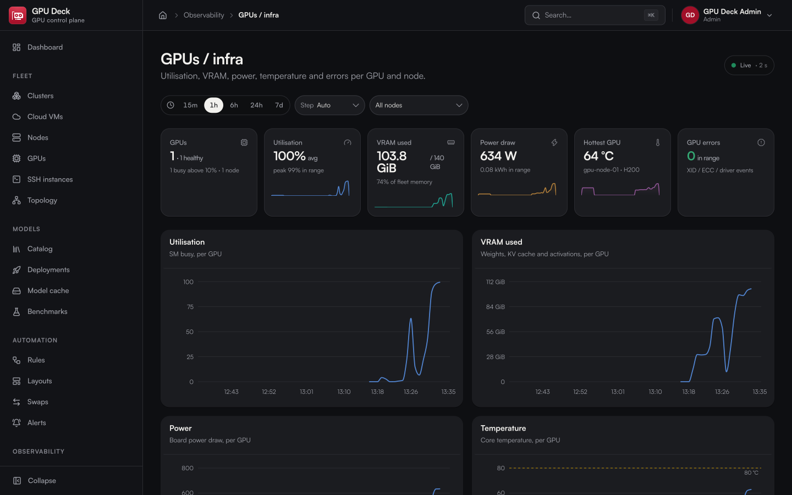
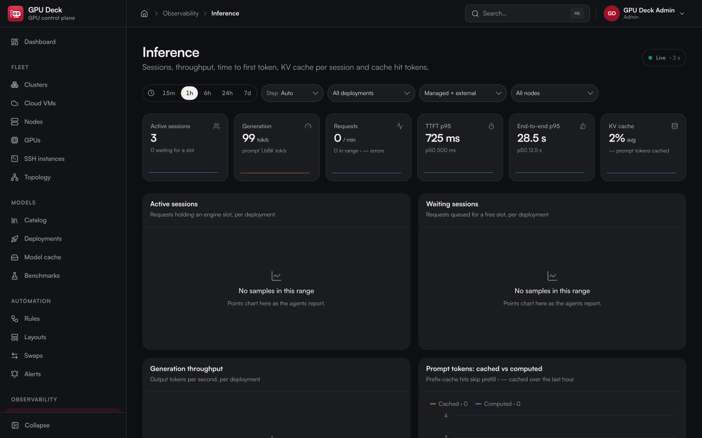

# NVIDIA

Covers NVIDIA data-center and consumer GPUs (Ampere, Ada, Hopper, Blackwell) through the node
agent's NVIDIA device plugin and the engines whose `supported_vendors` includes `nvidia`. The
compatibility code does not distinguish between NVIDIA generations: the same driver minimums and
pinned builds apply across all of them. Where generation matters — mainly slicing — the source
code comment is quoted directly below rather than generalised.

## Status on real hardware

GPU Deck has run on one Hopper-class (H100 / H200) GPU; [TESTING.md](../TESTING.md#nvidia-hopper-gpu)
has the details. Other generations use the same code paths but have not been run.

<!-- cards -->
- **Verified**: device monitoring through NVML (metrics matched `nvidia-smi`); vLLM, embeddings included; the llama.cpp CUDA build; all three API formats through the API layer; slices, weighted routing, failover, auto-heal, idle unload and layout swaps; SSH GPU instances with the GPU passed through.
- **Partial**: SGLang (runs natively once the CUDA toolkit is on the host); TensorRT-LLM (official image; tool-call and reasoning parsing missing, no slices).
- **Awaiting reports**: MIG, Xid tracking, the `nvidia-smi` fallback, tensor and pipeline parallel, multi-node models, vLLM-Omni, SGLang Diffusion, the vLLM and SGLang images, CUDA tools inside an SSH instance, other generations.

vLLM ran from an existing installation through `engine_paths`, not from the pinned image. Fixes
made after that run (engines re-adopted after an agent restart, pooled HTTP/2 connections to the
nodes, the outbound-only tunnel mode, the glibc-based SSH-instance image, among others) are
covered by automated tests and await re-verification on a GPU. Reports from other NVIDIA GPUs
are very welcome; see [SUPPORT.md](../SUPPORT.md).

## Detection

The agent's NVIDIA plugin (`apps/node-agent/crates/gpudeck-devices/src/nvidia/`) uses NVML first
(`libnvidia-ml.so.1`, dlopen'ed — the binary runs without the library present) and falls back to
parsing `nvidia-smi --query-gpu=... --format=csv,noheader,nounits` when NVML cannot be loaded
(for example inside a minimal container). Force the CLI backend with
`GPUDECK_NVIDIA_BACKEND=smi`. Reported per device: name, UUID, driver version, CUDA driver
version, total/used VRAM, utilization, power, temperature, clocks, fan speed, ECC errors,
throttle reasons, and — only through NVML — MIG mode and MIG device list, and Xid critical
events. Xid codes 48 (double-bit ECC), 63 (page retirement / row remap) and 79 (fallen off the
bus) mark the device unhealthy (`FATAL_XIDS` in `nvidia/nvml.rs`).



*GPUs / infra on a real H200 node: utilisation, VRAM, power and temperature per GPU, read through NVML.*



*Inference stats for an observed vLLM server on that node.*

## OS and glibc

Linux (x86_64 and arm64) and native Windows are not evaluated here; the engine artifacts are
pinned for Linux only (see below). Prebuilt Linux engine builds need the glibc of the Ubuntu
release they were built on:

| Build | Built on | glibc needed |
| --- | --- | --- |
| llama.cpp CUDA 12.8 (x86_64) | Ubuntu 24.04 | 2.38+ |
| llama.cpp CUDA 13.5 (arm64) | Ubuntu 24.04 | 2.38+ |
| vLLM / vLLM-Omni / SGLang / TensorRT-LLM (containers) | n/a — run in the pinned image | whatever the image needs; the host only needs a container runtime and the driver |
| SGLang Diffusion (Python wheel) | manylinux_2_34 | 2.34+ |
| whisper.cpp (CPU-only release) | Ubuntu 22.04 | 2.35+ |
| stable-diffusion.cpp (Vulkan build, used on NVIDIA — see below) | Ubuntu 26.04 | that new |

Machines with glibc 2.38 or newer (Ubuntu 24.04, Debian 13, RHEL 10, Fedora 39+) run every pinned
llama.cpp build natively. Older systems (Ubuntu 22.04, Debian 12, RHEL 9) run the x86_64 CPU and
Vulkan builds as is; for CUDA the agent falls back to the official image
(`ghcr.io/ggml-org/llama.cpp:server-cuda-b12464`) when Docker or Podman with the NVIDIA Container
Toolkit is installed, otherwise it refuses with a message naming the glibc it has, the one the
build needs, and these options. Full detail: [DEPLOYMENT.md's Linux requirements per
platform](../DEPLOYMENT.md#linux-requirements-per-platform).

## Driver and runtime minimums

From `DEFAULT_MIN_DRIVER` in `compat.py` and the pinned artifacts in `seed.py`. A missing or
unparseable driver version on the node is a warning (`driver_unverified`), never a hard failure.

| Engine | NVIDIA driver minimum | Source |
| --- | --- | --- |
| llama.cpp CUDA 12.8 (x86_64) | 525.60.13 | artifact `min_driver_version` |
| llama.cpp CUDA 13.5 (arm64) | 580 | artifact `min_driver_version` |
| llama.cpp (no CUDA build applicable / default) | 525 | `DEFAULT_MIN_DRIVER["llama_cpp"]["nvidia"]` |
| vLLM | 580 (CUDA 13.0 image) | `engine_versions.min_driver_version` |
| vLLM-Omni | 580 (CUDA 13.0 image) | same |
| SGLang | 580 (CUDA 13.0 image) | same |
| TensorRT-LLM | 580 (CUDA 13.4 image) | same |
| whisper.cpp, stable-diffusion.cpp | 525 (`DEFAULT_MIN_DRIVER`, not applied in practice — see below) | `DEFAULT_MIN_DRIVER` |

whisper.cpp and stable-diffusion.cpp carry a default NVIDIA minimum in `compat.py`, but neither
has a CUDA-accelerated artifact pinned (see below) — in practice they run on the CPU (whisper.cpp)
or the Vulkan build (stable-diffusion.cpp) on NVIDIA Linux nodes, so the driver minimum there is
whatever the Vulkan build needs (not separately pinned; "not specified").

## What the agent installs vs. what you install

Same split as every accelerator (full table: [DEPLOYMENT.md §"What the agent installs, and what
you install"](../DEPLOYMENT.md#what-the-agent-installs-and-what-you-install)). NVIDIA-specific:

| | Agent | You |
| --- | --- | --- |
| Driver | Nothing — reads NVML / `nvidia-smi` | The NVIDIA driver matching the engine you deploy (see table above) |
| CUDA runtime (llama.cpp) | Bundled: the CUDA runtime + cuBLAS `parts` archive is unpacked alongside the pinned llama.cpp CUDA build | Nothing extra |
| CUDA toolkit (native SGLang Diffusion) | Nothing — it is a Python wheel that pulls its own PyTorch | Python 3.12 on the node |
| Container runtime | Nothing | Docker, Podman or nerdctl, plus the **NVIDIA Container Toolkit** so `--gpus` works, for vLLM, vLLM-Omni, SGLang, TensorRT-LLM and custom container engines |

## Per-engine notes

### llama.cpp (native, router mode)

Pinned build `b12500`. Platform keys and what each needs:

| Platform | Needs | Fallback on older glibc |
| --- | --- | --- |
| `linux/x86_64/cuda` | CUDA 12.8 runtime bundle (installed by the agent), driver ≥ 525.60.13, glibc ≥ 2.38 | official image `server-cuda-b12464` (Docker/Podman + NVIDIA Container Toolkit) |
| `linux/aarch64/cuda` | CUDA 13.5 runtime bundle, driver ≥ 580, glibc ≥ 2.38 | official image `server-cuda13-b12464` |
| `linux/x86_64/vulkan`, `linux/aarch64/vulkan` | `libvulkan1` + the GPU's Vulkan driver | runs as is (built on Ubuntu 22.04 / 24.04) |
| `linux/x86_64`, `linux/aarch64` (CPU) | `libgomp1` | runs as is |

Selection order (`artifacts.py` `ACCELERATOR_ORDER["nvidia"]`): CUDA build first, then Vulkan,
then CPU. Runs in router mode: one `llama-server --models-dir` process per node serves every
loaded model; see [`components/node-agent.md`](../components/node-agent.md) for router behaviour
(restart on an unknown model, `router_overflow`, idle stop).

### vLLM, vLLM-Omni, SGLang, TensorRT-LLM (containers)

Each is the NVIDIA-only image pinned by tag and digest — no native NVIDIA build:

| Engine | Image |
| --- | --- |
| vLLM | `vllm/vllm-openai:v0.34.0@sha256:20fd...` |
| vLLM-Omni | `vllm/vllm-omni:v0.32.0@sha256:f713...` |
| SGLang | `lmsysorg/sglang:v0.5.23@sha256:f832...` |
| TensorRT-LLM | `nvcr.io/nvidia/tensorrt-llm/release:1.3.0@sha256:bb9a...` (`trtllm-serve`, PyTorch backend) |

All four need a container runtime and the NVIDIA Container Toolkit; none has an NVIDIA
requirement beyond the image's own CUDA version and the driver minimum above. TensorRT-LLM
deployments do not parse tool calls or reasoning output yet (per
[TESTING.md](../TESTING.md#known-requirements-and-limits)).

### SGLang Diffusion (native)

A managed Python 3.12 venv with the pinned `sglang==0.5.23` wheel and its `diffusion` extra;
`pip` pulls PyTorch for the node's CUDA at install time. Linux x86_64 and arm64 only (no macOS
wheel). No GPU-specific launch flags beyond the base template; serves image and video model
types through the OpenAI `/v1/images/*` and `/v1/videos` paths.

### whisper.cpp, stable-diffusion.cpp (native, CPU/Vulkan on NVIDIA Linux)

Neither has an NVIDIA CUDA artifact pinned. On an NVIDIA Linux node:

- **whisper.cpp**: the Linux release build is CPU-only (`linux/x86_64` and `linux/aarch64`
  entries carry no accelerator suffix).
- **stable-diffusion.cpp**: there is no `linux/x86_64/cuda` entry, only `linux/x86_64` (CPU),
  `linux/x86_64/vulkan` and `linux/x86_64/rocm`; `artifacts.py`'s selection order for NVIDIA
  (`cuda`, then `vulkan`) finds no `cuda` key and falls through to the Vulkan build.

## Slicing: MIG and MPS

From `apps/node-agent/crates/gpudeck-devices/src/slicing.rs::slice_support(Vendor::Nvidia)`
(`SliceMode::HardwarePartition`, memory isolated, compute enforced, 1% compute granularity):

- **MIG** ("A100/H100/B200 class" GPUs, per the source comment — Ampere, Hopper and Blackwell
  data-center parts): a slice is a MIG instance; the agent passes its MIG UUID (`MIG-GPU-...`) in
  `CUDA_VISIBLE_DEVICES`. `vram_bytes` / `compute_pct` come from the MIG profile (for example
  `1g.10gb` = 1/7 compute).
- **Without MIG**: NVIDIA MPS — a compute share via `CUDA_MPS_ACTIVE_THREAD_PERCENTAGE` and a
  memory cap via `CUDA_MPS_PINNED_DEVICE_MEM_LIMIT=0=<bytes>` — requires
  `nvidia-cuda-mps-control -d` running on the node. Without MPS running, the agent falls back to
  `MemoryCap` mode (engine flags only, no hardware-enforced isolation) with time-slicing.

Device selection env vars: `CUDA_VISIBLE_DEVICES`, `NVIDIA_VISIBLE_DEVICES`. Container `--gpus`
argument is built per device: `device=<index>` for one device, `"device=<a>,<b>"` for several; a
MIG UUID is used in place of the index for a MIG slice
(`apps/node-agent/crates/gpudeck-engines/src/launch.rs::container_device_args`).

## Multi-GPU and multi-node

- **Tensor parallel**: vLLM, vLLM-Omni (TP only, no PP), SGLang, TensorRT-LLM
  (`capabilities.tensor_parallel = true` in `001_init/up.sql`).
- **Pipeline parallel**: vLLM, SGLang, TensorRT-LLM, and llama.cpp since migration `003`
  (`capabilities.pipeline_parallel = true`, added by `003_llamacpp_pipeline_parallel`).
- **Cross-node pipeline parallel** (`apps/node-agent/crates/gpudeck-agent/src/distributed.rs`):
  vLLM gets `--nnodes/--node-rank/--master-addr/--master-port[/--headless]`; SGLang gets
  `--nnodes/--node-rank/--dist-init-addr`; llama.cpp's head rank runs a single-model
  `llama-server --rpc <peers>` and worker ranks run `ggml-rpc-server` (`rpc-server` on older
  builds), flags checked against the pinned build's `--help` output.
- **PD split, speculative decoding, shared KV cache**: capability-gated per engine
  (`001_init/up.sql` `capabilities.pd_split` / `speculative_decoding` / `kv_sharing`) — vLLM,
  SGLang and TensorRT-LLM support prefill/decode split and speculative decoding; vLLM and SGLang
  support shared KV cache; llama.cpp supports speculative decoding only.

## Known limitations

- MIG, Xid tracking and CUDA tools inside an SSH instance have not been run on real NVIDIA
  hardware yet (unit/fixture tests only) — see [TESTING.md](../TESTING.md).
- TensorRT-LLM does not parse tool calls or reasoning output, and does not run on slices.
- whisper.cpp and stable-diffusion.cpp do not use the GPU on NVIDIA Linux nodes out of the box
  (see the per-engine notes above); install your own CUDA build via `engine_paths` if you need
  GPU-accelerated transcription or image generation there.

> [!IMPORTANT]
> Native SGLang needs the CUDA toolkit on the machine for its JIT kernels (a pip install alone
> is not enough) — the agent checks for `CUDA_HOME` / `CUDA_PATH` / `/usr/local/cuda` / `nvcc` on
> `PATH` before loading and refuses with a message naming what is missing. The SGLang container
> image includes the toolkit.

## Prepare this machine (checklist)

<p>
  <picture>
    <source media="(prefers-color-scheme: dark)" srcset="../diagrams/prepare-gpu-machine-dark.svg">
    
  </picture>
</p>

```text
[ ] Install the NVIDIA driver (see the minimum for your engine above; CUDA 13 images need >= 580)
[ ] Confirm it: `nvidia-smi` shows your GPU(s)
[ ] For container engines (vLLM, vLLM-Omni, SGLang, TensorRT-LLM, custom):
    [ ] Install Docker, Podman or nerdctl
    [ ] Install the NVIDIA Container Toolkit and confirm `--gpus all` works
    [ ] Add the agent's service user to the group that can run the container CLI
[ ] For native SGLang Diffusion: Python 3.12 available on PATH
[ ] For MIG: configure MIG profiles before the node joins (the agent only reads the MIG state)
[ ] For MPS: run `nvidia-cuda-mps-control -d` if you plan to use compute-share slices without MIG
[ ] Allow outbound 8443 (hub) and 8444-8445 (API-layer tunnels) to the control plane, and 443
    to Hugging Face / ModelScope (or your mirror); no inbound port is needed
[ ] Direct mode only (private networks): inbound 9443 from the API layer's addresses
[ ] Run the install command from Nodes -> Add node in the web UI
```

## Troubleshooting

| Refusal / symptom | Meaning |
| --- | --- |
| `driver_too_old` | The reported NVIDIA driver is below the engine's minimum (table above) |
| `driver_unverified` (warning, not a refusal) | The node's driver version could not be parsed; the deployment is not blocked, but check `nvidia-smi` output |
| `artifact_missing` | No pinned llama.cpp build matches this platform and the node did not report an operator-installed one; usually glibc too old with no container runtime available |
| `unsupported_engine` naming a glibc | The node's glibc does not meet any pinned build's `min_glibc`, and no container runtime was found; install Docker/Podman, or set `engine_paths` |
| `image_missing` | The engine version has no container image recorded (should not happen for the built-in NVIDIA images; check for a bad custom engine version) |
| `vendor_unsupported` for vLLM-Omni, TensorRT-LLM | These are NVIDIA-only engines; the node reported a different or no vendor |
| `slice_too_small` / `insufficient_vram` | The MIG profile or MPS budget (or whole-device free VRAM) is smaller than the estimate; pick a smaller model, quantization or a bigger slice |
