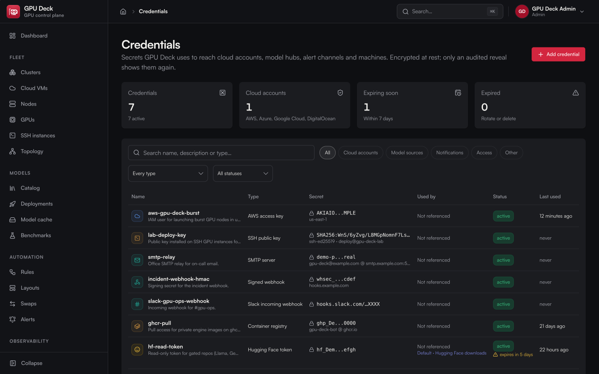
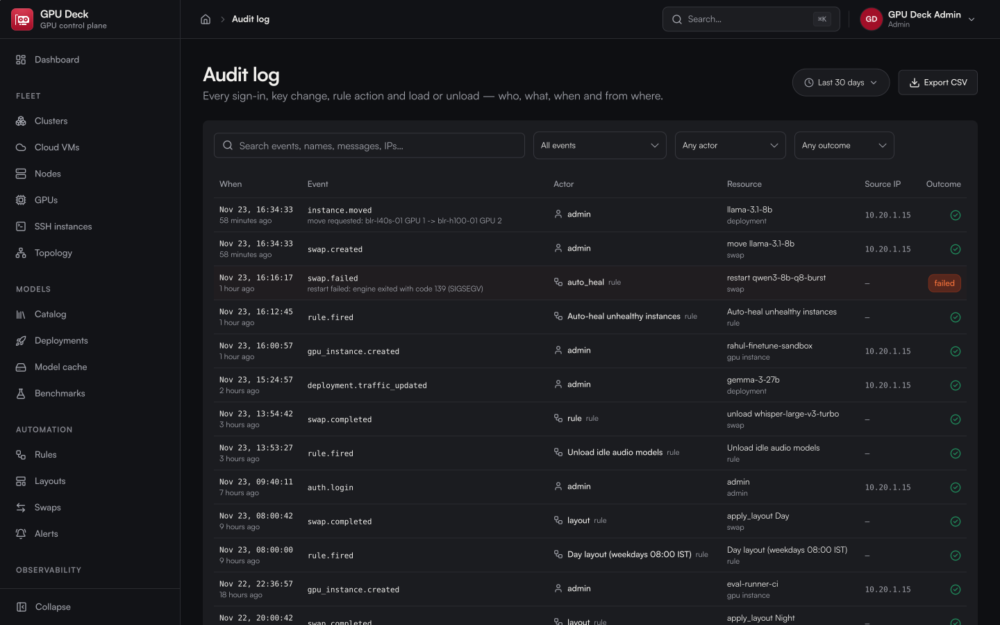

# GPU Deck security

Base rule: **deny everything, then open only the paths below.** A GPU machine trusts exactly one
control plane — the one whose CA it pinned when it joined — and, by default, listens on no port
at all: the agent dials out, and inference reaches the engines over that outbound connection.
Ports are defaults (see `libs/contracts/env.md`). This document maps every network rule and
control to where it is enforced, the threats they answer and how they were verified. The
vulnerability reporting policy is [SECURITY.md](SECURITY.md).

## 1. Network rules

| From | To | Port | Rule | Enforced by |
| --- | --- | --- | --- | --- |
| AI gateway | API layer | 443 → 8181, TLS | Only the gateway's IPs, every call needs an API key | Ingress `sourceRanges` / Helm NetworkPolicy `api-layer` ingress CIDRs; in-app IP rules scope `api_layer` + `GATEWAY_IP_ALLOWLIST` (403 `ip_blocked`, checked before key lookup); API-key auth on every serving route |
| Admin | Control plane UI / admin API | 443 → 3180 / 8180, TLS | Private network or VPN only, never public | Internal ingress / Caddy; NetworkPolicies `web` + `admin-api` accept only the ingress controller; compose binds UI/admin to 127.0.0.1 unless `GPUDECK_BIND`; IP rules scope `admin` (block wins, any allow rule ⇒ allow-list mode) |
| Node agent | Agent hub | 8443, mutual TLS | Agent dials out; the hub must be the pinned one | Hub listener TLS 1.3, client cert required on `/agent/v1/ws` (CN = node id, chained to the internal CA, not in the CRL); the agent accepts the hub only with a certificate chained to the CA pinned at join **and** a key pinned by the signed security policy; no redirects; NetworkPolicy `agent-hub` from node CIDRs only |
| Node agent | API layer tunnel | 8444 (one port per worker), mutual TLS | **Default data path**: the agent dials out, the API layer sends requests back over that connection; the GPU machine needs no inbound port | API layer: TLS 1.3, node certificate required (CN = node id, `O=gpudeck-nodes`, URI SAN, not in the CRL), ALPN h2, handshake cap; agent: server key pinned by the policy, endpoints only from the policy |
| API layer | Node agent proxy | 9443, mutual TLS | **Direct mode only** (local opt-in, private networks): only the API layer's address and key | Agent: source allow-list before TLS (`policy.direct.allowed_source_cidrs`, default private ranges), per-source handshake rate limit, client cert chained to the CA + pinned API-layer key + subject + CRL inside the handshake; bound to the private interface; host firewall (nftables / pf) admits only the allow-listed sources. The API layer verifies the node cert chain and CN == node id |
| Node agent | Engines | localhost only | Engines never listen on a network interface | The agent launches engines bound to 127.0.0.1 on ports from `ENGINE_PORT_RANGE`, refuses one that answers on a network interface (at start and when re-adopting), and the host firewall drops the engine port range and the metrics port from the network; engine admin endpoints (llama.cpp load/unload/slots) are never forwarded |
| Control plane and jobs | PostgreSQL | 5432, TLS | Private network only | NetworkPolicy `data-egress` (database CIDRs); `POSTGRES_SSLMODE=verify-full` + `POSTGRES_SSLROOTCERT` |
| Control plane | Vault (secrets) | private, TLS | Private network only | The vault is the `credentials` table in the same private Postgres (Fernet / MultiFernet at rest, keys only in `VAULT_KEYS`) |
| GPU machines | Hugging Face, ModelScope | 443, TLS | Outbound only, or a mirror for offline sites | Optional egress lock (`firewall_egress_lock`: pf on macOS, nftables on Linux) with `EGRESS_ALLOWLIST_DEFAULT` + per-cluster `egress_allowlist` + the hub + the tunnel endpoints; `HF_ENDPOINT` / `MODELSCOPE_ENDPOINT` for mirrors |
| Admins | GPU machines | 22, SSH | Through a bastion or VPN, keys only | Site firewall / bastion (outside GPU Deck). The host firewall never blocks the ports sshd listens on (detected at install) |
| Users | SSH GPU instances | 2200-2299, SSH | Per instance source CIDRs, keys only | Forwarder on the private interface (public only when the node's own `ssh_bind` says so), resets sources outside the instance's CIDRs (else the cluster default; **none = nobody**); host firewall opens the range only to those CIDRs; container sshd keys only, no password / root login |

Kubernetes: `infra/helm/gpu-deck/templates/networkpolicies.yaml` implements the default deny and
each row above for the control-plane pods. In-cluster node agents run in direct mode on the
cluster network (hostNetwork; NetworkPolicies plus the agent's own allow-list and key pinning).

## 2. Controls

| Control | Implementation |
| --- | --- |
| Machine join | Join tokens (`gdj_` + 40 hex, SHA-256 stored, TTL `JOIN_TOKEN_TTL_MINUTES` 15; one-time by default with an atomic claim, multi-use only when `max_uses` > 1 is asked for, with a TTL of up to a year for node pools; revocable; every join audited with the token used; rate limited `JOIN_RATE_LIMIT`). The install command pins the sha256 of `GET /agent/v1/ca.pem` before it fetches the installer; the installer verifies every download from the hub against that CA only (the system trust store only for a separate download host) and passes `--ca-fingerprint`, which `gpudeck-agent join` requires (`--insecure-skip-ca-pin` to override). The agent sends a CSR; the hub signs it with the internal CA (key in the vault as `internal-ca`) |
| Control-plane pinning | A node security policy signed with the CA key (agent protocol §13), in the join response and every config push: hub and API-layer key pins (SubjectPublicKeyInfo sha256: current, pre-published next, previous during `SERVICE_KEY_ROTATION_GRACE_HOURS`), tunnel endpoints, direct-mode source CIDRs and handshake limits, SSH defaults. Verified against the pinned CA, bound to the node id, monotonic serial (no rollback); a push whose policy fails is rejected whole. Service certificates are re-issued for the same key; `python -m app.services.pki.cli rotate-key` rotates without lock-out |
| Serving transport | Default `tunnel`: the agent dials the API layer (`AGENT_TUNNEL_PORT`, TLS 1.3, node certificate, pinned server key) and serves HTTP/2 over that connection, no inbound port. `direct` (local opt-in in `agent.toml`): proxy on the private interface, source allow-list and rate limit before TLS, pinned API-layer key inside the handshake |
| Host firewall | nftables table `inet gpudeck` / pf anchor `com.apple/gpudeck`, applied and verified by every installer (`firewall=0` / `--no-firewall` to opt out), kept current by the agent (`CAP_NET_ADMIN` in the systemd unit): proxy port only from the allow-listed sources (tunnel: nobody), SSH-instance range only from the instances' CIDRs, metrics and engine ports never from the network, the operator's sshd ports always accepted first. `gpudeck-agent firewall status|apply|remove`. Optional egress lock |
| Inbound monitoring | Rejected attempts (source, rate limit, TLS identity) counted per reason and source, one `ingress_rejected` event per interval; at `NODE_INGRESS_ALERT_THRESHOLD` it is critical and raises a `node.ingress_rejected` alert |
| Self-check | At start the agent audits its listening sockets and refuses to re-adopt an engine reachable on a network interface; `gpudeck-agent security audit` prints every listener and flags anything of GPU Deck's reachable from the network (exit 1) |
| Machine revoke | Revoking a cert closes the hub socket (4003), pushes the CRL to every agent proxy and drops the node from the routing table; certs rotate automatically 30 days before expiry |
| API keys | `gd-` + 48 hex, shown once, stored as SHA-256 only (`key_prefix` = first 12 chars for display). Revoke / suspend / rotate invalidates every API layer process at once (pub/sub `gpu-deck:apikeys:invalidate` + short local cache `API_KEY_LOCAL_CACHE_SECONDS`) |
| Admin password | Argon2id (`argon2-cffi`, `ARGON2_*`), min length `AUTH_PASSWORD_MIN_LENGTH`; seed password re-applied only when the `.env` value changes (stored as HMAC with `SECRET_KEY`) |
| Login limits | Lockout after `AUTH_LOCKOUT_ATTEMPTS` (5) for `AUTH_LOCKOUT_MINUTES` (15) per username; slowapi `RATE_LIMIT_LOGIN_PER_MINUTE` per client IP (forwarded headers trusted only from `TRUSTED_PROXIES`) |
| Sessions | Opaque Fernet tokens (SHA-256 stored), HttpOnly cookie `gpudeck_session`, `Secure` in production, `SameSite=Strict` in production / `Lax` in dev; hard expiry `SESSION_EXPIRE_HOURS` (12) + idle timeout `SESSION_IDLE_TIMEOUT_MINUTES`; password change revokes other sessions |
| CSRF | Pure-ASGI double-submit middleware: cookie `gpudeck_csrf` + `X-CSRF-Token` header, HMAC-bound to the session; bearer-token clients (CLI, Terraform) are exempt because they carry no ambient cookie |
| IP rules | `ip_rules` (scopes `admin`, `api_layer`), block wins, allow rules switch the scope to allow-list mode; cached in Redis + process memory; the API refuses a change that would lock out the caller; client IP from `X-Forwarded-For` only via `TRUSTED_PROXIES` |
| Secrets | Vault (`credentials`): Fernet/MultiFernet with rotation (`VAULT_KEYS`, hourly re-encrypt job); values never logged (`mask` helpers). Typed kinds (architecture.md §2): fields validated against a JSON Schema per kind; secret fields are write-only (list / get return a masked preview and the public fields only; edit replaces a secret only when it is typed again); the plaintext leaves the vault only to the consuming domain (each use writes `credential_usage_history` with its purpose) or through the reveal endpoint, which needs a confirmation in the UI and writes `credential.revealed` + a `reveal` usage row; `test` checks decryption, status and schema without returning anything secret. System credentials (internal CA key, hub / API-layer TLS keys) are hidden from listings and refused by update / delete / reveal (403 `CREDENTIAL_SYSTEM`). Deleting a credential that a cluster, alert channel, model or live cloud VM references is refused (409 `CREDENTIAL_IN_USE`). SSH keys are stored as public keys only |
| Audit | Every admin, rule, swap, key and vault action writes `audit_logs` (actor, IP, user agent, request id, before/after); export CSV; retention `AUDIT_RETENTION_DAYS`; filter by exact, category (`rule`), prefix or glob `event_type` |
| Request limits | Body caps (`MAX_REQUEST_BODY_BYTES`, `MAX_UPLOAD_BODY_BYTES`, `ADMIN_MAX_REQUEST_BODY_BYTES`) enforced before routing; serving timeouts per call site; no quotas on the serving path (the job of the AI gateway in front) |
| Response headers | Security headers on every response (nosniff, frame deny, HSTS, CSP, referrer and permissions policy); branding assets get a sandboxed CSP |
| Request ids | Inbound `X-Request-ID` echoed only when it is a UUID, otherwise a new one; ties audit and usage rows |
| Containers | Compose / Helm run non-root with read-only root FS, tmpfs, dropped capabilities |
| Supply chain | Pinned Python deps (`requirements.txt`), lockfiles for web/agent/CLI; CI produces SBOMs and vulnerability scans for every image |

> [!IMPORTANT]
> Keep the installer's host firewall on (it is applied by default) and leave GPU machines in the
> default tunnel mode unless you need direct mode on a private network: then a GPU machine has no
> listening port at all.

*Credentials: typed, encrypted vault entries; secrets are write-only and never logged.*

*The audit log: every admin, rule, swap, key and vault action, exportable as CSV.*

## 3. Threat model (GPU machines)

Assume every port of a GPU machine is reachable from the internet, and the attacker can run
anything on the same network, scan, present any certificate (self-signed, from another CA, or a
valid certificate issued by our own CA for another purpose), replay a join token seen in a
shell history, and impersonate the control plane on the network path (DNS / ARP / NAT).

| Threat | Control | Result |
| --- | --- | --- |
| Reach an engine, the agent or its metrics from the network | Tunnel mode listens on nothing; engines and metrics bind 127.0.0.1 (self-check, refusal, firewall) | Nothing to connect to |
| Talk to the direct-mode proxy | Source allow-list before TLS, firewall, rate limit; TLS identity pinned to the API layer's key | Reset or TLS alert; never an HTTP byte |
| Use a stolen GPU Deck certificate (node / control-plane / hub-type) as the API layer | Key pinning (SubjectPublicKeyInfo) on top of chain + subject + CRL | TLS alert |
| Impersonate the hub or the API layer to an agent (MITM, spoofed DNS) | CA pinned at join, key pinning from the CA-signed policy, endpoints only from that policy, no redirects | Agent refuses and logs "not pinned" / unknown issuer |
| Push a forged or old policy (compromised hub process, replay) | Policy signed with the CA key, verified against the pinned CA, bound to the node, monotonic serial | Whole push rejected (`config_rejected`) |
| Join a rogue machine | Join tokens single use by default (15 min, atomic claim), multi-use only explicitly; CSR signed with the node id as subject | Replayed token → 401 at join, install script and downloads |
| First-boot interception (TOFU) | `--ca-fingerprint` required; the one-liner pins `ca.pem` by sha256 before fetching anything; downloads from the hub verified against the internal CA only | Install aborts on a mismatch |
| SSH instances open to the world | Fail-closed CIDRs, private bind, firewall | Unreachable until CIDRs are set |
| Lock-out of the operator by the firewall | sshd ports detected and accepted first; guard rules touch GPU Deck ports only | Operator SSH unaffected |
| Bursts of probing go unnoticed | `ingress_rejected` events per interval; critical ones raise `node.ingress_rejected` alerts | Alert with sources and reasons |

## 4. Desktop app (apps/desktop, Tauri 2 remote shell)

The desktop app loads a control plane's own web UI (a remote origin) in its main window, so
the webview IPC is locked down with Tauri 2 capabilities. Auth is unchanged: the session cookie
and CSRF double-submit live in the webview; native code never stores, reads or sends credentials.

| Surface | Allowed | Enforced by |
| --- | --- | --- |
| Remote server page (main window) → native | Only `notify` and `set_tray_status`, only from the origin of a **saved** server that is currently connected | Runtime capability per origin (`remote.urls = ["<origin>/*"]`, `local: false`, window/webview `main`, permissions `allow-notify` + `allow-set-tray-status`) added at connect time (`src-tauri/src/windows.rs::grant_ipc`); the app ACL (`build.rs` app manifest) makes every app command require an explicit `allow-<cmd>`; both handlers re-check window label, caller origin == connected origin, origin still saved |
| Remote page → plugins (fs, shell, opener, store, notification JS, updater, deep-link, event emit/listen) | Nothing | No plugin permission is granted to any remote origin; the opener plugin is not registered (Rust `open_url` only) |
| Connect screen (bundled, `connect` window) → native | 7 server-list commands, event listen/unlisten, window dragging | `capabilities/connect-screen.json` (`local: true`, `windows: ["connect"]`), handlers check the window label; CSP `default-src 'self'` (+ Fontshare CSS/fonts). `freezePrototype` stays off: Tauri injects it into every page, including the server's web UI, where it breaks libraries (recharts) |
| Payloads from the server page | Display text and in-app paths only | `status.rs`: control characters stripped, lengths capped (title 120, body 400, 5 tray items × 80), paths must resolve inside the server origin; notifications rate limited 10/min |
| Main window navigation | Same origin as the server; `blob:`/`data:` downloads go to the Downloads folder | `on_navigation` / `on_new_window`: other http(s) links open in the system browser, `target=_blank` never creates a window |
| Server URLs | `https://` by default; `http://` only for loopback, RFC 1918, CGNAT, link-local, IPv6 ULA, `localhost`, `*.local` (shown with a warning); no userinfo, path, query or fragment | `servers.rs::normalize_server_url` (re-applied when the store is loaded, so a hand-edited store cannot widen the allowlist); mirrored in the connect screen |
| Server check | Unauthenticated `GET /api/v1/branding` + `/api/v1/health`, no cookies, no redirects, 256 KB cap, 6 s timeout, OS trust store | `probe.rs` (reqwest + rustls platform verifier) |
| Deep links `gpudeck://open?server=…&path=…` | Connect only to saved servers; unknown servers open the connect screen prefilled (never auto-connect); path validated as above | `deeplink.rs` |
| Auto-update | Off unless built with an https endpoint and a minisign public key; artifacts verified against the embedded key | `updater.rs`, [desktop.md](components/desktop.md) |
| Persisted data | `servers.json` in the app config dir: names, URLs, last used, window geometry | `state.rs`; cookies stay in the OS webview store |

## 5. Verification (2026-11-24)

**Harness:** `apps/node-agent/testing/security/run.sh`. Two GPU machines in Ubuntu 24.04 containers
(systemd, nftables, a simulated NVIDIA GPU, the test engine as `llama-server`, an operator sshd on
port 2222 — inside the SSH-instance range on purpose), joined with the real one-line install
command to a local control plane: node T in the default tunnel mode, node D in direct mode with
the cluster's `proxy_allowed_source_cidrs` = the API layer's address + one "insider" address. An
attacker container and the insider container sit on the same Docker network. A model is deployed
on each node and called through the real API layer before and after the attacks.

| # | Attack (from) | Expected | Result |
| --- | --- | --- | --- |
| 1 | Full TCP scan of node T, 65535 ports (attacker) | Nothing of GPU Deck's open | PASS — only 2222 (operator sshd, preserved); also with the firewall removed: 65534 closed, 2222 open (the agent has no listener) |
| 2 | Full TCP scan of node D (attacker, not allow-listed) | Proxy unreachable | PASS — 9443 filtered by the host firewall; only 2222 open |
| 3 | Engine (10240-10340), metrics (9100), SSH-instance (2200-2299) ports, both nodes | Closed | PASS — 0 open; an engine port deliberately bound to 0.0.0.0 was flagged `EXPOSED` by `security audit` and still filtered by the firewall |
| 4 | TLS to node D :9443 from a non-allow-listed address, firewall removed | Closed before TLS | PASS — connection reset (`errno=104`), no TLS ServerHello, no HTTP |
| 5 | TLS to node D :9443 from the allow-listed insider: no client cert / self-signed / another CA (CN=api-layer) / a valid GPU Deck control-plane cert / a valid GPU Deck hub-type cert | TLS failure, no HTTP | PASS — alerts `certificate required`, `certificate unknown`, `unknown ca`, `handshake failure` ×2; not one HTTP byte |
| 6 | Handshake flood, 60 in a row from one source (insider) | Rate limited | PASS — 20 reached TLS, 40 reset before TLS; a critical `node.ingress_rejected` alert with source 172.30.99.60 and reasons `rate_limited`, `no_client_certificate` |
| 7 | Replay the used one-time join token at `/agent/v1/join`, `/install.sh`, `/downloads` (attacker) | Refused | PASS — 401 `JOIN_TOKEN_INVALID` / 401 / 401 |
| 8 | Connect to the API layer's tunnel listener :8444 with no cert / self-signed / another CA / a valid GPU Deck control-plane cert (attacker) | No HTTP/2 frame | PASS — closed without a byte; counted as `tls_handshake_failed` / `node_identity_rejected` |
| 9 | Spoof the tunnel endpoint (node T's path redirected to the attacker): self-signed / another CA / our CA with an unpinned key | Agent refuses | PASS — `CaUsedAsEndEntity`, `UnknownIssuer`, "API layer tunnel key … is not pinned by the security policy"; no request served |
| 10 | Spoof the hub: a hub-type certificate for `localhost` from our own CA with a fresh key | Agent refuses | PASS — "agent hub key … is not pinned by the security policy" |
| 11 | Forged policy (another CA), rolled-back policy (older serial), another node's policy pushed over the hub | Push rejected whole | PASS (`tests/secure_transport_e2e.rs`) — `config_rejected`, policy unchanged |
| 12 | The real API layer, both modes, before and after the attacks | Works | PASS — 30/30 streamed chat completions per node through `/v1/chat/completions` (tunnel and direct), served by the right node |

`gpudeck-agent security audit` on both nodes afterwards: metrics and engine loopback-only, node D's
proxy on its private address only, node T nothing on the proxy port, 2222 reported as the
operator's SSH port; `firewall status`: current plan loaded.

**Latency, tunnel vs direct.** `tests/secure_transport_e2e.rs::tunnel_vs_direct_latency_with_simulated_rtt`
puts a relay that delays every segment by 10 ms each way (20 ms RTT) between the API-layer
stand-in and the agent, 60 warm streamed requests per mode, interleaved:

| Mode | TTFB p50 | TTFB p95 | Total p50 | Cold first request |
| --- | --- | --- | --- | --- |
| Direct | 24.58 ms | 24.87 ms | 30.49 ms | 57.04 ms (TCP + TLS + request) |
| Tunnel | 24.58 ms | 25.71 ms | 30.34 ms | 31.66 ms (already connected) |

Warm requests cost one round trip in both modes (the test asserts the tunnel adds < 3 ms at p50;
measured +0.00 ms); the tunnel saves the handshake round trips on a cold path. Through the real
Python API layer and the containers above: 46.4 ms (tunnel) vs 46.9 ms (direct) TTFB p50.

**Needs real hardware / cloud:** a multi-replica API layer on Kubernetes with tunnels (each worker
must be reachable individually; the chart runs in-cluster agents in direct mode), pf on a macOS
LaunchDaemon install across a reboot, nftables coexistence with ufw / firewalld / cloud images and
a cloud provider's security groups, tunnel behaviour across real WAN links and NATs with idle
timeouts.

## 6. Reporting

Security issues: report them privately through GitHub security advisories (see [SECURITY.md](SECURITY.md)); do not open public issues.
