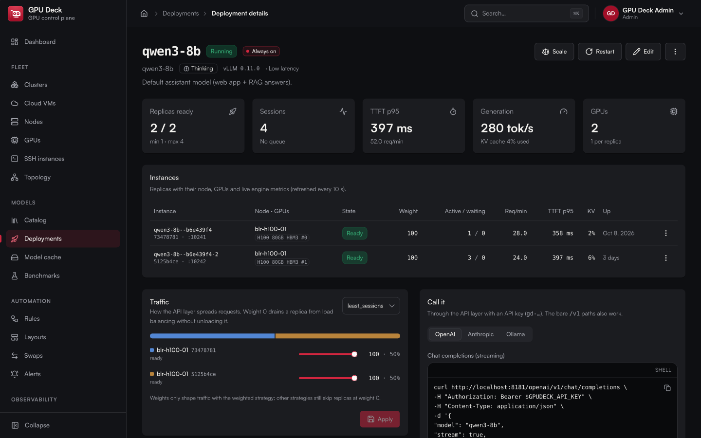

# Serving API contract (API layer, :8181)

The data plane. Pure pass-through from any AI gateway in front of GPU Deck (or any client) to engines via the node agent proxies. Implemented in `app/api/serving/{openai,anthropic,ollama}` and `services/{serving,metering,billing}`. This document is the contract for the API layer, the web "API keys" screens, the CLI and the Rust proxy (the §7 routing table consumer).

<p>
  <picture>
    <source media="(prefers-color-scheme: dark)" srcset="../../../docs/diagrams/request-path-dark.svg">
    
  </picture>
</p>

## 1. Endpoints

All formats are mounted on the same process. Explicit prefixes always work; the bare paths are kept for drop-in compatibility and disambiguated as in §2.

| Format | Explicit prefix | Bare paths (compat) | Endpoints |
| --- | --- | --- | --- |
| OpenAI | `/openai/v1/...` | `/v1/...` | `POST chat/completions`, `POST responses`, `GET responses/{id}` (async video/batch responses), `DELETE responses/{id}`, `POST responses/{id}/cancel`, `POST completions`, `POST embeddings`, `POST rerank` (Jina/Cohere-style body, also `/v1/reranking`), `POST audio/transcriptions`, `POST audio/translations`, `POST audio/speech`, `POST images/generations`, `POST images/edits`, `POST videos`, `GET videos/{id}`, `GET videos/{id}/content`, `DELETE videos/{id}`, `GET videos`, `GET models`, `GET models/{model}` |
| Anthropic | `/anthropic/v1/...` | `/v1/...` | `POST messages`, `POST messages/count_tokens`, `POST messages/batches`, `GET messages/batches`, `GET messages/batches/{id}`, `GET messages/batches/{id}/results` (JSONL), `POST messages/batches/{id}/cancel`, `DELETE messages/batches/{id}`, `GET models`, `GET models/{model}` |
| Ollama | `/ollama/api/...` | `/api/...` | `POST chat`, `POST generate`, `POST embed` (and legacy `POST embeddings`), `GET tags`, `POST show`, `GET ps`, `GET version`. Everything else under `/api/*` (`pull`, `push`, `create`, `delete`, `copy`, `blobs`) → `404 {"error":"not supported by GPU Deck; manage models in the control plane"}` |
| Common | — | `/health` (public, no key; 200 when routing table loaded and ≥ 1 node reachable, else 503), `/metrics` (Prometheus, `PROMETHEUS_SCRAPE_TOKEN`) | |

Anthropic-only extras supported on `/v1/messages`: streaming, tools (`tools`, `tool_choice`, parallel), extended thinking (`thinking: {type: enabled, budget_tokens}`), images and documents in content blocks, `system`, `stop_sequences`, `metadata`, and **compaction** / context management (`context_management` with `edits: [{type: "compact_..."}]` as per the current Anthropic beta header `context-management-2025-06-27`; when the engine does not support it the API layer performs the compaction itself with the same model and returns the standard Anthropic response shape — the only non-pass-through work besides batches).

## 2. Path prefix scheme and `/v1/models` disambiguation

Both OpenAI and Anthropic use `/v1/models` and `/v1/models/{model}`. Resolution order for **bare** `/v1/...` paths:

1. Path is unique to a format → that format (`/v1/messages*` Anthropic; `/v1/chat/completions`, `/v1/responses`, `/v1/completions`, `/v1/embeddings`, `/v1/rerank`, `/v1/audio/*`, `/v1/images/*`, `/v1/videos*` OpenAI).
2. Shared path (`/v1/models*`): `anthropic-version` request header present → Anthropic shape; else `x-api-key` header present **and** no `Authorization` header → Anthropic shape; else OpenAI shape.
3. Explicit prefixes (`/openai/`, `/anthropic/`, `/ollama/`) override everything; use them in gateway configuration.

> [!TIP]
> In an AI gateway or any shared configuration, use the explicit prefixes (`/openai/v1`,
> `/anthropic/v1`, `/ollama/api`): they never depend on which headers a client sends.

Clients that cannot set headers (Ollama CLI, some SDKs) use the explicit prefix as base URL: `OPENAI_BASE_URL=https://host/openai/v1`, `ANTHROPIC_BASE_URL=https://host/anthropic`, `OLLAMA_HOST=https://host/ollama`.

`/v1/models` (OpenAI) lists every model whose deployment has ≥ 1 `ready` instance plus aliases (`id` = serving name, `owned_by` = `gpudeck`, `created` = deployment created_at epoch; extension fields `gpudeck: {type, deployment_id, engine, ready_replicas, aliases, model, deployments}`). When several deployments serve one model, the model name is listed once (`gpudeck.deployments` = `[{id, name, engine}]`, traffic balanced across all of them) **and** each deployment is listed under its own deployment name (`gpudeck.model` = the model it serves); see §5 "Addressing one deployment". Anthropic `/v1/models` returns `{data: [{type: "model", id, display_name, created_at}], has_more, first_id, last_id}`. Ollama `/api/tags` returns `{models: [{name, model, modified_at, size, digest, details: {family, format, parameter_size, quantization_level}}]}` from model versions; `/api/ps` lists loaded instances with `size_vram`, `expires_at` (null — GPU Deck rules decide), `/api/show` returns model metadata + `template`/`parameters` when known.

`SERVING_LIST_UNLOADED_MODELS=true` additionally lists models with a deployment but no ready instance (so a request can trigger on-demand load, see §5).

## 3. Authentication

| Header | Formats | Notes |
| --- | --- | --- |
| `Authorization: Bearer gd-...` | all | Preferred for OpenAI and Ollama clients |
| `X-API-Key: gd-...` | all | `WWW-Authenticate: ApiKey` on 401 |
| `x-api-key: gd-...` | Anthropic | Anthropic SDK default; same key namespace |

Key format `gd-` + 48 hex (`API_KEY_PREFIX`, default `gd-` — product-specific so GPU Deck keys are not mistaken for OpenAI `sk-` keys; keys issued under another prefix keep working because lookup is by hash of the full key). Lookup: SHA-256 → process-local cache (`API_KEY_LOCAL_CACHE_SECONDS`) → Redis `gpu-deck:apikey:{hash}` (TTL `API_KEY_CACHE_TTL_SECONDS` 60 s, invalidated on revoke/suspend/rotate via pub/sub `gpu-deck:apikeys:invalidate`) → DB. Rejections: missing → 401, unknown → 401 `invalid_api_key`, `status != active` → 401 `api_key_<status>`, `expires_at` passed → 401 `api_key_expired`. No quotas or rate limits here (gateway's job). The request's IP must pass `ip_rules` scope `api_layer` and `GATEWAY_IP_ALLOWLIST` (403 `ip_blocked`), checked **before** key lookup.

The `anthropic-version` header is accepted and echoed; any value is allowed (`2023-06-01` default). `anthropic-beta` is passed through to engines that speak Anthropic natively and parsed for context-management otherwise.

## 4. Error shapes

| Format | Body | Notes |
| --- | --- | --- |
| OpenAI | `{"error": {"message": "...", "type": "<type>", "param": null, "code": "<code>"}}` | types: `invalid_request_error` (400/404/413/415/422), `authentication_error` (401), `permission_error` (403), `rate_limit_error` (429, only `instance_busy`), `server_error` (500/502/503/504); codes: `invalid_api_key`, `api_key_expired`, `api_key_revoked`, `api_key_suspended`, `ip_blocked`, `model_not_found`, `model_not_ready`, `model_type_mismatch`, `request_too_large`, `request_timeout`, `upstream_error`, `upstream_timeout`, `instance_busy`, `no_instance_available`, `unsupported_endpoint`, `internal_error` |
| Anthropic | `{"type": "error", "error": {"type": "<type>", "message": "..."}}` | types: `invalid_request_error` (400), `authentication_error` (401), `permission_error` (403), `not_found_error` (404), `request_too_large` (413), `rate_limit_error` (429), `api_error` (500), `overloaded_error` (503/529 — GPU Deck sends 503); the GPU Deck code goes in `message` suffix `[code=...]` and header `x-gpudeck-error-code` |
| Ollama | `{"error": "<message>"}` | status codes as OpenAI; code in header `x-gpudeck-error-code` |

Unknown routes / methods (no route matched, 404/405) use the same shapes with header `x-gpudeck-error-code: unsupported_endpoint`: OpenAI `{"error": {"message": "Not Found", "type": "api_error", "code": ...}}`, Anthropic `not_found_error`, Ollama `{"error": "Not Found"}`. Only the Ollama model-management paths (`pull`, `push`, `create`, `delete`, `copy`, `blobs/*`) answer "not supported by GPU Deck; manage models in the control plane".

Streaming errors after headers were sent: OpenAI → `data: {"error": {...}}\n\n` then `data: [DONE]`; Anthropic → `event: error\ndata: {"type":"error","error":{...}}\n\n`; Ollama → a final JSON line `{"error": "...", "done": true}`.

Status mapping from the agent proxy / engine: connection refused or TLS failure → 502 `upstream_error` and the instance is ejected from routing for `SERVING_EJECT_SECONDS` (10 s) with failover to another instance **before** any bytes were sent; `503 instance_draining`/`instance_busy` from the proxy → retry on another instance (max `traffic_config.max_retries`); engine 4xx → passed through unchanged (body and status); engine 5xx → passed through with `upstream_error` code header.

## 5. Routing and load balancing



*A deployment's replicas with their live sessions and traffic weights, the input to the strategies below.*

- Routing table (§7) maps serving name/alias → deployment → ready instances with weights. Strategy per deployment `traffic_config.strategy`: `least_sessions` (default; uses live `active_sessions` pushed by the hub into the table every 2 s), `round_robin`, `weighted` (by `traffic_weight`). Weight 0 = never selected. Instances with `health != healthy` or `accepting=false` are skipped.
- **Latency-aware selection** (`least_sessions`, on unless `SERVING_LATENCY_ROUTING=false`): every API layer probes its round trip to each connected node over the path requests use (one `GET /_health` on the warm HTTP/2 connection or the agent's tunnel every `SERVING_RTT_PROBE_SECONDS`, EWMA + jitter; no extra round trip per request) and picks the replica with the lowest expected latency `rtt + SERVING_LATENCY_LOAD_PENALTY_MS × sessions / capacity ÷ (weight/100)` (sessions = live active + waiting + this process's in-flight; capacity = `max_concurrent`, else `SERVING_LATENCY_DEFAULT_CAPACITY`). Replicas within `SERVING_LATENCY_TOLERANCE_MS` of the best share the load (least loaded, then weighted random). The nearest replica takes the traffic until its load penalty outweighs the extra round trip to the next one. A node without a measurement counts as the farthest measured one; with no measurement at all the plain least-sessions rule applies. Failover, ejection and the other strategies are unchanged.
- Model type check: an endpoint only routes to a deployment whose `model_type` is allowed for it (chat/thinking/vision → chat, responses, messages, ollama chat/generate; embedding → embeddings/embed; rerank → rerank; stt → transcriptions/translations; tts → audio/speech; image → images/*; video → videos). Mismatch → 400 `model_type_mismatch`.
- **No ready instance**: if the deployment exists with `desired_running=true` and an instance is `loading`, the request waits up to `SERVING_NO_INSTANCE_WAIT_SECONDS` (default 30; set by swaps) then 503 `model_not_ready` + `Retry-After`. If no instance is loading and `SERVING_ON_DEMAND_LOAD=true`, the API layer asks the control plane to start the deployment (`POST /deployments/{id}/start` internal call) and waits the same window. Otherwise 503 `model_not_ready`.
- **Addressing one deployment**: every deployment is also routable by its own name (deployment names are unique, case-insensitive). `model: "qwen3-0.6b"` balances across all deployments of that model; `model: "qwen3-0.6b-sglang"` (a deployment name) goes only to that deployment's instances with its own traffic settings. A deployment name that equals a model name or alias is not added (the model wins). Per-deployment names are listed in `/v1/models` only when the model name is shared by ≥ 2 deployments; they always resolve. Metering records the deployment either way; the response `model` field echoes the requested name.
- Model name rewrite: request `model` is replaced by `instances.served_model_name` before forwarding; the response `model` field is rewritten back to the requested name (string replace in JSON / SSE frames; off with `SERVING_REWRITE_RESPONSE_MODEL=false`).
- Translation: engines speak OpenAI natively (llama.cpp, vLLM, SGLang, TRT-LLM, MLX, mlx-audio, vLLM-Omni). Anthropic `/v1/messages` → OpenAI chat/completions (translator extended with thinking ↔ `reasoning_content`/`<think>` handling per `models.family`, tool parsers, image/document blocks) → Anthropic response/SSE. Ollama `/api/chat|generate|embed` → OpenAI chat/completions|completions|embeddings → Ollama NDJSON. whisper.cpp (`/inference`) and stable-diffusion.cpp (`/txt2img`, `/img2img`) have engine-specific bodies; the API layer translates OpenAI audio/image requests to them.
- Streaming: SSE/NDJSON forwarded chunk-by-chunk (`X-Accel-Buffering: no`, no gzip). Client disconnect cancels the upstream request.

## 6. Usage extraction (metering)

> [!NOTE]
> Metering and billing pages and their admin endpoints (`/usage/*`, `/billing/*`, `/price-plans`) are planned for v2. The recording below already runs in v1: it feeds the request and token figures on the dashboard and the API key pages (`/metrics/usage`).

Recorded after the response completes (streams: after the last frame), enqueued to Celery queue `metering` (`enqueue_usage_event`, never raises). One `usage_events` row per request; batches write one row per item.

| Format / endpoint | input_tokens | output_tokens | cached_tokens | reasoning_tokens | media_units | notes |
| --- | --- | --- | --- | --- | --- | --- |
| OpenAI chat/completions, completions (JSON) | `usage.prompt_tokens` | `usage.completion_tokens` | `usage.prompt_tokens_details.cached_tokens` | `usage.completion_tokens_details.reasoning_tokens` | 0 | llama.cpp `timings.cache_n` used for cached when `prompt_tokens_details` absent |
| OpenAI chat/completions (SSE) | last frame with `usage` | same | same | same | 0 | API layer sets `stream_options.include_usage=true` on the upstream request **and forwards the extra usage chunk to the client unchanged** (all official SDKs tolerate it). If no usage frame arrives: `output_tokens` = count of frames with non-empty `delta.content`/`delta.reasoning_content`, `input_tokens` = engine-reported later via session sample if available else `null` → 0 with `metadata.estimated=true` |
| OpenAI responses (JSON / SSE `response.completed`) | `usage.input_tokens` | `usage.output_tokens` | `usage.input_tokens_details.cached_tokens` | `usage.output_tokens_details.reasoning_tokens` | 0 | |
| OpenAI embeddings | `usage.prompt_tokens` | 0 | 0 | 0 | 0 | |
| OpenAI rerank | `usage.prompt_tokens` or `meta.billed_units.search_units`→tokens if only that | 0 | 0 | 0 | 0 | |
| OpenAI audio/transcriptions, translations | `usage.input_tokens` if present (0 otherwise) | `usage.output_tokens` if present | 0 | 0 | audio seconds (`usage.seconds` / `duration` from `verbose_json` / parsed from the uploaded file header) | |
| OpenAI audio/speech | `usage.input_tokens` if present else `len(input)` chars/4 estimate (`metadata.estimated=true`) | 0 | 0 | 0 | output audio seconds (from bytes ÷ format bitrate; `response_format` known) | |
| OpenAI images/generations, edits | `usage.input_tokens` if present | `usage.output_tokens` if present | 0 | 0 | number of images (`n`) × size factor 1 | |
| OpenAI videos | 0 | 0 | 0 | 0 | seconds of generated video (`seconds` param) | one row when the job completes (`status=completed`), status `error` if it fails |
| Anthropic messages (JSON) | `usage.input_tokens` + `cache_creation_input_tokens` + `cache_read_input_tokens` (total prompt) | `usage.output_tokens` | `usage.cache_read_input_tokens` | 0 (thinking tokens are inside output_tokens) | 0 | `metadata.cache_creation_input_tokens` kept separately |
| Anthropic messages (SSE) | `message_start.message.usage.input_tokens` (+ cache fields), updated by `message_delta.usage` when present | `message_delta.usage.output_tokens` (cumulative, last wins) | as JSON | 0 | 0 | |
| Anthropic count_tokens | 0 | 0 | 0 | 0 | 0 | `request_count=1`, `endpoint=messages/count_tokens`, free (cost 0) |
| Anthropic batches | per item as JSON | | | | | `endpoint=messages/batches`, `metadata.batch_id` |
| Ollama chat, generate (final `done:true` object) | `prompt_eval_count` | `eval_count` | 0 (Ollama has no cached field; llama.cpp `timings.cache_n` when the translation layer sees it) | 0 | 0 | `latency_ms` from `total_duration` ns when present; `ttft_ms` = `prompt_eval_duration`/1e6 |
| Ollama embed | `prompt_eval_count` | 0 | 0 | 0 | 0 | |

Common fields: `latency_ms` = response end − request start at the API layer; `ttft_ms` = first content byte − start (streams only, else null); `gpu_count` = deployment `gpu_count`; `gpu_seconds` = the request's **busy share** (informational; billable GPU time comes from instance uptime): `latency_ms/1000 × gpu_count × (slice_compute_pct or 100)/100 ÷ max(1, concurrent active requests on that instance at start)`; `cost_usd` = **token cost only**: `(input − cached)/1000 × usd_per_1k_input_tokens + cached/1000 × usd_per_1k_cached_tokens + output/1000 × usd_per_1k_output_tokens` (cached tokens are part of `input_tokens`, so they are billed once, at the cached rate; `usd_per_1k_cached_tokens` null → the input rate) using the node's plan, else the cluster's, else the default plan, else 0; `status` = success (2xx), error (4xx/5xx), timeout, cancelled (client disconnect); `request_count` = 1 (Anthropic batch rows: 1 per item).

**Billable GPU time** is computed from instance uptime, not per request: every instance-minute in `ready`/`draining` gets the instance's share of its GPUs (per device: a slice claims `compute_pct/100`, a whole-GPU instance 1; when everything on one device in that minute — managed instances, observed engines, SSH GPU instances — claims more than the device, the device-minute is split by VRAM share, each capped at its claim, so **one GPU never bills more than one GPU-minute per minute**; loaded-but-idle instances keep their share; instances without device ids fall back to `gpu_count × slice_fraction`), and those GPU-minutes are allocated to the API keys that used the instance in that minute, pro-rata by tokens processed (by requests when the minute has no tokens); minutes without traffic go to the `unallocated` bucket (`api_key_id IS NULL`, the cost of keeping a model loaded). The result lives in `usage_rollups_hourly.gpu_seconds`, whose `cost_usd` = token cost + allocated GPU minutes × `usd_per_gpu_minute` of the node's plan. In v2, billing reports will re-price with the current plans; the summary and estimate show the write-time cost.

SSH GPU instances (not serving traffic) write one `usage_events` row per metered window with `endpoint = gpu_instance` (`gpu_seconds` = window × GPUs × slice, `api_key_id`/`model_id`/`deployment_id` null, `metadata.kind = gpu_instance`). The rollup adds those GPU-seconds to the bucket's billable GPU time for that node (priced with the node plan), takes their claim off the device capacity left for engine instances in the same minutes, and never counts them as requests or latency.

Hourly rollups: the `metering.rollup` beat task upserts `usage_rollups_hourly` for the previous hour (and re-runs the current hour every 5 minutes) grouped by `(bucket, api_key_id, model_id, node_id, deployment_id)`; `api_keys.total_requests` and `last_used_at`, `deployments.last_request_at`, `instances.last_request_at` are updated by the same task.

## 7. Routing table (internal contract: control plane → API layer)

Key `gpu-deck:routing:v1` in Redis (JSON), rewritten by the control plane on every instance/deployment/node/cert change and every 2 s with live session counts; pub/sub channel `gpu-deck:routing:updated` carries the new `version`. The API layer loads it at boot, subscribes, and keeps an in-memory copy; **no DB read on the request path**. Fallback: poll every 5 s if pub/sub is silent.

```json
{
  "version": 1234, "generated_at": "2026-11-16T10:00:00Z",
  "models": {
    "qwen3-0.6b": {
      "model_id": "…", "type": "chat", "aliases": ["qwen3"], "family": "qwen3",
      "deployment_id": "…", "priority": "normal", "desired_running": true,
      "traffic": {"strategy": "least_sessions", "failover": true, "max_retries": 1, "health_eject": true},
      "native_formats": ["openai"],
      "tool_parser": "hermes", "context_size": 8192,
      "instances": [
        {"instance_id": "…", "node_id": "…", "proxy_url": "https://10.0.0.5:9443", "served_model_name": "qwen3-0.6b-q4",
         "engine": "llama_cpp", "state": "ready", "health": "healthy", "accepting": true, "weight": 100,
         "active_sessions": 2, "waiting_sessions": 0, "max_concurrent": null, "pd_role": null,
         "deployment_id": "…"}
      ],
      "deployment_ids": ["…"], "deployments": [{"id": "…", "name": "qwen3-0.6b", "engine": "llama_cpp"}]
    },
    "qwen3-0.6b-sglang": {
      "model_id": "…", "type": "chat", "aliases": [], "deployment_id": "…",
      "deployment_name": "qwen3-0.6b-sglang", "model_name": "qwen3-0.6b", "listed": true,
      "instances": ["… only this deployment's instances …"]
    }
  },
  "nodes": {"<node_id>": {"name": "mac-1", "proxy_url": "https://10.0.0.5:9443", "status": "online", "cert_fingerprint": "…"}},
  "crl": {"generated_at": "…", "serials": [], "fingerprints_sha256": []},
  "ca_bundle_pem": "…"
}
```

The API layer dials `proxy_url` with its client cert (`API_LAYER_CLIENT_CERT_PATH/KEY_PATH`), verifies the node cert against `ca_bundle_pem` and rejects fingerprints in `crl` (defence in depth; the hub already closes revoked nodes). Request path: `POST {proxy_url}/instances/{instance_id}/v1/chat/completions` with headers from `protocol.md` §6.

## 8. Required response headers

| Header | Value | Formats |
| --- | --- | --- |
| `X-Request-ID` | uuid generated at ingress (echoed if the client sent one that parses as uuid) | all |
| `request-id` | same value | Anthropic (SDK reads it) |
| `anthropic-version` | echo of the request header or default | Anthropic |
| `openai-processing-ms` | integer ms | OpenAI |
| `x-gpudeck-model` / `x-gpudeck-deployment` / `x-gpudeck-instance` / `x-gpudeck-node` | ids | all (omitted when `SERVING_EXPOSE_ROUTING_HEADERS=false`) |
| `x-gpudeck-error-code` | code | all, on errors |
| `Server-Timing` | phase durations (§10); off with `SERVING_SERVER_TIMING=off` | all |
| `Cache-Control: no-store` | | all |
| `X-Accel-Buffering: no` + `Content-Type: text/event-stream` (OpenAI/Anthropic) or `application/x-ndjson` (Ollama) | | streams |
| `Retry-After` | seconds | 429/503 |

## 9. Request limits (env, see `env.md`)

| Env | Default | Applies to |
| --- | --- | --- |
| `SERVING_MAX_JSON_BODY_BYTES` | 16 MiB | chat/messages/responses/completions/embeddings/rerank/speech/ollama |
| `SERVING_MAX_UPLOAD_BYTES` | 256 MiB | audio transcriptions/translations, image edits (multipart) |
| `SERVING_MAX_INPUT_ITEMS` | 2048 | embeddings `input` array length, rerank `documents` |
| `SERVING_REQUEST_TIMEOUT_SECONDS` | 600 | total time per request (non-video) |
| `SERVING_STREAM_IDLE_TIMEOUT_SECONDS` | 120 | max gap between stream frames |
| `SERVING_CONNECT_TIMEOUT_SECONDS` | 5 | TCP/TLS to the agent proxy |
| `SERVING_VIDEO_JOB_TIMEOUT_SECONDS` | 3600 | async video jobs |
| `SERVING_MAX_CONCURRENT_REQUESTS` | 1024 | per API-layer process (503 `instance_busy` beyond) |
| `SERVING_BATCH_MAX_ITEMS` / `SERVING_BATCH_MAX_BYTES` | 10000 / 256 MiB | Anthropic batches |
| `SERVING_BATCH_EXPIRES_HOURS` | 24 | batch lifetime; results kept `SERVING_BATCH_RESULTS_RETENTION_DAYS` 29 |

Oversized → 413 `request_too_large`; timeouts → 504 `upstream_timeout` (or stream error frame).

## 10. Server-Timing and the request timing breakdown

Every serving response carries a [`Server-Timing`](https://www.w3.org/TR/server-timing/) header with where the time went inside GPU Deck, in milliseconds:

```
Server-Timing: route;dur=0.1, queue;dur=0.0, connect;dur=0.0, rtt;dur=18.4, net;dur=19.0, engine;dur=30.6, upstream;dur=50.2, total;dur=53.0
```

| Metric | Meaning |
| --- | --- |
| `route` | Routing decision in the API layer: model lookup and replica selection (in memory) |
| `queue` | Time in the API layer before the attempt that answered went out: waiting for a ready replica (load on demand, swaps) and failed attempts retried on another replica |
| `connect` | Opening the upstream connection for that attempt (TCP + TLS); `0` on a warm pooled connection or an agent tunnel |
| `rtt` | Smoothed round trip from this API layer to the chosen node (EWMA of the probes, not this request) |
| `net` | This request's network time: `upstream` minus the time the node reported for it (needs an agent that sends `x-gpudeck-proxy-timing`, protocol.md §6) |
| `engine` | Engine time to its response headers, measured on the node (includes the node's wait for a concurrency slot) |
| `upstream` | Request headers written to the node → response headers read, measured in the API layer |
| `total` | The whole request in the API layer; non-streaming responses only |

Streaming responses send their headers before the first token, so their `Server-Timing` has everything up to `upstream` and no `total`; the full breakdown, with `ttft` and `total`, is kept with the request and served by the admin API (`GET /metrics/request-timing`): `metadata.timing` holds `route_ms`, `queue_ms`, `connect_ms`, `rtt_ms`, `net_ms`, `engine_ms`, `node_queue_ms`, `upstream_ms`, `ttft_ms` and `total_ms` (only the phases known for the request), and `metadata.api_layer` the `{id, region}` of the API layer that served it (`API_LAYER_ID`, `API_LAYER_REGION`). Phases that are not known are left out (for example `net` and `engine` with an older agent).

`SERVING_SERVER_TIMING`: `generic` (default) sends only the metric names and durations above, nothing that names a host, address, node or region; `detailed` adds `edge;desc="<API_LAYER_REGION>"` and `node;desc="<node name>"` for trusted callers; `off` sends no header. An AI gateway or load balancer in front of the API layer can read the header from the upstream response (it is a normal response header, not a trailer), merge it with its own entries and pass it on or strip it before it reaches end users. Browsers only expose it to scripts of another origin when the response also carries `Timing-Allow-Origin`; the serving API is not meant to be called from browsers and does not send it.

The node agent's proxy reports its share in a response header the API layer reads and removes (never passed to clients): `x-gpudeck-proxy-timing: queue;dur=<ms>, engine;dur=<ms>, node;dur=<ms>`.

