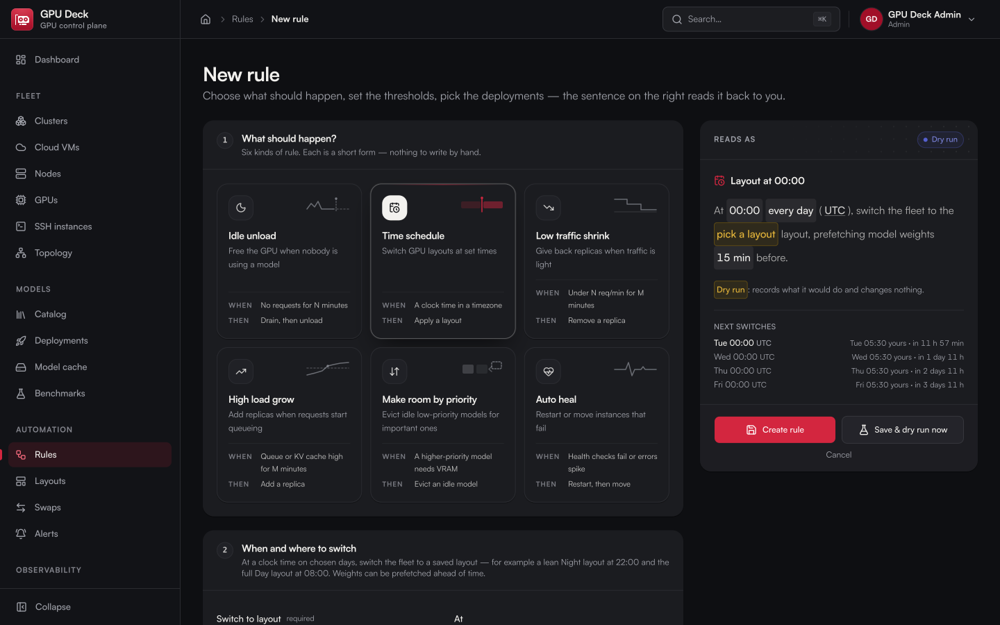
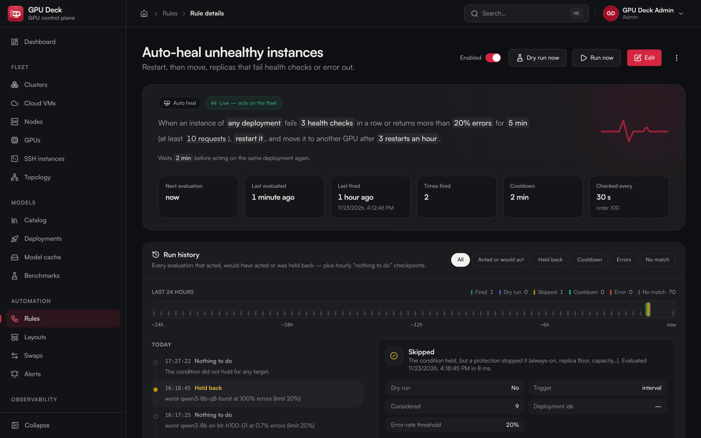
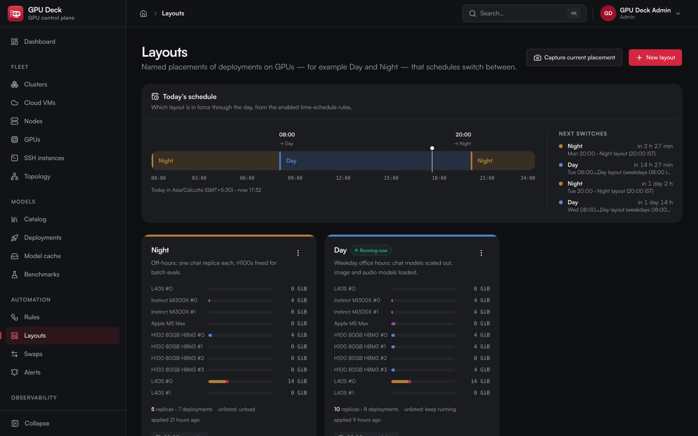
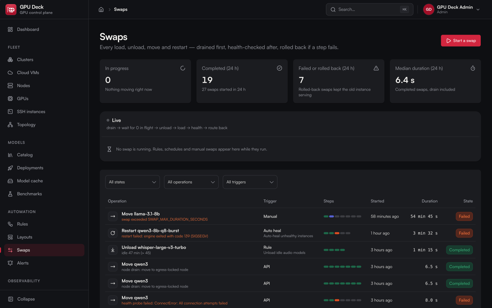

# Rules engine — semantics (v1)

Schemas in this folder define the **params** of each of the six rule types, the **target selector**, the **layout** document and the composite **rule** object. This file defines how the jobs process (`services/rules`, `services/swap`, `services/layouts`) evaluates them. The web rule builder renders forms straight from the schemas (`title`, `description`, `default`, `minimum`, `maximum`, `enum`). `GET /api/v1/rules/schemas` serves these files verbatim.

## 1. Evaluation loop

<p>
  <picture>
    <source media="(prefers-color-scheme: dark)" srcset="../../../docs/diagrams/rule-loop-dark.svg">
    
  </picture>
</p>

- One evaluator runs at a time, in the jobs process that holds the `rules-evaluator` lease (`ha_leases`, TTL `HA_LEASE_TTL_SECONDS` 30 s, renew every 10 s). On lease loss the evaluator stops before its next tick; in-flight swaps continue in the swap manager (also leader-only via `jobs-leader`).
- Tick every `RULES_TICK_SECONDS` (default 10 s). Each enabled rule is evaluated when `now - last_evaluated_at >= evaluation_interval_seconds` (per-rule, default 30 s). Rules are evaluated in `priority` ascending, then `created_at`.
- `time_schedule` rules are evaluated on every `rules.tick` by the jobs leader (not as per-rule APScheduler cron jobs: the shared RedisJobStore would fire them on any replica and bypass leader election, dry run and catch-up). The next fire time is computed timezone-aware from the cron / `at`+`days` (CronTrigger), so the switch happens within `RULES_TICK_SECONDS` of the minute. DST: a repeated local hour (fall back) fires once; a skipped hour (spring forward) fires once at the shifted time. `catch_up` governs missed runs (applied on start-up only when the next run is more than 1 h away). `Rule.next_evaluation_at` in the API is that next fire time.
- `make_room_by_priority` is additionally invoked **synchronously** by the scheduler when a placement fails with `insufficient_vram` (`trigger` = `placement_failure` or `both`).

### Inputs

| Need | Source |
| --- | --- |
| Last request time per deployment | `deployments.last_request_at` (set by metering task for every usage event; also bumped by the hub when an engine sample shows `active_sessions > 0`) |
| Requests per minute | `metric_rollups_engine_1m.requests_delta` summed over the deployment's instances; the current (incomplete) minute is computed from `metric_samples_engine` counters |
| Waiting requests | `metric_rollups_engine_1m.waiting_sessions_avg` (sum over instances) and `waiting_sessions_max` |
| KV cache use | `metric_rollups_engine_1m.kv_cache_usage_pct_avg` (max over instances) |
| Free VRAM per GPU | `devices.vram_total_bytes` − Σ active `device_slices.vram_bytes` (reserved) and the latest `metric_samples_gpu.memory_used_bytes` (observed); the scheduler uses the larger of the two as "used" |
| Health / error rate | `instances.health` (+ consecutive failure count kept in Redis `heal:fail:{instance_id}`), `metric_rollups_engine_1m.error_rate_pct` |
| Priority | `deployments.priority_override` else `models.priority` |

A window of `for_minutes` = M means **every** complete 1-minute bucket in `[now − M min, now)` satisfies the condition; a missing bucket (instance not reporting) counts as **not satisfied** for grow/shrink and as **satisfied** for auto-heal health failures only if the instance is `unhealthy`.

### Outcome of one evaluation (`rule_runs.outcome`)

| outcome | meaning | row written? |
| --- | --- | --- |
| `no_match` | condition not met for any target | at most once per `RULE_RUN_NO_MATCH_LOG_INTERVAL_SECONDS` (3600) per rule |
| `cooldown` | condition met but target fired within `cooldown_seconds` | yes |
| `skipped` | condition met but protected (always_on, min_loaded grace, min/max replicas, drain in progress, node draining, no capacity) — `decision.reason` says why | yes |
| `dry_run` | condition met, rule in dry-run: `actions` lists what *would* happen, nothing executed | yes |
| `fired` | actions executed (swap_operations created) | yes |
| `error` | evaluator exception | yes, with `error_message` |

`decision` always holds the observed values (`{"idle_minutes": 42.3, "threshold": 30, "targets": [...]}`) so the history screen can show *why*.

### Cooldown

Per **(rule, deployment)**: a rule may fire again on the same deployment only after `cooldown_seconds` since its last `fired` run on that deployment (Redis `rule:cooldown:{rule_id}:{deployment_id}` with TTL, mirrored in `rule_runs`). Cooldown also applies after a `dry_run` outcome so dry-run history looks like real history.

Global guard: at most `RULES_MAX_CONCURRENT_SWAPS` (default 2) swap operations in a non-terminal state across the cluster; rules that would exceed it return `skipped(reason=swap_capacity)`.

### Dry run

> [!TIP]
> Create a rule in dry run first and read its history for a day: every evaluation shows what it
> would have done and why, without touching a model. Then switch it to live.

`rules.dry_run=true` (per rule) or `POST /rules/{id}/dry-run` (one-off, even for disabled rules) runs the full evaluation and planning (including scheduler placement for grow/move) and writes a `rule_runs` row with `dry_run=true` and the planned `actions`, but creates no `swap_operations` and sends no commands. Alerts of severity `info` are still emitted for dry-run fires if the channel's `event_filter` includes `rule.dry_run`.

## 2. Per-type semantics



*The rule builder: each rule type is a short form generated from the schemas in this folder.*

| Type | Fires when | Action | Protections |
| --- | --- | --- | --- |
| `idle_unload` | `now − last_request_at ≥ idle_minutes` **and** no active/waiting sessions right now | unload instances beyond `max(keep_replicas, deployments.min_replicas)` via swap `unload` (drain first); after every completed swap `deployments.replicas` = live instances clamped to `[min_replicas, max_replicas]` (status `stopped` when none is left) so the reconciler does not reload what the rule unloaded | always_on never; instance ready < `min_loaded_minutes`; outside `respect_time_windows` |
| `time_schedule` | cron tick | `apply_layout` swap (see §4); prefetch commands `prefetch_minutes_before` earlier with `pin=true` | always_on deployments missing from the layout are kept regardless of `unlisted_policy` |
| `low_traffic_shrink` | rpm < N for every minute of the last M | `scale_down` by `step_replicas` to ≥ `min_replicas`, or `move` to `shrink_slice` | always_on clamped to `min_replicas ≥ 1`; never below `deployments.min_replicas` |
| `high_load_grow` | waiting > N and/or KV% > X for M minutes | `scale_up` by `step_replicas` to ≤ `max_replicas`, placement via scheduler | never above `deployments.max_replicas`; `skipped(no_capacity)` unless `make_room` |
| `make_room_by_priority` | a deployment with higher effective priority is `pending`/`scheduling` with `insufficient_vram` | `unload` the lowest-priority eligible victim(s) on the GPU that then fits the requester, then re-run placement | victim ∉ always_on; victim priority < requester priority and ∈ `evict_priorities`; idle ≥ `victim_idle_minutes`; max `max_evictions_per_run` |
| `auto_heal` | `health_failures` consecutive unhealthy checks, or error rate > X % over M minutes with ≥ `min_requests_in_window` | `restart` (same node/devices) or `move` (scheduler, excluding failed device) per `action`; `restart_then_move` escalates after `max_restarts_per_hour` | applies to always_on; never reduces replica count (move loads the new instance before unloading the old one) |

Priority ordering for `make_room_by_priority`: `always_on (3) > normal (2) > evictable (1)`. Ties never evict.



*A rule's history: every evaluation with what it observed and why it fired or held back.*

## 3. Swap safety sequence

<p>
  <picture>
    <source media="(prefers-color-scheme: dark)" srcset="../../../docs/diagrams/safe-swap-dark.svg">
    
  </picture>
</p>

Every action becomes a `swap_operations` row executed by the swap manager (leader-only). Steps, each recorded in `steps[]` with timestamps and the `agent_commands.id`:

```
1. plan         compute target instance spec(s); reserve device_slices (status=reserved); write rollback
2. route_off    remove from_instance from the API layer routing table (Redis push) and set proxy accepting=false (config_push)
3. drain        command drain_instance(timeout=drain_timeout_seconds, wait_for_zero=true)
                emits drain_progress; API layer already sends new requests elsewhere (or queues up to SERVING_NO_INSTANCE_WAIT_SECONDS when none is left)
4. unload       command unload_model (force only if step 3 timed out AND rule/plan allows force_after_timeout; default false → swap fails, rollback = route_on)
5. load         command load_model for the new instance (port chosen by agent), instances.state loading
6. health       wait until the agent reports ready + healthy (health startup_timeout), then one probe through the proxy (/_health) from the control plane
7. route_on     add to routing table with the planned traffic_weight; mark swap completed; release old slices
```

For `swap`/`move` where VRAM allows, steps 5–6 run **before** 3–4 (load the replacement first, then drain the old one) so capacity never drops; the planner decides based on free VRAM and records the chosen order in `plan.order`.

> [!WARNING]
> `force_after_timeout` is off by default: a drain that times out fails the swap and routes the
> old instance back on, rather than cutting requests that are still running. Turn it on
> (`SWAP_FORCE_AFTER_DRAIN_TIMEOUT` for rule-triggered swaps) only when clients retry.

**Rollback.** On failure at or after step 4: if the old instance is still loaded (unload not executed or failed), `route_on` it again (state `rolled_back`). If the old instance is gone, try to reload it from `rollback.previous_spec` on the same devices; if that fails too the swap ends `failed`, the deployment goes `degraded`, an alert `swap.failed` (critical) fires and auto-heal may pick it up. Rollback is attempted at most once; `swap_operations.rollback` stores `{previous_instance_spec, previous_routing, attempted: bool, result}`.

**Timeouts.** Each command carries `timeout_seconds` (drain: `drain_timeout_seconds + 10`; load: `health.startup_timeout_seconds + 60`). The whole swap has `SWAP_MAX_DURATION_SECONDS` (default 1800).

**Layouts.** `apply_layout` builds one swap per deployment in `position` order from the diff (`POST /layouts/{id}/preview` returns the same diff without executing): instances to unload, load, move, re-weight. Independent deployments are applied in parallel up to `RULES_MAX_CONCURRENT_SWAPS`; a failure in one does not roll back the others (the layout screen shows per-item status).



*Layouts: named sets of models switched on a schedule; the preview shows the diff before it runs.*



*Swaps: the steps above as they run, with timing and any rollback.*

## 4. Audit and alerts

Every `fired` run writes `audit_logs` (`event_type=rule.fired`, `actor_type=rule`, `actor_id=rule_id`, `after_state=actions`) and each swap step that changes an instance writes `instance.loaded` / `instance.unloaded` / `instance.moved`. Alerts: `rule.fired` (info), `rule.dry_run` (info), `rule.error` (warning), `swap.failed` (critical), `swap.rolled_back` (warning), `heal.restart` (warning), `heal.move` (warning), `heal.giving_up` (critical).
